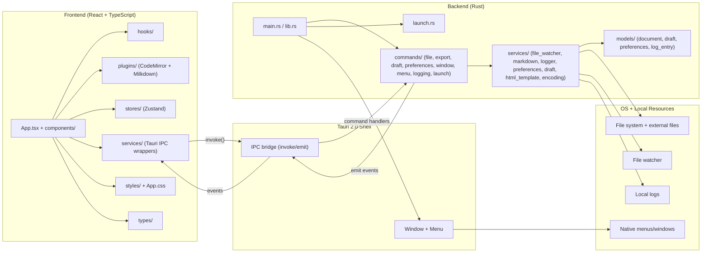

# mdpro

A local Markdown editor built with Tauri 2 + React + TypeScript.

## Features

- **4 View Modes**: Split, Editor-only, Preview-only, WYSIWYG

- **Dual-Engine Architecture**: CodeMirror for source editing, Milkdown for WYSIWYG

- **Typora-style Shortcuts**: ⌘B/I/K for formatting, ⌘1-6 for headings

- **Plugin System**: Unified plugin architecture for CodeMirror + Milkdown features

- **Native macOS Menu**: File, Edit, View, Theme integration

- **Auto-save Drafts**: Recover unsaved work

- **External File Watching**: Detect changes made outside the app

- **MCP Server**: Claude Code, Codex CLI, and Gemini CLI integration for AI-assisted editing


## File Structure

```
.
|-- src/                 # React UI
|   |-- components/      # UI components (Editor, Toolbar, etc.)
|   |-- hooks/           # Custom hooks (useDocument, shortcuts, etc.)
|   |-- plugins/         # Editor plugin system (CodeMirror + Milkdown)
|   |-- services/        # Tauri IPC wrappers
|   |-- stores/          # Zustand state stores
|   |-- styles/          # Global + theme styles
|   `-- types/           # Shared TypeScript types
|-- src-tauri/           # Rust backend (Tauri)
|   `-- src/
|       |-- commands/    # IPC commands (file, export, etc.)
|       |-- models/      # Data models
|       `-- services/    # Backend services
|-- doc/                 # Technical documentation
|-- specs/               # Feature specifications
|-- public/              # Static assets
`-- package.json
```

## Architecture



## How to Use

Prerequisites:

- `Node.js + pnpm`

- `Rust toolchain` (stable)

- `Tauri CLI` (installed via devDependencies)

Common commands:

- `pnpm install`: install JS dependencies

- `pnpm dev`: run the Vite web dev server

- `pnpm build`: build the web bundle (type-check + Vite build)

- `pnpm tauri dev`: run the desktop app (uses Vite in the background)

- `pnpm tauri build`: build a desktop app bundle

- `pnpm tauri build --bundles app`: build only the `.app` bundle (skip DMG)


## MCP Server (Claude Code / Codex CLI Integration)

mdpro includes an MCP (Model Context Protocol) server that allows Claude Code, Codex CLI, and other MCP-compatible tools to read and write documents in mdpro.

### How It Works

1. When mdpro starts, it launches an HTTP API server on localhost

2. Connection info is written to `~/.mdpro/server.port` and `~/.mdpro/server.token`

3. The `mdpro_mcp` binary acts as an MCP server that forwards requests to mdpro

### Development Mode

After building the MCP binary:

```bash
cd src-tauri && cargo build --bin mdpro_mcp
```

Add to your Claude Code MCP config (`~/.claude.json`):

```json
{
  "mcpServers": {
    "mdpro": {
      "command": "/path/to/mdpro/src-tauri/target/debug/mdpro_mcp",
      "args": [],
      "type": "stdio"
    }
  }
}
```

### Production Mode (Mac App)

After installing mdpro.app, add to Claude Code MCP config (`~/.claude.json`):

```json
{
  "mcpServers": {
    "mdpro": {
      "command": "/Applications/mdpro.app/Contents/MacOS/mdpro_mcp",
      "args": [],
      "type": "stdio"
    }
  }
}
```

**Note:** After editing the config, restart Claude Code for changes to take effect.

### Claude Desktop

Add to `~/Library/Application Support/Claude/claude_desktop_config.json`:

```json
{
  "mcpServers": {
    "mdpro": {
      "command": "/Applications/mdpro.app/Contents/MacOS/mdpro_mcp"
    }
  }
}
```

### Codex CLI

Add to `~/.codex/config.json`:

```json
{
  "mcpServers": {
    "mdpro": {
      "command": "/Applications/mdpro.app/Contents/MacOS/mdpro_mcp"
    }
  }
}
```

### Available MCP Tools

Tool

Description

`get_open_documents`

List all open documents (id, title, path, dirty status)

`read_document`

Read content of a document by ID

`write_document`

Replace entire document content (may require confirmation)

`insert_content`

Insert text at cursor, start, end, or specific position

### Notes

- mdpro must be running for MCP tools to work

- Write operations show a confirmation dialog if mdpro is not focused

- Multi-window support: operations target the most recently focused window

## Debug Logging (macOS Open With)

When you need to debug why `.md` files do not open from Finder ("Open With" or double-click), mdpro writes a backend log to:

- `~/.mdpro/mdpro.log`

Useful commands:

- `tail -f ~/.mdpro/mdpro.log` (follow live logs)

The log includes launch args, macOS `RunEvent::Opened` URLs, filtered markdown paths, and `open_file` calls.

Mac OS cannot open app, use this command:`sudo find "/Applications/mdpro.app" -exec xattr -d com.apple.quarantine {} \;`

## How to Test

Tests are not wired yet. When added:

- Frontend: `pnpm test` (Vitest)

- Backend: `cargo test` in `src-tauri/`

- E2E: `pnpm playwright test`

## Shipping DMG via GitHub Actions

This repo ships macOS DMG files on tag pushes using `.github/workflows/release.yml`.

Steps:

1. Commit and push your changes.

2. Create a version tag (example):

   - `git tag v0.1.1`

   - `git push origin v0.1.1`

3. GitHub Actions builds on `macos-latest` and publishes a GitHub Release with the DMG attached.

Notes:

- The workflow only runs on tags that match `v*`.

- The bundle targets in `src-tauri/tauri.conf.json` must include `dmg` and `app`.

- For public distribution, add signing/notarization later (not configured yet).

## Version Management

Update version numbers in **both** files before release:

| File                        | Field                         |
| --------------------------- | ----------------------------- |
| `src-tauri/Cargo.toml`      | `version = "x.y.z"` (line 3)  |
| `src-tauri/tauri.conf.json` | `"version": "x.y.z"` (line 4) |

## Release Checklist

- Update version numbers (see [Version Management](#version-management)).

- Run `pnpm tauri build` locally to sanity-check.

- Push commits to `main` or `master`.

- Tag a release (example):

  - `git tag v0.1.1`

  - `git push origin v0.1.1`

- Verify the GitHub Release assets include the `.dmg` and `.app`.

## macOS Signing and Notarization (CI)

Tauri can sign and notarize on GitHub Actions using environment variables. Add these
GitHub repository secrets and the workflow will use them if present.

Required for signing:

- `APPLE_CERTIFICATE`: base64 of your `.p12` signing certificate.

- `APPLE_CERTIFICATE_PASSWORD`: password for the `.p12` file.

- `APPLE_SIGNING_IDENTITY`: certificate name shown by `security find-identity -v -p codesigning`.

Required for notarization (choose one option):

1. Apple ID:

   - `APPLE_ID`

   - `APPLE_PASSWORD` (app-specific password)

   - `APPLE_TEAM_ID`

2. App Store Connect API key:

   - `APPLE_API_ISSUER`

   - `APPLE_API_KEY`

   - `APPLE_API_KEY_P8` (base64 of the `.p8` key file)

Notes:

- Notarization is required for Developer ID distribution.

- Secrets are referenced in `.github/workflows/release.yml`.

## Troubleshooting

- **Tauri build fails**: ensure Rust toolchain is installed (`rustup show`) and `pnpm install` has run.

- **DMG build fails with** ``: build the app bundle only with `pnpm tauri build --bundles app` (system-level `hdiutil` issue).

- **Window doesn't open**: make sure `pnpm tauri dev` is used (not just `pnpm dev`).

- **File dialogs not working**: confirm native dialog permissions (macOS Security & Privacy).

- **IPC errors**: verify commands are registered in `src-tauri/src/commands/mod.rs` and `src-tauri/src/main.rs`.

- **Type errors after dependency changes**: delete `node_modules`, re-run `pnpm install`.

- **MCP "mdpro not running" error**: start mdpro before using MCP tools. Check that `~/.mdpro/server.port` exists.

- **MCP connection refused**: verify mdpro is running and `~/.mdpro/server.token` has correct permissions (mode 600).

## WYSIWYG Architecture

mdpro uses a **dual-engine architecture** for editing:

| Engine           | View Modes          | Description                                |
| ---------------- | ------------------- | ------------------------------------------ |
| **CodeMirror 6** | Split, Editor-only  | Source editing with syntax highlighting    |
| **Milkdown**     | WYSIWYG             | True rich-text editing (ProseMirror-based) |
| **marked**       | Preview-only, Split | Markdown rendering                         |

### Plugin System

Editor features are implemented as plugins registered via `src/plugins/` and
loaded per editor mode (CodeMirror or Milkdown). This keeps feature code
decoupled from core editor components and allows enable/disable via config.

### View Modes

| Mode         | Shortcut | Description                   |
| ------------ | -------- | ----------------------------- |
| Split        | ⌃1       | Editor + Preview side-by-side |
| Editor Only  | ⌃2       | Full-width source editing     |
| Preview Only | ⌃3       | Read-only rendered view       |
| WYSIWYG      | ⌃4       | Rich-text editing like Typora |

### Keyboard Shortcuts

**Global:**

- ⌘N/O/S/W - New/Open/Save/Close

- ⌃1-4 - Switch view modes (Control key)

- ⌘/ - Cycle view modes

- ⌘⇧B - Toggle sidebar

**WYSIWYG Mode:**

- ⌘B/I/K - Bold/Italic/Link

- ⌘0-6 - Paragraph/Headings

- **Typora-style Inline Editing**: Click inside a link to see `[text](url)`, click inside inline code to see backticks

### Technical Documentation

Detailed technical documentation is available in the `` folder:

- [Architecture Overview](./doc/architecture.md) - System design and data flow

- [Milkdown Integration](./doc/milkdown-integration.md) - WYSIWYG editor implementation

- [View Modes](./doc/view-modes.md) - How view mode switching works

- [State Management](./doc/state-management.md) - Zustand stores architecture

- [Keyboard Shortcuts](./doc/keyboard-shortcuts.md) - Complete shortcut reference

## Recommended IDE Setup

- VS Code + Tauri + rust-analyzer

