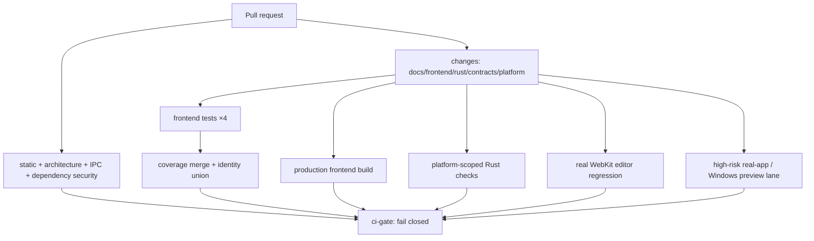
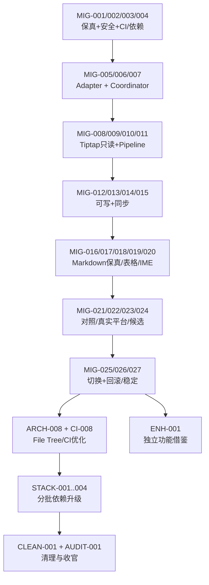

# mdpro：Milkdown 7 → Tiptap 3 迁移与架构、CI 优化整合实施计划

> **版本**：v1.1（2026-11-07，Windows Preservation-First 修订）  
> **项目**：[anzchy/mdpro](https://github.com/anzchy/mdpro) · 默认分支 `master`  
> **对标参考**：[xiaolai/vmark](https://github.com/xiaolai/vmark) · 默认分支 `main`  
> **依据文档**：`mdpro_architecture_ci_optimization_plan_2026-11-07.md`（2026-11-07，v1.0，460 行）；`mdpro_cross_platform_development_release_assessment_2026-11-07.md`  
> **文档定位**：**新的主实施计划（Proposal）**。用户已经决定将 Milkdown 替换为 Tiptap，本计划不再以“是否迁移”为待决定事项；但仍以可证明的数据安全和用户体验作为能否发布的门槛。  
> **执行状态**：未修改仓库、未运行本地测试、未建立 PR。本计划所有 PR 与文件树均为建议，实施前以最新主干 SHA 再次校准。  
> **冲突处理**：原架构计划中“保留 Milkdown”“不进行 Milkdown→Tiptap 迁移”等条款，**由本计划明确覆盖**；原计划其余 8 项优化任务及质量护栏保留。
> **Windows 修订原则（v1.1）**：当前 Windows 版本以“**按新架构迁移 + 保留已验证功能 + 不增加数据安全风险**”为交付目标；Windows 的新功能与非关键 UI polish 不在本次迁移的阻断范围。Windows 平台隔离代码在共享 EditorPort 确立后优先迁移，Tiptap 实现阶段执行逐 PR Windows 回归，而非最后才集中验收。

---


## 0A. Windows Preservation-First：v1.1 的正式实施约束（优先于下文一般性阶段描述）

> **结论**：Windows **不是等 Tiptap 全部完成才验收的附带平台**，它是一条在 M0 开始、贯穿 M1–M6 的独立迁移与回归主线。**先稳住现有 Windows 行为，再迁移平台适配层，然后并行验证新的共享编辑器内核；polish 与新功能后置。** 本节与下文旧阶段发生排序歧义时，以本节为准。

### W0 — 先明确 Windows As-Is 功能与风险基线（M0 的必经工作）

- 以主干固定 Commit SHA 和可辨识的 Windows 安装包为准，从 `docs/feature-ledger.md` 各分区的“Windows 差异”表、`docs/test/` 真机证据及相关 Issues/PR 构建 **Windows Capability Matrix**。
- 每项标记 `Confirmed Working` / `Known Defect or Partial` / `Unknown`，并额外记录 `Data-Safety Critical`、是否为跨平台共享行为、Owner、最后真机验证 SHA。**`Unknown` 不得因为 macOS 的 `Shipped` 而自动变为 Windows 的 `Shipped`**。
- 对 `Confirmed Working`：迁移前后同一 Windows 真机 Journey 必须通过，构成不可退化的硬门禁。对 `Known Defect/Partial`：保持既有行为边界、不引入新回归，安全缺陷另列阻断；若是原有 Bug，不自动把“本次必须修复”加入 Tiptap 迁移范围。对 `Unknown`：优先建立可复现的 smoke 和证据，不能用未运行的测试声称通过。
- 第一批覆盖：Windows 文件打开/保存/另存为、外部修改防覆盖、脏状态与取消关闭、Source/WYSIWYG 切换、普通文字输入与 Ctrl/AltGr/IME、Undo/Redo、基本表格、链接与图片显示、Windows 多窗口路由、MCP 读写与许可、首次启动及 NSIS 安装。复杂表格、特定快捷键、尚未验证的交互则按 Capability Matrix 分级。
- 已有实证样本包括 Windows 本地图片 `asset.localhost` 显示、部分 Ctrl+Alt 表格动作、高亮快捷键；`Ctrl+K` 链接插入曾有待复核异常，部分表格与光标交互为 `Unknown`。这不是说其他功能已确认失败，只是验证证据不足。

**交付物**：`windows-capability-matrix.md`、证据索引（Build SHA/Windows 版本/Journey/结果）、Known Defect 清单、迁移范围 Freeze ADR。

### W1 — 共享契约先建立；Windows 平台代码紧接着优先迁移（M1 子阶段）

顺序必须是：**最小 `EditorPort`/`MarkdownCodec`/`Flush Contract` → Windows 相关原生与 UI Adapter 的边界迁移 → Tiptap 共享引擎适配**。

- 将 Windows 专属的快捷键/AltGr、WebView2 输入事件、窗口控制与路由、文件对话框差异、安装与 App 身份逻辑按 *platform adapter* 清晰隔离；共享 Editor/Document/Save/MCP 业务规则放在独立的 Application 或 Service 层。
- 对现有 Windows 行为进行 **behavior-preserving move/refactor**：只调整依赖关系、入口和必要的测试接线，不夹带窗口 UI polish、键盘布局重设计、新平台功能或无关 Rust/React 大版本升级。
- 迁移模块应保留稳定的宿主接口；新 Tiptap 只能从同一个公共接口调用，而不能创建 Windows 专属的第二套文档状态、Flush 或写盘流程。
- 每个 Windows Adapter PR：Windows Native Compile/Clippy/Test + 相关真实 Windows App Journey；对共有代码做 Mac 基础回归（Linux 在其支持范围内做检查）；更新 Windows 差异表。
- **不建议现在一次性移动全部 `src-tauri` 或 `src/`**。先迁移涉及 Windows 的垂直切片，M7 再完成全局 File Tree Reorganization，避免路径变化吞没功能变化。

**门禁**：Windows `Confirmed Working` 100% 不退化；保存/关闭/MCP/文件覆盖等关键路径 0 个新增安全缺陷；`Known Defect` 没有扩大影响范围；未测范围如实标记。

### W2 — Tiptap 开发中每个里程碑都做 Windows 回归（M2–M4）

- M2 只读渲染：Windows WebView2 真实渲染、字体/选择/滚动/基本输入链路 Smoke；不得触碰真实文件。
- M3 可写核心：Windows 上直接验证编辑→同步 Flush→保存/重开、Source↔WYSIWYG、Undo、MCP 写入、关闭与恢复，任何旧实例写回覆盖新内容均阻断。
- M4 高风险功能：Windows IME/AltGr/Ctrl、表格粘贴与选区、引用链接、图片与富文本剪贴板使用独立 Golden Corpus 和 Windows Journey。**Windows 验收不是只有最终 M5 一次**。
- 无关的已知 UI 瑕疵继续跟踪到 Polish Backlog；迁移过程中只有阻止既有功能运行或造成数据损失的问题才必须前置修复。

### W3 — Windows Preview Cutover 与后续 Polish 分离（M5–M6 / M9+）

- macOS Stable 与 Windows Preview **共享主干代码和固定构建 SHA，但产品成熟度可不同**。Windows Preview 的 Tiptap 上线要求的是现有 Confirmed Working 行为回归、核心数据安全和安装/启动基本闭环，而非追平 Mac 的全部新能力。
- Preview 与 Stable 必须隔离 App Identifier、配置/草稿目录、MCP Port、日志及 Updater Channel；Windows 当前 installer-only 的发布与更新限制必须如实保留，**不得假装 Preview 已拥有自动更新能力**。
- Windows Preview 验收通过后，才建立单独的 `WIN-POLISH` Epic：GUI 细节、未完成快捷键、表格体验、输入法边缘用例、文件关联与更新体验的进一步完善，逐项排优先级。
- 后续 polish 应沿新的 Adapter/Domain 边界实施；不要用无尽 polish 作为阻挡整个 Tiptap 迁移合并的理由，也不能以“以后再 polish”为借口容忍数据丢失。

### 对原 M0–M9 的顺序修正

```text
M0 / W0  先锁定 Windows 已有行为与数据安全证据，并补最小 Win/Mac CI
       ↓
M1      建立跨引擎 EditorPort + Document/Flush 统一契约（Milkdown 仍是生产实现）
       ↓
M1-W1   先按新边界迁移 Windows 平台专用代码（行为不变，不做 polish）
       ↓
M2      Tiptap 只读与 Markdown Pipeline 验证（同时做 Windows Smoke）
       ↓
M3–M4   Tiptap 功能迁移（每个里程碑 Mac/Windows 定向回归）
       ↓
M5–M6   Mac Stable / Windows Preview 按各自验收门槛切换，允许平台成熟度不同
       ↓
M7      全局 File Tree + CI 深度治理（非必要的大量文件搬迁后置）
       ↓
M8–M9   分批依赖升级、旧框架退场、独立 Windows Polish Backlog
```

### 建议新增 PR 与验收合同

| PR | 目标 | 前置依赖 | 必过门禁 |
|---|---|---|---|
| WIN-001 | Windows Capability Matrix + 原有 Windows 真机结果索引 | 固定 Baseline SHA | Working/Partial/Unknown 有明确证据，不虚报功能已验证 |
| WIN-002 | Windows Preview App Identity / Build SHA / 设备隔离 | WIN-001 | 测试绝不运行旧构建、永不写入 Stable 数据目录 |
| WIN-003 | Windows 平台专用 Adapter 边界迁移（按 Window/Input/File 分 PR） | EditorPort M1、WIN-001/002 | 仅做行为等价迁移，Windows 既有功能 100% 保留 |
| WIN-004 | Windows 最小 CI Gate 与 E2E Smoke | WIN-001/002 | Windows 代码变更不能只凭 Linux CI 变绿，异常 Skip 必须阻断 |
| WIN-005 | Tiptap Windows WebView2 核心编辑验收 | M3–M4 + WIN-003/004 | Flush/Save/Close/MCP/IME/Selection 关键行为不退化 |
| WIN-006 | Windows Preview Candidate / NSIS Smoke / 回滚路径 | M5、WIN-005 | 构建身份、安装启动与文件数据安全符合 Preview 范围 |
| WIN-POLISH | 功能增强与体验打磨（独立后续 Epic） | WIN-006 | 每项新功能单独验收；不阻断保留现有功能的迁移 |

**明确不在本次迁移范围**：立即修完 Windows 所有旧 Bug、实现 Mac/Windows 100% Feature Parity、重写所有 Rust 平台代码、增加完整 Windows 自动更新、重做所有快捷键与 UI 主题。若有可能造成用户数据丢失或安全问题的旧缺陷，应作为阻断或单独先修的高优先级例外。

---

## 0. Executive Decision：哪个在先，哪个在后？

**推荐实施依赖顺序**：

```text
先：当前行为证据 + 数据安全 + 跨平台最小 CI 保护
  ↓
接着：编辑器 Port / Adapter + 状态所有权和 Flush Contract
  ↓
再：Tiptap 独立适配器 + Markdown Pipeline 验证（不写真实文件）
  ↓
再：Tiptap 编辑、表格、链接、命令、IME、MCP 等功能迁移
  ↓
再：Mac/Windows 真机回归 + 分阶段切换 + 可回滚发布
  ↓
然后：全量 File Tree Reorganization + Knip 治理
  ↓
然后：CI 深度分层/提速 + TypeScript/Vite/Vitest/Zustand 分别升级
  ↓
最后：VMark 其他优秀编辑行为的局部引入、清理 Milkdown、收官审计
```

**最关键的改变**：原版计划 P2（全面 File Tree Reorganization）、P3（CI 全面改造）、P4（工具链升级）**不再全部排在编辑器迁移前**。迁移前只完成必需的边界和 CI 保护；**大规模搬目录、工具链升级、全链路 CI 改造放到 Tiptap 稳定切换之后**，避免四类大变更同时发生而无法定位回归根因。

但这不代表可以先迁移、最后再补测试：数据完整性、编辑器 Flush、测试分片完整性、Windows/macOS 原生验证必须在第一批就建立。

### 总体阶段安排

| 阶段 | 名称 | 主要目的 | 进入下一阶段的条件 |
|---|---|---|---|
| **M0** | 冻结基线、定义正确性、跨平台保护 | 现有行为有可运行的金标准 | Corpus、状态安全测试、平台验证基线齐备 |
| **M1** | 先建立编辑器抽象，不先搬整棵目录 | 隔离 Milkdown 与业务逻辑 | `EditorPort` / Flush Contract 在 Milkdown 下可工作 |
| **M2** | Tiptap 基础与解析/序列化 PoC | 建立可编译、可渲染、可回写到测试内存的路径 | 核心 Markdown 样本无静默语义丢失 |
| **M3** | 基础编辑 + 状态事务迁移 | 替换 WYSIWYG 运行时最关键的操作 | 保存、切换、Undo、MCP 同步等不变量通过 |
| **M4** | 高风险 Markdown、表格、交互功能 | 处理 Mdpro 最多的复杂行为 | 表格/空行/引用链接/IME 等回归守护全部通过 |
| **M5** | 双轨对照与真实平台候选验证 | 在真实 Mac/Windows 上验证差异 | 无 Blocker，发布候选可追溯且可撤回 |
| **M6** | 正式切换（Cutover）及稳定期 | 默认 Tiptap，保留短期回滚机制 | Stable/Preview 渠道均满足各自标准 |
| **M7** | 全面文件树重组 + CI 深度优化 | 在单编辑器架构稳定后减少技术债和耗时 | 不改变编辑行为；Architecture + CI Gate 严格通过 |
| **M8** | 技术栈分批升级 | 更新 Zustand/Vitest/TS/Vite，分别验证 | 每次只升一项，兼容性证据齐备 |
| **M9** | 借鉴 VMark 其余能力、退场清理与收官 | 删除旧 Milkdown 依赖及债务 | 依赖树、保真、性能、跨平台、发行结果复核 |

> **排序不是时间承诺**；工作量较大的 M3/M4/M5 按风险和证据拆成多个小 PR，不能靠压缩测试换速度。M6 与 M9 的部分 Milkdown 清理可以联动，但应优先保留可回滚能力，等稳定期证据满足后再最终移除。

---

## 1. 已核实的 Codebase 事实与不确定性

### 1.1 mdpro 当前能力与迁移范围

- 使用 **Milkdown 7**：`@milkdown/kit`、`@milkdown/react`，WYSIWYG 根组件 `src/components/Editor/MilkdownEditor.tsx`；另有 **CodeMirror 6 Source Mode**，不能随迁移移除。
- `src/plugins/milkdown/commonmarkPreset.ts` 对 Milkdown 预设进行了替换；其定制覆盖 Markdown 空段落、引用式链接定义、列表松紧等。
- `src/plugins/milkdown/table/` 是高复杂度区域，含 Ragged Table Widen、粘贴拒绝/补齐、表头修复、对齐规则、上下文菜单与行列编辑；`patches/prosemirror-tables@1.8.5.patch` 是**版本相关的依赖补丁**。
- `src/plugins/milkdown/editSync/controller.ts` 已把关键写回/Flush 策略与 React、Milkdown 框架解耦，是**迁移优先复用的核心资产**；`editSync/plugin.ts` 负责把此控制器与 Milkdown 插件生命周期相连。
- `src/stores/milkdownEditorStore.ts` 是 Flusher Registry 和编辑器重载/丢弃的重要协调入口；`documentStore.ts`、`App.tsx` 与 Hooks/Services 对它有外部依赖。
- mdpro 当前 CI 已有 Vitest **四分片 + Coverage Merge + 测试身份完整性核验**；发布流程包含 Mac ARM64/Intel、Windows x64、Linux x64 构建矩阵，但 Windows/Linux 发布与更新支持程度并不等同于 macOS。
- mdpro 仍在解决 Windows 设备自动化、窗口/键盘/定时器等问题，因此 **Mac 通过不能作为 Windows 行为正确的替代证据**。

### 1.2 VMark 借鉴时必须明确的边界

- VMark 采用 Tiptap 3，但其 Markdown 转换并**非**简单依赖 Tiptap 自带的 Markdown 扩展；它维护独立 `Markdown → Remark/MDAST → ProseMirror → MDAST → Markdown` 转换层。
- VMark 将编辑器内容同步与生命周期拆到 `TiptapEditor.tsx`、`useTiptapFlush.ts`、`useTiptapContentSync.ts` 等模块，提供很好的组织参考；**不可直接复制其状态模型或假设其数据契约等同 mdpro**。
- VMark 的 `linkDefinition` 表示为不可编辑 Atom Node，与 mdpro 的显示/选择策略不同；应按 mdpro 产品验收要求重新决定，不能照搬后声称行为等价。
- ProseMirror 是共同底层，但 **Milkdown `$prose`、Ctx、Preset、Parser/Serializer、React 生命周期 API 与 Tiptap Extension API 并不兼容**；只有底层算法/类型满足 Schema 与依赖版本条件时才可复用。

### 1.3 执行前核对项

第一张 PR 必须记录：

1. `git rev-parse HEAD`，`package.json`/锁文件/Cargo.lock SHA；所有在途编辑器、CI、Windows PR 的清单与 Owner。
2. 当前 Milkdown、ProseMirror、`prosemirror-tables` 实际解析版本、补丁生效状态、pnpm 依赖图；候选 Tiptap 3 和 `@tiptap/pm` 版本。
3. 现有 `tests/ci-inventory.json`、Vitest 4 分片、Coverage Threshold 与校验脚本是否仍与主干一致。
4. Markdown 当前已知限制（例如 README 的 Known Limits）和不能无意放宽的行为承诺。
5. Mac Stable、Windows Preview、Linux 的支持范围、输入法/窗口/安装验证状态。

**无需重建用户文件数据格式**：mdpro 主存储是 `.md`，不是 Milkdown 私有二进制文档。迁移风险主要在打开、编辑、序列化、同步和写入路径；持久化选区/内部元数据若使用特定 Schema 或 PM Position，需单独兼容。

---

## 2. 迁移的不可妥协原则

### 2.1 数据安全优先级高于 UI 新功能

1. **不静默丢失 Markdown 语义**：未知节点、不可表达的嵌套表格或 HTML 不得悄悄删掉；可拒绝进入 WYSIWYG、转 Source Mode、提示用户。
2. **不凭“编辑器能显示”判断成功**：必须验证保存、关闭、重开、Undo/Redo、外部改动、MCP 写入后的文件语义与已知表现。
3. **旧编辑器不能在卸载时覆盖新内容**：全部 Flush 都绑定文档 ID、编辑器实例/代次、原始 Baseline；废弃实例须 `discard` 而不能晚到覆盖。
4. **任何时间点只有一个可写 WYSIWYG 实例**：PoC 可以并行比较两个 *只读* 实例，但**禁止同一个文档的 Milkdown 与 Tiptap 同时拥有写回资格**。
5. **不让旧 Milkdown 错误契约“永久合法化”**：先记录当前行为；对当前已知 Bug 单独标注 `known-limitation`、期望新行为和接受理由。
6. **不同时升级基础设施**：迁移窗口中锁定 Zustand、Vitest、TypeScript、Vite 大版本；必要安全补丁单独 PR 并重新验证。
7. **CI 不得假绿**：不可用删除测试、放宽 Coverage、跳过身份联合校验、扩大 Ignore 或无条件容忍 `skipped` 来换绿色。
8. **逐 PR 可回滚**：在数据安全证据不足时不能将 Tiptap 当作可写 Stable 默认引擎。

### 2.2 正确性测试采用三级标准

- **A级：原始文件不应该被写**：只打开、只浏览、只切换视图的情况下，不应触发无意义写入；原文件 Byte-for-byte 保持不变。
- **B级：内容发生编辑的情况**：按明确记录的 Markdown 合法正规化规则比较；既检查 Markdown/MDAST 语义等价，也核对未编辑区域、引用定义、空行等产品要求保留的源码信息。**仅 AST 等价不够**。
- **C级：用户交互/状态情况**：选区、光标、Undo 历史、脏状态、焦点、输入法、Tab 切换、窗口退出等，以行为不变量和真实 App 测试验收。

要特别区分 `parse → serialize` 的无编辑 Roundtrip 与 `parse → 小编辑 → serialize`：前者可以选择**根本不写回磁盘**实现字节保留，后者必须测试序列化确实安全，不能用“没写文件”掩盖转换缺陷。

---

## 3. 与原 8 项优化任务的优先级重新映射

| 原计划 ID | 原任务 | 新主要阶段 | 如何调整先后顺序 |
|---|---|---|---|
| **OPT-01** | dependency-cruiser 架构边界 | **M0–M1**，M7 收紧 | 提前建立报告/防新增违例；Tiptap 适配层的依赖规则先落地；历史例外 M7 清理 |
| **OPT-02** | App.tsx 拆分 | **M1 最小必要部分**，M7 完成 | 优先抽离与编辑器选择/生命周期/Flush 相关装配；其他 UI/启动拆分延后，避免与 Tiptap 并发重构 |
| **OPT-03** | TS ↔ Rust IPC Contract | **M0–M1** 阻断关键路径，M7 扩面 | 先保证文件/MCP/窗口关键 IPC 正确；Tiptap 不直接改变 Rust API，暂不做大规模生成器改造 |
| **OPT-04** | Knip | **M0 只读盘点**，M7 真正清理 | 迁移期间会暂时共存两套依赖，Knip 容易误判动态插件/Feature Flag；先收集，不大删 |
| **OPT-05** | 跨 Store 状态事务 | **M0–M1 必须先完成** | 先把 Flush/Reload/Save/Switch/Close 的状态 Owner 和 Contract 稳定，Tiptap 才能替换运行时 |
| **OPT-06** | CI 分层与提速 | **M0 最小跨平台质量护栏**，M7 全面优化 | 先补可靠性、真实 WebKit/Windows 关键路径；保留四分片，避免迁移中重写整个 CI DAG |
| **OPT-07** | Zustand / Vitest / TypeScript / Vite 升级 | **M8** | 迁移稳定后分别升级；先固定依赖版本可重现，禁止同时升级导致测试基线失效 |
| **OPT-08** | 局部借鉴 VMark 编辑器插件 | **M2–M4 策略借鉴**，M9 额外功能 | 迁移需要的算法可以研究与重写；非必要新功能一律后置 |
| **新增 MIG** | Milkdown → Tiptap | **M2–M6** | 独立主线，拥有专属 Golden Corpus、适配层、功能迁移、双轨验证和 Cutover |
| **新增 PLATFORM** | Mac/Win/Linux 开发与发布保护 | **M0、M5、M6** | 在迁移最早阶段设门禁；Mac Stable 与 Windows Preview 的运行数据和渠道不能互相覆盖 |

**结论**：原计划的“大规模 File Tree → CI → 依赖升级 → 局部插件优化”顺序变为“最小架构边界/最小 CI 保护 → Tiptap → 全面 File Tree/CI → 升级”。保留原计划文档作为架构工作包的详细参考，不要求重新实施其中与新计划冲突的编辑器保留条款。

---

## 4. 目标架构：先加最小稳定边界，再重组完整 File Tree

### 4.1 迁移期间的目标

```text
src/
  app/                        # 组合根：选择引擎；不包含编辑算法
  features/
    document/                 # 最小改动：文档用例与权威状态（先有接口，后搬目录）
    editor/
      contracts/
        WysiwygEditorPort.ts  # 宿主调用、同步 Flush、reload、destroy/discard
        MarkdownCodec.ts     # parse/serialize 统一契约与异常模型
        EditorTransaction.ts # 文档 ID、实例代次、保存边界
      application/
        editorCoordinator.ts  # 切换/卸载/外部编辑事务
      adapters/
        milkdown/             # 迁移期旧实现；后续删除
        tiptap/               # 新 Tiptap 编辑器、Extensions、绑定
        codemirror/           # Source Mode 不重写
      markdown/
        corpus/               # fixture、parity、golden、diff 工具
        pipeline/             # 经评估选择的 Markdown 解析/序列化逻辑
  shared/                     # 纯函数、不可变 DTO、Guard；不能依赖 React/Tauri
src-tauri/
  src/                        # Rust 原生服务保持不变，契约校验即可
```

这是**目标逻辑分区**，不是要求 M1 把全部 `src/` 移动完。M1 优先以新增接口与薄封装适配现有文件路径，只有新 Tiptap 模块使用新目录；M7 再统一整理旧的 `src/components/Editor`、`src/plugins/milkdown`、`src/hooks`、`src/stores` 和测试目录。

### 4.2 推荐的编辑器 Port（伪代码，不是定版 TypeScript）

```ts
interface WysiwygEditorPort {
  readonly engine: "milkdown" | "tiptap";
  readonly documentId: string;
  readonly generation: number;
  // 同步边界：用户触发保存或切换前必须得到可检查结果。
  flush(reason: "save" | "switch" | "close" | "mcp" | "reload" | "quit"): FlushResult;
  // 外部状态替换必须让旧实例不能再覆写。
  replaceContent(input: { markdown: string; expectedGeneration: number }): ReplaceResult;
  discard(reason: string): void;
  getSelectionSnapshot(): SelectionSnapshot | null;
  restoreSelection(snapshot: SelectionSnapshot): RestoreResult;
}
```

Port **不是**为了给所有 Tiptap API 套一层通用抽象；它只暴露宿主真正需要的跨引擎合同。Node/Mark Schema、插件命令等保持在各自 Adapter 内，避免设计成过大的上帝接口。

### 4.3 跨层约束

- `markdown/pipeline` 不允许导入 React、Zustand、Tauri、Tiptap React 组件；必要的 PM Model 类型可以通过参数或纯结构适配提供。
- `editor/application` 依赖 Port 而不是具体 Milkdown/Tiptap；Tiptap Extension 不允许直接写文件系统。
- UI 与其他 Feature 不能导入 `adapters/tiptap/internal/*`；Source Mode 依靠统一的 Document/Editor Coordinator。
- Rust IPC 调用仍经过受控 Services；MCP 不得越过文档确认和版本冲突保护。
- dependency-cruiser 对新增边界采用**阻断模式**，对历史违规暂用限期例外和 Ratchet。

---

## 5. M0 — 数据正确性、基线与跨平台最小保护（必须最先做）

**工作包：MIG-001～MIG-004；不要触碰正式编辑器实现。**

### MIG-001：建立 Markdown Golden Corpus 与现有行为档案

1. 收集现有 tests/ 下针对 D188（空段落）、D192（`<br>`）、D194（引用链接）、D195（列表）、D100/D103/D136/D142/D162（表格/Rowspan/粘贴）、D203（Undo 跨 Tab）、D214（保存 Baseline）、IME/AltGr/Windows 等用例。
2. 用机械可重现脚本提取输入、期望输出、已知限制；形成 `case-id / class / input / action / expected / baseline-sha / platform`。
3. 建立三组文件：`immutable/no-edit`、`semantic-roundtrip/edited`、`interaction-and-safety`。
4. 测试语料至少涵盖：GFM 不规则表格、表格空单元格、跨行/跨列、HTML Paste、引用式链接定义、行内 HTML/`<br>`、空段落、松紧列表、带序号列表、GFM Task List、代码 Fence、图片/路径、硬换行、Emoji/CJK、CRLF/LF、UTF-8/UTF-16（文件读写层）、非法或极端长 Markdown、嵌套/超长表格。
5. 对无法保持保真的已知例外标为 `known-limitation`，与用户体验契约分开，不要自动接受新引擎更差的行为。

**验收**：所有现有黄金行为有可复现执行入口；每项声明保真的关键行为存在**会失败的负向用例**；不以 Mock 全通过替代真 PM Schema/Parser 测试。

### MIG-002：建立数据安全与跨 Store Characterization Tests

必须覆盖：

- WYSIWYG 输入但 Debounce 未触发 → 立即 `Cmd+S`：保存的是最新文本。
- WYSIWYG 输入 → 切换 Source → 快速切回：不丢编辑、Undo/Selection 策略明确。
- 输入 → 关闭 Tab/最后一个窗口/退出：Dirty Prompt 正确，取消不丢。
- MCP 修改当前或后台文档、审批/超时/拒绝后，旧编辑器 Flush 不得覆盖 MCP 新内容。
- 文件外部修改、监听、别名路径、Save As、替换文档、恢复草稿、并发两窗口编辑：旧 Baseline 不允许覆盖新版本。
- React StrictMode 双挂载、Unmount、重载代次递增、晚到异步事件、序列化抛异常、测试销毁清理。
- Mac 快捷键、Windows Ctrl/AltGr/IME/窗口路由。

**验收**：测试明确文档 ID/Generation/Owner，`FlushResult` 不隐藏错误；不存在“失败仍返回成功”的行为。

### MIG-003：建立跨平台最小 CI 保护（不是完整 CI 重构）

- 保留 mdpro 当前四分片、Coverage 合并、Test Identity Union 和 `ci-gate`；不触碰已证明有效的完整性判定。
- 将 `package.json`/pnpm-lock、编辑器适配器、PM/Markdown Pipeline、CI Config、Rust IPC Contract 变更纳入合适的必测路径。
- 新增或启用小规模 **Real WebKit** 编辑核心测试；macOS WKWebView 真实设备验收另设人工/自动化门禁，不能被 Linux Playwright WebKit 替代。
- 与平台相关的 Rust/Tauri 代码变更，在 Windows、macOS、Linux 的对应 Runner 做最小 Compile/Clippy/Test 验证；根据运行成本设置明确分类，不接受“Linux 绿就代表 Windows 绿”。
- Windows Preview 使用测试 App ID、独立 App Data、MCP Port、日志与发布 Channel；要求测试报告带 Commit SHA + Build ID，避免误操作旧构建。

**验收**：构造“分片漏测”“某平台失败”“分类器失败”“未启动的 pending Test”故障注入，最终 Required Gate 必须为红；CI P50/P90/Queue/Runner-Minutes 有基线。

### MIG-004：锁定依赖与决策档案

- 记录 Milkdown 实际 PM 版本、Tiptap 候选 `@tiptap/pm` 版本和 pnpm 依赖解析结果；确认不会存在两个不兼容的 ProseMirror Runtime 互相传递 Node/Plugin/Schema 实例。
- 记录 `prosemirror-tables@1.8.5` Patch 的行为和测试；迁移后不能原样假定补丁生效。
- 建立 `Tiptap Migration ADR`：解释选择、成功条件、已接受的写入限制、回滚路径、授权/第三方源码复用边界。

**M0 → M1 门禁**：上述基线可重现；新适配器没有写真实文件；Mac/Windows 风险不变量有覆盖计划和可运行的守护样本。

---

## 6. M1 — 在 Milkdown 仍为唯一可写编辑器时稳定边界

**工作包：MIG-005～MIG-007。核心思想：先保证可替换，再替换。**

### MIG-005：EditorPort / Flush Contract（先于 Tiptap）

1. 给现有 Milkdown 实现加一层薄 Adapter，对宿主暴露 `flush / discard / replace / selection`；保留其内部 Milkdown Ctx。
2. 将当前 `editSync/controller.ts` 改为引擎中性的依赖注入接口或放到共享 Application 层；**先保持现有 Controller 的时序语义不变**。
3. 把 `milkdownEditorStore` 对外的命名、Flusher Registry 和宿主调用逐步收口为中性 `wysiwygEditorRegistry`（可以先 Alias，避免一次性改大量 import）；同一个 Document 只有一个 Active Writer。
4. 规定 Owner：Document Store 是 Markdown 文本/脏状态权威；Editor Adapter 拥有 PM View 临时状态；Coordinator 拥有切换、Flush、Discard、Reload 事务。
5. 新契约测试必须先对现有 Milkdown 运行通过，并包含重复注册、旧实例注销、异常、切换并发测试。

**验收**：React UI、Document、MCP、Save、Quit 不必直接知道当前编辑器是 Milkdown；现有行为无回归。

### MIG-006：只抽离 App.tsx 中编辑器生命周期职责

- 将编辑器引擎选择、编辑实例初始化与清理、Source/WYSIWYG 切换、保存前 Flush、MCP 修改时的替换逻辑收敛到 Coordinator。
- 不在此 PR 同时调整主题、设置页、窗口菜单、其他 UI Layout 或进行大规模目录迁移。
- 使用符合依赖方向的 Wiring 层，让 App.tsx 主要负责装配。

**验收**：减少 App 中关于具体 Milkdown 的显式耦合；效果用依赖扫描与集成测试证明，不以 App.tsx 行数作为唯一指标。

### MIG-007：Architecture Guard + IPC Contract 的最小闭环

- dependency-cruiser 保护新 `features/editor/contracts`、Adapter 与 Pipeline；不得新增反向依赖。
- 新关键 IPC `invoke()` 与 Rust 注册命令的名称、参数、错误映射必须接受合约检查。
- Knip 仅报告、不删除疑似插件动态入口；记录后续清理预算。

**M1 → M2 门禁**：Milkdown 作为当前实现通过完整旧测试；Port 假实现能驱动状态生命周期测试；Adapter 结构不允许绕开统一写入协议。

---

## 7. M2 — Tiptap 基础与 Markdown 解析体系的实际验证

**工作包：MIG-008～MIG-011。Tiptap 此时不能写真实用户文件。**

### MIG-008：安装 Tiptap、建立独立 Feature Branch/PoC

- 选择成套、可锁定版本的 `@tiptap/core`、`@tiptap/react`、`@tiptap/pm`、所需 Extensions；**仅在 PoC 分支/开发构建启用**。
- `TiptapEditor` 与 Milkdown 不可共享未验证的 PM JSON、Schema、Selection；转换统一经过 Markdown 或显式结构化 Adapter。
- 在测试环境提供只读 Tiptap 渲染，显示基础标题、段落、链接、列表、代码块、图片、GFM 表格。
- 加 Engine Flag（dev-only），默认 Milkdown；PoC 不能把内容保存回用户文件。

### MIG-009：选择 Markdown Pipeline，而不是盲目相信 Tiptap 自带序列化

评估两个候选：

**方案 A：Tiptap 官方 Markdown 扩展**：开发速度快、生态统一；对 mdpro 的精确空行/引用链接/不规则表格/HTML/格式保真仍须证明。

**方案 B：独立 Remark/MDAST Pipeline**（借鉴 VMark 的技术路径）：可完整控制 Markdown ↔ MDAST ↔ PM Schema 映射，适合多种特殊语法和保真要求；但工程量、性能与维护成本显著更高。

**推荐决策规则**：先用相同 Golden Corpus 和同一候选 Schema 对两个方案跑真实 Parse/Serialize；不以 Demo 是否显示正确为依据。若官方扩展无法满足**必须保留**的行为，优先选择可测试的独立 Pipeline；如要做定制，仅对已证实的差异实现，不一次复制 VMark 整个转换系统。

Pipeline 对外至少提供：`parse(markdown) → PM doc | typed refusal`、`serialize(pm doc) → markdown | typed failure`；额外保留源位置/原始语法信息与错误边界的选择应由真实 Corpus 决定。

### MIG-010：Schema 逐节点兼容清单

为每类 Markdown 节点建立映射：

| Markdown 能力 | Milkdown 当前表示 | Tiptap 候选表示 | 风险 |
|---|---|---|---|
| 标题/段落/行内格式 | Milkdown CommonMark preset | Tiptap StarterKit/扩展 | 较低（仍需测试） |
| 图片/尺寸 | Milkdown image attrs / 自定义 UI | Tiptap Image + 自定义 attrs | 中高 |
| 引用式链接定义 | 现有保留定义的节点+序列化 | 自定义 Node/IR 与源位置 | **极高** |
| 连续空段落与 `<br>` | 替换预设 Remark Plugin + 边界 Serializer | 独立解析/序列化插件 | **极高** |
| 松紧列表、数字起始值 | listSpread + Remark 规则 | 自定义 List 规则 | 高 |
| GFM 不规则表格、Rowspan | 定制 Schema/粘贴防护/依赖 Patch | Table Extensions + PM Plugin + 新 Schema | **极高** |
| Inline Syntax Reveal | ProseMirror Decoration | PM 插件包装为 Tiptap Extension | 中高 |
| HTML / 不支持节点 | 当前处理与 Known Limits | 自定义安全策略与降级 | 高 |

不能复用的操作必须提供明确的 User-visible 降级，而不是自动删除该节点。

### MIG-011：PoC 的不可写安全壳

- Tiptap 只写测试内存 State，不注册 `save_file`、真实文件 Watch Hold 或生产 MCP Flusher。
- 只读/测试沙箱之外的任何保存入口被测试强制拒绝；对同一文本可运行 Milkdown/Tiptap 的 Corpus 对照，但两边不得同时写 Store。
- 如 PoC 出现解析失败，明确转 Source Mode 和显示错误，测试确认没有文件变更。

**M2 → M3 门禁**：核心 Schema 与 Pipeline 已选定；基础 Roundtrip 可量化；无法支持的特殊结构列为显式阻断项/降级项；未产生真实磁盘写入。

---

## 8. M3 — Tiptap 可写核心与状态事务对齐

**工作包：MIG-012～MIG-015。**

### MIG-012：Tiptap 可编辑 Adapter

- 实现基本编辑、插入、Selection、Undo/Redo 与关键 Commands；内部使用 Tiptap Extension/Command API。
- 通过 `WysiwygEditorPort` 向宿主注册唯一 Writer；不得直接修改 Document Store/文件系统的旁路。
- 按文档 ID + Generation 注册、替换、注销；保留 `discard` 的一次性语义。
- React StrictMode 下防双注册、重复执行 Flush、卸载后回调。

### MIG-013：同步 Flush 与外部修改契约

- 沿用 mdpro 现有纯 `editSync` Controller 的核心 Revision/Dirty/Flush 算法；只重写输入通知、Serializer Closure 和 Tiptap 插件事件适配。
- 外部内容 `replace` 与用户编辑 `onUpdate` 要有循环防护；不能把初次载入误认为用户编辑或因双向同步产生反复写入。
- 存储侧最新版本优先于旧实例延迟 Flush；Reader/Writer Generation 错误立即拒绝。
- 序列化失败时当前编辑不能被当成已保存；继续保留可恢复的草稿/未提交状态。

### MIG-014：Source ↔ WYSIWYG / MCP / Save / Close 跨引擎事务

- 在一个隔离应用中允许**切换整个活动编辑器引擎**用于测试，但每次切换要先同步/注销原实例；严禁两者同时有写回权限。
- CodeMirror Source Mode 不换底层，仅通过中性合同读取/写入 Markdown。
- MCP 的读、写、插入、表格动作遵守原先的审批、文档版本、活跃窗口、错误和 Flush 不变量。
- 保存、退出、关闭、重载、Recovery、Watcher 逻辑不应知道内部是 Milkdown 还是 Tiptap。

### MIG-015：低复杂功能完成度清单

按用户行为实现标题、段落、强调、引用、代码、链接、图片、列表、基础表格操作、快捷键、基本搜索/选区。对尚未实现的高风险功能暂时明确禁用并引导 Source Mode，而不是做半成品但允许保存。

**M3 → M4 门禁**：全部数据安全 Blocker Tests 在 Tiptap 下通过；Engine Flag 切换不改变 User Data；跨 Tab/多窗口/MCP 的失败注入均能发现错误。

---

## 9. M4 — 高风险 Markdown、表格、输入法和体验等价

**工作包：MIG-016～MIG-020。按功能切成小 PR，串行进入编辑器核心。**

### MIG-016：Markdown 保真特例（先于复杂 UI）

优先顺序：

1. 连续空行/空段落、Legacy `<br>`、不同缩进与 CRLF 等源信息。
2. 引用式链接定义及未编辑区域的定义保留。
3. 松紧列表、编号起始值、GFM Task List 与引用嵌套。
4. 硬换行、HTML、图片 URL、转义和 Unicode/CJK。

这些功能会影响用户文件的实质内容，应在表格复杂交互和 UI 细节前完成。VMark 的 Remark Pipeline 可用于对照思想，但具体 Schema 必须由 mdpro Goldens 决定。

### MIG-017：表格功能专项（最高风险）

实施顺序：

- 先证实 GFM 表格的 Parser/Serializer 与 Source-side `tableWiden` 输出等价。
- 再实现不规则表格补齐、表头修复、空单元格、对齐信息。
- 再实现行列 CRUD、Tab 导航、CellSelection、拖拽/HTML Paste、Rowspan/Colspan 处理。
- 检查 `prosemirror-tables` 实际被 Tiptap 拉入的版本、`patches/prosemirror-tables@1.8.5.patch` 是否应迁移为上游修复、新补丁或删除（必须通过针对性负向测试决定）。
- 在 Windows WebView2 与 macOS WKWebView 上真实验证粘贴和选区，禁止只靠 jsdom 测试。

### MIG-018：Typora 风格 Inline Reveal 与自定义 Mark

将旧 `inlineEditPlugin` 的 ProseMirror Decoration 算法按新 Schema 适配；通过 Tiptap Extension 包装，但不能直接搬 Milkdown `$prose`。验证链接/行内代码的光标进入和离开、组合输入、移动选择区域的渲染稳定性。

### MIG-019：IME、快捷键、焦点与 Undo

- macOS 中文拼音、Windows 中文输入法/AltGr/国际键盘；在真实 WebView 环境中测试 Composition 顺序。
- 防键盘命令与 Tiptap Extension 重复处理：同一命令只能执行一次，避免“双 Toggle”。
- Mode 切换、Tab 切换、MCP 外部写入、恢复草稿之后保证焦点/选区行为可解释；Undo 历史可保留、重置或明确降级，但不能悄悄撤销别的文档内容。

### MIG-020：复杂文件及性能保护

- 大文件首次打开、切换 Tab、持续输入、表格粘贴、长段落/Code Fence 的 50/95 分位耗时，OOM/递归深度/恶意 Markdown 拒绝策略。
- Tiptap React 重渲染策略、Markdown 序列化频率、装饰更新成本使用 Profiler 数据驱动；不因 VMark 使用某参数便直接照搬。
- 对比 Milkdown 同硬件/同语料的结果，避免在不同 Runner 上比较性能数字。

**M4 → M5 门禁**：所有既定保真能力和关键交互均达到明确定义的行为合同；未知结构没有静默数据损失；不得以“X% pass”放过任何数据安全 Blocker。

---

## 10. M5 — 双轨对照、跨平台验证与 Release Candidate

**工作包：MIG-021～MIG-024。Tiptap 已可写，但尚未作为 Stable 默认。**

### MIG-021：双轨对照及可复现差异分析

- 同一 Golden Corpus 在 Milkdown 与 Tiptap 分别运行 Parse/Edit/Serialize，并生成 `caseId / diff kind / severity / owner / expected behavior / fixed commit`。
- 强制将差异分为：`semantic-loss`、`source-preservation-loss`、`UI-behavior`、`performance`、`known-limitation`。
- 对涉及用户文件持久化的差异采用安全阻断；UI 表现差异按具体 Severity 分级。
- 比较期间仍遵循**一份文档只允许一个可写 Editor**；禁止让两种引擎以生产写路径同时修改同一 Store。

### MIG-022：真实 Mac/Windows 验收

- **macOS**：WKWebView 实际安装、输入、拖拽/粘贴、原生菜单、窗口切换、Quit Guard、文件权限、MCP Sidecar。
- **Windows**：WebView2、IME/AltGr/快捷键、文件对话框、窗口焦点、Installer、文件关联、Save As/Watcher、MCP、测试构建 SHA/Process Identity。
- **Linux**：对应的编译/测试及基础运行 Smoke；若 Linux 仍属于非正式验证平台，明确保留限制，不把编译通过说成完整 GUI 支持。
- 回归用例的测试设备、OS 版本、应用身份、Build SHA、运行时间、输入/输出文件 Hash 必须能复现。

### MIG-023：预发布候选及风险分级

- Mac Stable 与 Windows Preview 分开配置 App Identifier、数据目录、日志、MCP Port、Updater Channel；**Preview 不得操作 Stable 的用户文件，除非用户明确使用测试副本**。
- 对迁移候选执行 Build + Artifact Verification + 安装/卸载/首次启动与 Sidecar Smoke；从固定 Commit SHA 生成安装包。
- Preview 阶段发布与升级清单必须只包含已签名、已验证且与安装类型匹配的包；不得将未验证的 Windows Stable 写入 updater manifest。
- 若候选失败，回滚到最近一个成功构建/旧引擎；不要求用户手工修复被新编辑器破坏的文件。

### MIG-024：Cutover Readiness Review

**必须为零的风险**：数据覆盖/丢失、解析后静默删除、失效的恢复/保存/退出保护、MCP 逃逸确认、现有 Release 产物签名错误、跨平台平台条件分支明显构建失败。

**可以有条件接受的剩余项**：只影响非关键外观的差异、有清晰可见的非支持功能提示、独立的性能改善待优化任务；必须登记 Owner 和明确的 Release Scope。

**M5 → M6 门禁**：满足各平台 Release 验收标准，核心行为证据来自真实 App，而不只是 CI 模拟。

---

## 11. M6 — Tiptap Cutover 与安全退场

**工作包：MIG-025～MIG-027。**

### MIG-025：默认引擎切换（单独 PR）

- 将 Dev、Preview 中已验证的 Tiptap 设为默认，并在对应目标平台开启 Stable 的 Tiptap 构建。
- 短期保留**内部构建可用的** Milkdown Rollback 机制，仅作为安全恢复手段；避免让普通用户任意切换同一编辑会话的底层引擎。
- 如必须让一个运行中的 App 切换，先关停旧 Writer、Flush 或 Discard、校验 Generation，再初始化新实例；失效时禁止切换。
- 默认引擎切换和锁文件升级、App 大规模移动、CI Job 重写不能在同一 PR。

### MIG-026：稳定期观测

监测：保存失败、Flush 失败、编辑器初始化失败、回退 Source Mode、外部文件冲突、MCP 版本冲突、Runtime Error、平台差异与 Crash。用户内容不应写入遥测；记录事件类型和匿名化技术指标，注意本地隐私设计。

### MIG-027：保留可回滚的完整 Release 路径

- 回滚的单位是**完整可发布的软件版本**（Tiptap Cutover 前稳定构建），而不是在生产环境手动替换一个 NPM 包。
- 旧 Engine 与新 Engine 的用户文件都是 Markdown，但任何新 Feature 产生的旧引擎不能解析语法需明确降级；防止回滚导致数据二次损失。
- 可以停发 Windows Preview 或独立撤回 Preview 渠道，而不污染 macOS Stable。

**M6 → M7 门禁**：默认引擎稳定，数据安全和关键交互验收通过，最近的已验证 Stable/Preview 版本可恢复；才允许进行无关的全面代码搬迁。

---

## 12. M7 — 全面 File Tree Reorganization + CI 深度优化

### 为什么这个阶段必须在 Cutover 之后？

因为 Tiptap 迁移期间，编辑器的 Plugin、Schema、Parser、Hooks、Controller 与测试都在变化；如果再大规模修改目录，代码评审难以判断变更来自“重构”还是“迁移”；CI 的路径过滤、模块导入、测试快照容易同步漂移。

### M7-A：File Tree Reorganization

- 先移动/清理已弃用的 Milkdown 目录与相关 Hook；只动 import 路径、别名、目录结构，**不改变用户行为**。
- 将 Editor/Document/MCP/Window 逐个 Feature 垂直切片重组；每个 PR 一个 Feature，保留必要的兼容转发入口。
- 更新 `tsconfig`、Vite Alias、Vitest 路径、CI 变更分类、依赖规则、测试清单、Feature Ledger、Agent 路由。
- Knip 从报告升级为可回溯的治理：先扫描动态入口与 Tauri/MCP/Feature Flag，后小批清理。

### M7-B：CI 深度分层

候选 DAG：



- `static`、`frontend tests`、`build` 尽可能并行；`coverage merge` 必须等待所有分片。
- 对文档类 PR 仍运行文档/引用校验；`skipped` 只在 `changes` 明确允许时视为合法。
- 保留现有四分片 JSON/Blob Coverage、Test Identity Union，以及 `ci-gate` 固定 Required Check。
- Windows/macOS 编译/测试按跨平台风险触发；真正有数据丢失风险的通用编辑器变化不得只在 Ubuntu 验证。
- 建立 CI Performance Dashboard：Queue Time、Job Runtime、Critical Path、Runner Minutes、CI Re-run/Flake Rate、P50/P90。
- 先观察基线，再调整 Cache、Shard 负载均衡与并发；不以人为设定的绝对时间目标替代正确性。

**M7 → M8 门禁**：文件移动没有改变编辑行为；CI Required Gate 仍无假绿路径；常规 CI 的 P50/P90 不应无理由恶化。

---

## 13. M8 — 技术栈升级：仍然需要一个一个来

从当前 Tiptap 稳定基线出发，建议顺序为：

1. **Zustand 4 → 5**：状态边界已稳定，验证订阅触发、Selector、StrictMode、多窗口/多 Tab/MCP。
2. **Vitest 3 → 4**：重点检验测试发现、四分片 Blob/JSON 报告、Coverage Merge、Test Identity Union、WebKit Config、Mock 行为、超时与 Runner 并发。
3. **TypeScript 5.8 → 6**：仅在候选 Tiptap、@tiptap/pm、React/Tauri 的实际兼容矩阵允许时升级；所有 Type Error 按原因分类。
4. **Vite 7 → 8**：最后升级；检查动态 Chunk、Tauri HMR、桌面 WebView 加载、打包 Assets、Source Map、平台 Installer。

若某项升级的上游依赖不兼容或没有足够收益，记录明确 Deferred ADR，不因为“新计划”而强行升级。每个升级 PR 必须有单独的锁文件差异、发布构建、回归结果和回滚操作。

---

## 14. M9 — 借鉴 VMark 其他能力、清理兼容层、收官审计

1. 对迁移后仍有价值的 VMark 功能（更高级表格 UI、Source Peek、复杂 Markdown Preview、性能优化）逐项建立真实需求和测试；不要把所有功能移植当成完成迁移的条件。
2. 在数据安全稳定期和回滚窗口结束后，删除 `@milkdown/kit`、`@milkdown/react`、Milkdown Ctx/Plugin 路径、旧 DOM CSS、仅旧引擎使用的动态入口与 Feature Flag；保留实际需要的 ProseMirror 原生逻辑和通过测试证明仍必要的 Patch。
3. 进行 Knip、dependency-cruiser、Bundle Size、License/SBOM、安全审计及实际 Installer 产物对照。
4. 更新 `ARCHITECTURE.md`、Feature Ledger、ADR、Agent Rules、CI/Release Runbook，防止文档仍声称主引擎为 Milkdown。
5. 形成迁移审计报告：保真结果、已修复问题、剩余差异、Windows Preview 状态、实际运行数据、后续维护成本。

---

## 15. 建议的 PR / Issue 拆分（一个 PR 一个风险主题）

| Issue/PR | 主题 | 依赖 | 关键交付 / 验收 |
|---|---|---|---|
| MIG-001 | Golden Corpus & Characterization Baseline | 无 | 文档保真类测试与已知限制报告 |
| MIG-002 | Document/Editor State Safety Contract | MIG-001 | Flush、Dirty、Switch、MCP、Quit、Reload 测试 |
| MIG-003 | Cross-Platform Minimal CI Guard | MIG-001 | Mac/Win/Linux 相关 PR 不会仅凭 Linux 假绿 |
| MIG-004 | Dependency & Migration ADR | MIG-001 | 版本锁定、Schema/PM 兼容、发布/回滚政策 |
| MIG-005 | EditorPort + Milkdown Adapter | MIG-002 | Milkdown 行为不变，外部调用经 Port |
| MIG-006 | Minimal App/Editor Coordinator Extraction | MIG-005 | 宿主不再直接操作核心 Milkdown API |
| MIG-007 | Architecture / IPC Boundary Gate | MIG-005 | 新区域禁止反向依赖和绕过关键 IPC |
| MIG-008 | Tiptap Runtime Read-Only | MIG-004,005 | 测试/开发环境渲染、绝不写真实文件 |
| MIG-009 | Markdown Pipeline Decision + Implementation | MIG-001,008 | 双方案 Corpus 结果；可测 Parse/Serialize |
| MIG-010 | Schema / Node Mapping | MIG-009 | 节点映射覆盖/拒绝行为明确 |
| MIG-011 | Tiptap No-Write Guard | MIG-008 | 负向测试禁止落盘、禁止两个 Active Writer |
| MIG-012 | Editable Tiptap Adapter | MIG-010,011 | 基础编辑、注册 Flusher 生命周期 |
| MIG-013 | Sync / Flush Integration | MIG-012,002 | 事件、Revision、跨 Tab/Unmount 正确 |
| MIG-014 | Source/MCP/Save/Close Transactions | MIG-013 | 所有关键业务路径的行为等价 |
| MIG-015 | Basic WYSIWYG Features | MIG-012,014 | 标题、列表、链接、图片、基础表格 |
| MIG-016 | Markdown Fidelity Special Cases | MIG-009,013 | 空行、引用链接、列表、HTML、编码保护 |
| MIG-017 | Advanced Table Parity | MIG-016 | Ragged、Rowspan、CellSelection、Paste、Patch 决策 |
| MIG-018 | Inline Reveal / Custom Marks | MIG-015 | 光标进入/离开与 Decoration 正确 |
| MIG-019 | IME / Keymap / Focus / Undo | MIG-014,018 | Mac/Windows 真实引擎行为 |
| MIG-020 | Performance / Hostile Markdown | MIG-016,017 | 规模/时延/资源基线，无明显失控 |
| MIG-021 | Milkdown↔Tiptap Differential Harness | MIG-020 | 差异分级且可复现 |
| MIG-022 | Mac/Windows/Linux Device Verification | MIG-021,003 | 设备构建身份与结果证据齐备 |
| MIG-023 | Preview Candidate & Artifact Smoke | MIG-022 | 独立发布渠道和安装包验证 |
| MIG-024 | Cutover Readiness Gate | MIG-023 | Blocker 为零，风险签收 |
| MIG-025 | Default Tiptap Cutover | MIG-024 | 单独 PR，保留内部回滚方法 |
| MIG-026 | Stable Monitoring & Triage | MIG-025 | 数据安全/行为/性能回归与反馈机制 |
| MIG-027 | Rollback & Release Runbook | MIG-024,025 | 可完整回退到最后可用构建 |
| ARCH-008 | Full File Tree Reorganization | MIG-026 | 文件移动不改变行为、Knip/依赖无恶化 |
| CI-008 | CI DAG Deep Optimization | ARCH-008 | 门禁完整，测量 P50/P90 与 Runner Minutes |
| STACK-001 | Zustand Upgrade | CI-008 | 状态兼容性 Test Matrix |
| STACK-002 | Vitest Upgrade | STACK-001 | 分片、Merge、Union、Browser Test 正确 |
| STACK-003 | TypeScript Upgrade | STACK-002 | 类型兼容和 Bundle 不回退 |
| STACK-004 | Vite Upgrade | STACK-003 | Dev/Build/Installer 不回退 |
| CLEAN-001 | Retire Milkdown & Unused Files | MIG-026,CI-008 | 删除旧代码和依赖，没有断开动态入口 |
| ENH-001 | VMark Feature Adoption | MIG-026 | 单功能单 PR，行为和许可证独立审查 |
| AUDIT-001 | Final Independent Audit | CLEAN-001,STACK-004 | 综合报告、源码与文档对账、剩余债务 |

> **修正建议**：`CLEAN-001` 实际操作可能需要等滚回窗口关闭；不应在同一 PR 同时删除旧引擎和升级 TypeScript/Vite。`MIG-027` 的方案应在 M0 起草，在 Cutover 前做实战演练，不能等事故发生再准备。

### 最小关键依赖图



Mermaid 为总依赖示意，不代表每个小 PR 不能并行开发。严格串行的是**共享高风险核心文件的合并顺序**，不是全部人员必须轮流工作。

---

## 16. 多 Agent / Worktree 并行执行策略

### 并行原则

- **单一集成主干**：`master` 是最终集成点；在不同 Worktree 中开发，但任何 Agent 不可以在共享主干直接跳过 Required Checks。
- **关键文件单一 Owner**：同一时间 `src/components/Editor/MilkdownEditor.tsx`、`src/stores/documentStore.ts`、新 `WysiwygEditorPort`、Markdown Pipeline/Schema、`ci.yml` 只指定一个实施 Owner，其他 Agent 审查、编写独立测试或研究。
- **可并行的工作**：Corpus 提取、跨平台 CI 基线、Schema Mapping 文档、性能基准、Tiptap 只读 PoC、VMark 参考行为核对（分别在无冲突分支）；但都基于固定基准 SHA。
- **不并行合并的工作**：状态事务重构与 Tiptap Flusher 接线；Parser/Serializer 修改与复杂 Table Schema 修改；CI DAG 大改与 Vitest 大版本升级；Cutover 与 File Tree 批量搬迁。
- **合并顺序**：基础合同 PR 先落地，PoC 在新主干重新 rebase 后合并；PoC 代码只有过安全守护才进入长期主干。

### Agent 分工（按职责，不按模型品牌）

- **Integrating Lead**：决定 Contract、顺序、权限，控制文件所有权和合并；不能兼做最终独立审计者。
- **Markdown Fidelity Implementor**：Parser、Serializer、Golden Corpus 与真实 PM Schema。
- **Editor Runtime Implementor**：Tiptap、Plugin/Extension、Selection、Flush、Undo。
- **Platform/CI Owner**：macOS/Windows/Linux、WebKit、设备测试、发布渠道与仪表盘。
- **Independent Auditor**：对每项关键 PR 从 diff 外扩到上下游依赖审查；负责注入漏测和状态丢失负样本。

### 每 PR 的证据模板

```md
- Base SHA / Head SHA:
- 触及的编辑器模块与 Test Owner:
- 输入/输出 Golden Corpus Case ID:
- 关键行为变化：无 / 有（逐项说明）
- 单测、真实 PM Integration、CI Shard、Coverage/Identity 结果:
- Mac WKWebView / Windows WebView2（如适用）的 Build SHA 和证据:
- 文件安全/拒绝写入/并发故障注入:
- Rollback / Roll-forward:
- 未解决风险、期限与 Owner:
```

---

## 17. 分阶段 Definition of Done 与不可放宽的 Release Gates

### 每个 PR 的最低标准

- [ ] 以固定 Base/Head SHA 说明改动范围；一个 PR 聚焦一个可验证风险主题。
- [ ] 新增行为具有先失败的用例或充分说明不可自动化部分；测试内容不能只 Mock 一个不存在的真实 PM Schema。
- [ ] 相关 `pnpm build`、Vitest、Rust、IPC Contract、Architecture Check 与 CI Required Checks 通过。
- [ ] 影响文件持久化的 PR 有真实文件备份/合成语料的写入差异与失败注入结果。
- [ ] 影响平台原生行为的 PR 有真实 Mac 或 Windows 设备证据；Linux Support Scope 明确。
- [ ] 不能用降低 Coverage、删除测试、放宽等待时限、跳过失败分片或改成无条件 `continue-on-error` 来通过。
- [ ] Feature Ledger、ADR、Agent Rule、测试目录、构建和 Release 文件随改动同步维护，但不以文档 Commit 数替代功能证据。
- [ ] 审计者独立复核数据安全和平台边界；记录回滚操作。

### 正式 Cutover 必过条件

1. **Zero Data Loss**：保存/关闭/Undo/Watcher/MCP/Recovery 的 Blocker 失败为 0。
2. **Markdown Fidelity**：已承诺的特殊语法用例通过；任何尚不支持的语法有明确拒绝、保留或 Source Mode 降级策略。
3. **MCP & State**：旧实例和延迟事件不能跨文档写入；审批、版本冲突、超时和错误路径未退化。
4. **Cross-platform**：macOS Stable 的真实 App 路径过关；Windows Preview 的真实设备关键路径过关，若 Windows 未达稳定标准不能错误标为 Stable；Linux 的支持声明与测试证据吻合。
5. **CI Integrity**：四分片身份完整性、合并 Coverage、最小 Architecture/IPC Gate、Required Gate 均 fail-closed。
6. **Release Safety**：构建源 SHA 唯一、Artifacts 可验证、签名/安装/侧车可用、Rollback 可执行。
7. **Performance**：与 Milkdown 同环境对照；无无法解释的灾难性退化，性能预算按用户关键路径实测设定并记录。

---

## 18. 风险台账及缓解办法

| 风险 | 触发原因 | 预警 / 缓解 | 回滚 |
|---|---|---|---|
| **最高**：文档保存静默丢失 | 旧/新 Writer、Serializer、Generation 顺序错误 | 合同测试+真实文件差异+负样本；不允许双 Writer | 回退完整引擎构建，使用保留的 .md/草稿 |
| **最高**：Markdown 保真退化 | Schema 丢失 Link Definition、空行、HTML | Golden Corpus 与双向 AST/源码核对 | 禁止该文档 WYSIWYG，转 Source Mode |
| **最高**：表格损坏 | ProseMirror Tables 版本/Patch/CellSelection 不同 | 表格变异与粘贴 Regression；真实 DOM | 禁用危险表格写操作，回退分支 |
| 高：Undo/IME 光标错位 | Tiptap Transaction/React 生命周期变化 | 真机 CJK/AltGr、Selection、History Tests | 回退相关 Extension/可写 Cutover |
| 高：MCP 外部写覆盖 | Flusher 或 Store 版本不一致 | 审批/外部更新/后台 Tab/异常顺序测试 | 拒绝写入/切换，保留草稿 |
| 高：Windows 误验证旧 App | 设备 Build ID、App ID/缓存不隔离 | SHA、PID、Bundle ID、独立数据目录 | 停止 Preview 测试与发布 |
| 高：CI 假绿 | 新测试未纳入分片/错误 Skip 规则 | Test Identity Union / Fixture 注入 | 还原原 CI Shape |
| 中：双引擎依赖膨胀 | pnpm lockfile 多份 PM 包与相同插件 | `pnpm why`、Bundle Size、版本隔离 | 不发布双引擎正式包 |
| 中：过早 File Tree 迁移 | 功能差异混入 import/路径修改 | M7 才大规模搬目录；独立 PR | 回滚目录 PR |
| 中：版本升级混合 | TS/Vite/Vitest/Zustand 影响 Test/Editor | M8 分批升级；冻结 M2–M6 基础设施 | 锁文件与单升级 PR 回滚 |

---

## 19. 为什么不照搬 VMark 的 Tiptap 代码？

1. mdpro 已有独特的保真契约：空段落、列表、引用链接、表格扩展与 `prosemirror-tables` Patch；VMark 的转换路径和 Schema 不保证与之等价。
2. VMark 拥有更多业务模块（Workspace、Browser、Workflow、Agent Journal），它的 Store/Flush 和 Tab 语义不能直接复制。
3. 参考代码的**许可证与依赖安全**需要单独核查；任何实际复用的非平凡实现都要遵守对应许可、标注来源并保留第三方 Notice。
4. 可以参考其 `TiptapEditor.tsx`、`useTiptapFlush.ts`、`useTiptapContentSync.ts`、Remark/MDAST Pipeline、Table UI，但应迁移**行为与约束**，而不是复制文件树与全部实现。

---

## 20. 第一批最优先开启的 Issues

按顺序建立：

1. **MIG-001**：Markdown Golden Corpus、现有已知限制与关键行为基线。
2. **MIG-002**：File Save / Flush / Switch / Close / MCP / Watcher / Recovery 合同与负向测试。
3. **MIG-003**：Mac/Windows 跨平台最小 CI Gate 与 Build SHA/设备身份核对。
4. **MIG-004**：Migration ADR、依赖版本矩阵、PM Runtime 和 Table Patch 测试。
5. **MIG-005**：`WysiwygEditorPort` 与现有 Milkdown Adapter（旧行为不变）。
6. **MIG-007**：dependency-cruiser 新边界和 IPC Contract 最小门禁。
7. **MIG-008**：Tiptap **只读**独立 Runtime Spike，不注册生产 Flusher、不写磁盘。
8. **MIG-009**：官方 Tiptap Markdown 扩展 vs Remark/MDAST 独立 Pipeline 的同 Corpus 对照试验。

**第一批完成之前，不建议启动复杂表格重写、Tiptap Stable Cutover、全量目录搬迁或工具链大版本升级。**

---

## 21. 源码与文档索引

### mdpro

- [原始优化计划对应代码：mdpro package.json](https://github.com/anzchy/mdpro/blob/master/package.json)
- [MilkdownEditor.tsx](https://github.com/anzchy/mdpro/blob/master/src/components/Editor/MilkdownEditor.tsx)
- [Milkdown CommonMark Preset](https://github.com/anzchy/mdpro/blob/master/src/plugins/milkdown/commonmarkPreset.ts)
- [Milkdown GFM Preset](https://github.com/anzchy/mdpro/blob/master/src/plugins/milkdown/gfmPreset.ts)
- [Empty Paragraph](https://github.com/anzchy/mdpro/tree/master/src/plugins/milkdown/emptyParagraph)
- [Link Definitions](https://github.com/anzchy/mdpro/tree/master/src/plugins/milkdown/linkDefinitions)
- [Table Parity](https://github.com/anzchy/mdpro/blob/master/src/plugins/milkdown/table/parityPlugins.ts)
- [Table Patch](https://github.com/anzchy/mdpro/blob/master/patches/prosemirror-tables@1.8.5.patch)
- [EditSync Controller](https://github.com/anzchy/mdpro/blob/master/src/plugins/milkdown/editSync/controller.ts)
- [EditSync Plugin](https://github.com/anzchy/mdpro/blob/master/src/plugins/milkdown/editSync/plugin.ts)
- [Milkdown Editor Store](https://github.com/anzchy/mdpro/blob/master/src/stores/milkdownEditorStore.ts)
- [Document Store](https://github.com/anzchy/mdpro/blob/master/src/stores/documentStore.ts)
- [mdpro CI](https://github.com/anzchy/mdpro/blob/master/.github/workflows/ci.yml)
- [mdpro Release](https://github.com/anzchy/mdpro/blob/master/.github/workflows/release.yml)

### VMark / 官方文档

- [VMark TiptapEditor](https://github.com/xiaolai/vmark/blob/main/src/components/Editor/TiptapEditor.tsx)
- [VMark useTiptapFlush](https://github.com/xiaolai/vmark/blob/main/src/components/Editor/useTiptapFlush.ts)
- [VMark useTiptapContentSync](https://github.com/xiaolai/vmark/blob/main/src/components/Editor/useTiptapContentSync.ts)
- [VMark Markdown Pipeline](https://github.com/xiaolai/vmark/tree/main/src/utils/markdownPipeline)
- [VMark Markdown Parser/Serializer](https://github.com/xiaolai/vmark/blob/main/src/utils/markdownPipeline/index.ts)
- [VMark Link Definition](https://github.com/xiaolai/vmark/blob/main/src/plugins/markdownArtifacts/linkDefinition.ts)
- [VMark Table UI](https://github.com/xiaolai/vmark/blob/main/src/plugins/tableUI/tiptap.ts)
- [VMark CI](https://github.com/xiaolai/vmark/blob/main/.github/workflows/ci.yml)
- [Tiptap 官方文档](https://tiptap.dev/docs/editor/getting-started/overview)
- [Tiptap Markdown 扩展](https://tiptap.dev/docs/editor/markdown)
- [Milkdown 官方文档](https://milkdown.dev/docs/guide/getting-started)

---

## 22. 一句话执行指令

> **用户已选择 Tiptap，开始实施时不再重复讨论是否迁移；但任何缺少数据安全、Markdown 保真和跨平台证据的 PR 不得进入 Stable。先在 Milkdown 下稳定 EditorPort、保存/Flush 合同与最小 CI 门禁，再做 Tiptap 只读→可写→完整功能→真实设备→Cutover。Tiptap 稳定后才进行全量 File Tree、CI 深度优化和主要工具链升级。**
