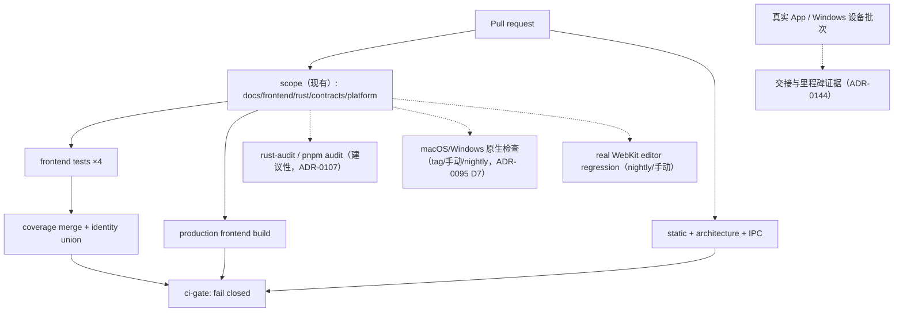
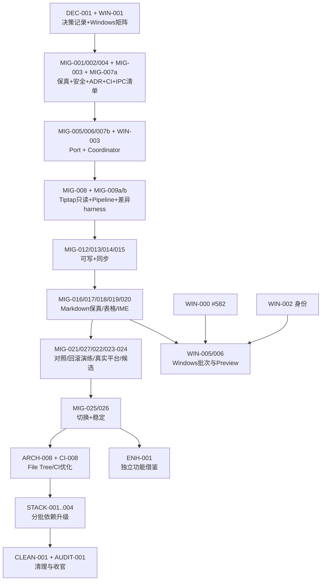

# mdpro：Milkdown 7 → Tiptap 3 迁移与架构、CI 优化整合实施计划

> **版本**：v1.2（2026-11-07，按第一轮双审计修订；v1.1 见 commit `49a33906`）  
> **项目**：[anzchy/mdpro](https://github.com/anzchy/mdpro) · 默认分支 `master`  
> **对标参考**：[xiaolai/vmark](https://github.com/xiaolai/vmark) · 默认分支 `main`  
> **依据文档**：`docs/plans/20261107-plan-architecture-restructure-ci.md`（v1.0，460 行，即 `mdpro_architecture_ci_optimization_plan_2026-11-07.md`）；`mdpro_cross_platform_development_release_assessment_2026-11-07.md`  
> **文档定位**：**新的主实施计划（Proposal）**。用户已经决定将 Milkdown 替换为 Tiptap，本计划不再以“是否迁移”为待决定事项；但仍以可证明的数据安全和用户体验作为能否发布的门槛。  
> **执行状态**：未修改仓库、未运行本地测试、未建立 PR。本计划所有 PR 与文件树均为建议，实施前以最新主干 SHA 再次校准。  
> **冲突处理**：原架构计划中“保留 Milkdown”“不进行 Milkdown→Tiptap 迁移”等条款，**由本计划明确覆盖**；原计划其余 8 项优化任务及质量护栏保留。v1.0 §5.1 “更新相关 ADR 的路径引用”与 §5.2 IPC 可选分层两条**也由本计划替换**（见 §12 M7-A 与 MIG-007）。
> **Windows 修订原则（v1.1）**：当前 Windows 版本以“**按新架构迁移 + 保留已验证功能 + 不增加数据安全风险**”为交付目标；Windows 的新功能与非关键 UI polish 不在本次迁移的阻断范围。Windows 平台隔离代码在共享 EditorPort 确立后优先迁移；Tiptap 实现阶段按**里程碑批次**做 Windows 回归（v1.2 由“逐 PR”改为“逐里程碑 + 逐 PR 记录豁免”，见 W1/W2），而非最后才集中验收。
> **执行约束（v1.2）**：MIG-/WIN-/ARCH-/CI- 编号只是计划标签；落实时每项是 `anzchy/mdpro` 的 GitHub Issue（2026-11-02 决定）。每个落地切片按 rule 12 判定是否 gated（gated 切片须经 `/grill-with-docs` → `/to-spec` → `/to-tickets` → 用户批准 → 快照 → 双审计计划评审），每个 PR 双审计（ADR-0143）、全机最多三个未落地实施项（ADR-0156）。本计划不是实施授权。

### v1.2 修订摘要（对应第一轮审计 `TP-1…TP-6`）

| 审计项 | v1.2 的处理 | 位置 |
|---|---|---|
| TP-1 ADR 不可变 / 搬迁映射 | MIG-004 交付 ADR 影响表（保留/取代/合并），点名 ADR-0010 F3 与 ADR-0012；搬迁只改活引用，用 ADR-0098 式 move map | MIG-004、§12 M7-A、§14 |
| TP-2 CI 政策 | 默认保留 ADR-0095 D7 与 ADR-0107：新 WebKit/原生/Windows 通道在 `ci-gate` 之外；若要改，先走 gate-sensitive 决策日志条目 | MIG-003、§12 M7-B |
| TP-3 Windows 发布与设备容量 | 新增 WIN-000（#582 退出条件 = ADR-0164 D4）；Windows 设备回归按里程碑批次；容量写入风险台账 | §0A、§18 |
| TP-4 Preview 身份是应用代码 | WIN-002 改为身份 ADR + 应用代码切片，逐项列出共享的身份值；Windows 无 Updater | WIN-002、W3、MIG-023 |
| TP-5 EditorPort 过薄 | Port 增加命令/聚焦、定向与聚合 Flush、destroy/discard、三类令牌；九个宿主调用点与入口合同表 | §4.2、MIG-005 |
| TP-6 决策未记录 | 新增 §0A.0：引用两次用户原话，并在 WIN-001 规格之前写决策日志条目 | §0A.0 |

---


## 0A. Windows Preservation-First：v1.1 的正式实施约束（优先于下文一般性阶段描述）

> **结论**：Windows **不是等 Tiptap 全部完成才验收的附带平台**，它是一条在 M0 开始、贯穿 M1–M6 的独立迁移与回归主线。**先稳住现有 Windows 行为，再迁移平台适配层，然后并行验证新的共享编辑器内核；polish 与新功能后置。** 本节与下文旧阶段发生排序歧义时，以本节为准。

### 0A.0 — 决策记录（v1.2 新增，先于 WIN-001 的规格）

- 用户 2026-11-06：「Skip all windows related feature, 接下来所有的精力专注于MacOS平台相关功能」。
- 用户 2026-11-07：「20261107-mdpro_tiptap_windows_plan_v1-1.md，这是更新之后的Plan，考虑了Windows相关部分迁移」。
- **较新的一句只在“保留”范围内取代较旧的一句**：Windows 在本迁移中只做“保留已验证行为 + 不增加数据安全风险”；Windows 新功能与 polish 仍按 2026-11-06 的决定暂停（本节末尾“明确不在本次迁移范围”即新功能边界）。本迁移之外的工作仍只做 macOS。
- delegator 在 WIN-001 的 `/to-spec` 之前写决策日志条目 `docs/agents/decisions/20261107-windows-preservation-not-features.md`，引用以上两句原话；第一轮审计的 PL-1 由该条目关闭，而不是由本计划关闭。

### WIN-000 — Windows 设备通道的入口门禁（v1.2 新增）

- **Windows 设备证据的前提是 #582 的退出条件**（ADR-0164 D4）：#575（D342–D346）落地且 smoke PASS、W036b 在已验证的 Windows 构建上运行、任何产品 FAIL 已修复。未满足之前，自动化 Windows 设备 Journey 不能作为任何 PR 的门禁证据。
- 在 #582 关闭之前，Windows Journey 以**用户手动执行的卡片**完成（ADR-0164 方案 2，约 1 小时/张），每个里程碑写明预算；或该里程碑记录豁免。
- **Windows 发布权限**：默认保留 ADR-0164 D4，即 Windows 只在 #582 退出后的第一个版本重新发布，WIN-006 以此为前置。若用户希望 Windows Preview 在 #582 关闭前发布，必须先有一份取代 ADR-0164 D4 的新 ADR，定义 Preview 的替代条件；本计划不默认这样做。
- macOS Stable 的切换（M6）不依赖 WIN-000，可以独立推进。

### W0 — 先明确 Windows As-Is 功能与风险基线（M0 的必经工作）

- 以主干固定 Commit SHA 和可辨识的 Windows 安装包为准，从 `docs/feature-ledger.md` 各分区的“Windows 差异”表、`docs/test/` 真机证据及相关 Issues/PR 构建 **Windows Capability Matrix**。
- 每项标记 `Confirmed Working` / `Known Defect or Partial` / `Unknown`，并额外记录 `Data-Safety Critical`、是否为跨平台共享行为、Owner、最后真机验证 SHA。**`Unknown` 不得因为 macOS 的 `Shipped` 而自动变为 Windows 的 `Shipped`**。
- 对 `Confirmed Working`：迁移前后同一 Windows 真机 Journey 必须通过，构成不可退化的硬门禁。对 `Known Defect/Partial`：保持既有行为边界、不引入新回归，安全缺陷另列阻断；若是原有 Bug，不自动把“本次必须修复”加入 Tiptap 迁移范围。对 `Unknown`：优先建立可复现的 smoke 和证据，不能用未运行的测试声称通过。
- 第一批覆盖：Windows 文件打开/保存/另存为、外部修改防覆盖、脏状态与取消关闭、Source/WYSIWYG 切换、普通文字输入与 Ctrl/AltGr/IME、Undo/Redo、基本表格、链接与图片显示、Windows 多窗口路由、MCP 读写与许可、首次启动及 NSIS 安装。复杂表格、特定快捷键、尚未验证的交互则按 Capability Matrix 分级。
- 已有实证样本包括 Windows 本地图片 `asset.localhost` 显示、部分 Ctrl+Alt 表格动作、高亮快捷键；`Ctrl+K` 链接插入曾有待复核异常，部分表格与光标交互为 `Unknown`。这不是说其他功能已确认失败，只是验证证据不足。
- **现状基数（da993ff1）**：账本 12 张 Windows 表共 98 `Unknown`、6 `Partial`、3 `Shipped`、2 `Absent`、12 `N/A`；`docs/test/` 有 11 份带日期的 Windows 设备记录，`docs/test/cards/` 只有 1 张 Windows 卡。W0 “第一批覆盖”几乎全部是 `Unknown`，因此 “Confirmed Working 100% 不退化” 起步只覆盖少数行。
- **证据规则**：`Confirmed Working` = 一份 `docs/test/` 记录写明构建 SHA/安装包哈希、OS/WebView/键盘/文件系统环境和对应卡片，或一张 ADR-0144 卡片在冻结基线上 PASS。历史结果保留为“历史证据”，在冻结基线上重跑之前标为“当前验证待定”；按文件名判断平台不算证据（例如 `20261023-b4-windows-editor-device-check.md` 实为 Mac mini 记录）；驱动失败（W036b 记录为 NOT EXERCISED）既不是产品失败也不是 PASS。账本中省略的 Windows 行本身就是一种声明（ADR-0089），矩阵须显式列出。
- **数据安全相关的 `Unknown`**：Windows Preview 发布前必须 PASS，或有记录在案的发布例外（用户原话）；“优先 smoke” 不是处置规则。W0 写明 W1 开始前必须转为 Confirmed 的最小行集（至少：打开/保存/另存为、脏状态关闭、外部修改防覆盖）。
- **可执行的“保留 vs polish”边界**：每个 Windows AC 必须引用一个 Capability Matrix 行号；没有行号的 Windows 工作一律标 `WIN-POLISH`，审计者把它当作范围蔓延处理。

**交付物**：`windows-capability-matrix.md`（逐个有边界的行为一行：历史测试 SHA、安装包哈希、环境、卡片、结果、当前基线处置）、证据索引、Known Defect 清单；范围冻结记录归入 0A.0 的决策日志条目和 MIG-004 的 ADR 影响表，不另起一份 ADR。

### W1 — 共享契约先建立；Windows 平台代码紧接着优先迁移（M1 子阶段）

顺序必须是：**最小 `EditorPort`/`MarkdownCodec`/`Flush Contract` → Windows 相关原生与 UI Adapter 的边界迁移 → Tiptap 共享引擎适配**。

- 将 Windows 专属的快捷键/AltGr、WebView2 输入事件、窗口控制与路由、文件对话框差异、安装与 App 身份逻辑按 *platform adapter* 清晰隔离；共享 Editor/Document/Save/MCP 业务规则放在独立的 Application 或 Service 层。
- 对现有 Windows 行为进行 **behavior-preserving move/refactor**：只调整依赖关系、入口和必要的测试接线，不夹带窗口 UI polish、键盘布局重设计、新平台功能或无关 Rust/React 大版本升级。
- 迁移模块应保留稳定的宿主接口；新 Tiptap 只能从同一个公共接口调用，而不能创建 Windows 专属的第二套文档状态、Flush 或写盘流程。
- **实际可搬的 Windows 代码很少**（da993ff1）：Rust 生产代码中 `target_os = "windows"` 只出现在 `commands/mcp.rs`（8 处）、`menu.rs`、`services/applied_shortcuts.rs`、`services/preferences_migration.rs`（各 1 处），`not(target_os = "macos")` 主要在 `services/quit_guard/`（6 处）与 `services/control_channel/mod.rs`（2 处）；TS 侧是 `src/commands/*` 快捷键表、`platformLabels.ts`、`imagePathUtils.ts`、`AdvancedSettings.tsx`。Windows 的主要风险在 WebView2 下的**共享编辑器**。因此 WIN-003 不再预设 “Window/Input/File 三个 PR”：要么每个 PR 写明上面列出的具体文件，要么并入 MIG-005/006，作为其 Windows AC。
- 每个 Windows Adapter PR：Windows Native Compile/Clippy/Test（在 `ci-gate` 之外的手动或 nightly 通道，见 MIG-003）；对共有代码做 Mac 基础回归（Linux 在其支持范围内做检查）；更新 Windows 差异表。**真实 Windows App Journey 按里程碑批次执行**（ADR-0144 决定 6），单个 PR 的 Windows device AC 用记录在案的豁免（rule 70 落地条件“PASS 证据或已记录的豁免”）指向该批次。
- **不建议现在一次性移动全部 `src-tauri` 或 `src/`**。先迁移涉及 Windows 的垂直切片，M7 再完成全局 File Tree Reorganization，避免路径变化吞没功能变化。

**门禁**：Windows `Confirmed Working` 100% 不退化；保存/关闭/MCP/文件覆盖等关键路径 0 个新增安全缺陷；`Known Defect` 没有扩大影响范围；未测范围如实标记。

### W2 — Tiptap 开发中每个里程碑都做 Windows 回归（M2–M4）

> **容量约束（v1.2）**：只有一台 `win-desktop`，单人操作锁（`device-batches.md` § Win-desktop lock）；设备测试员是 device 模式下的 `gpt-auditor`，它同时参与每个 PR 的审计；Mac 与 Windows 的 GUI 工作不是两条独立并行通道。ADR-0144 决定 3、5 规定 device AC 绑定落地 SHA 的身份（含 `package.json` 与锁文件），所以**每个改依赖的 Tiptap PR 都会使此前的 Windows PASS 失效**。因此：每个里程碑一个 Windows 批次（M2 1 次、M3 1 次、M4 1–2 次、M5 候选 1 次，外加身份失效导致的重跑），每次先实测准备/Journey/清理时长再定预算；批次内容只覆盖受影响的矩阵行，里程碑末与切换前跑完整保留语料，数据安全检查即使对原 `Unknown` 行也必须执行。

- M2 只读渲染：Windows WebView2 真实渲染、字体/选择/滚动/基本输入链路 Smoke；不得触碰真实文件。
- M3 可写核心：Windows 上直接验证编辑→同步 Flush→保存/重开、Source↔WYSIWYG、Undo、MCP 写入、关闭与恢复，任何旧实例写回覆盖新内容均阻断。
- M4 高风险功能：Windows IME/AltGr/Ctrl、表格粘贴与选区、引用链接、图片与富文本剪贴板使用独立 Golden Corpus 和 Windows Journey。**Windows 验收不是只有最终 M5 一次**。
- 无关的已知 UI 瑕疵继续跟踪到 Polish Backlog；迁移过程中只有阻止既有功能运行或造成数据损失的问题才必须前置修复。

### W3 — Windows Preview Cutover 与后续 Polish 分离（M5–M6 / M9+）

- macOS Stable 与 Windows Preview **共享主干代码和固定构建 SHA，但产品成熟度可不同**。Windows Preview 的 Tiptap 上线要求的是现有 Confirmed Working 行为回归、核心数据安全和安装/启动基本闭环，而非追平 Mac 的全部新能力。
- Preview 与 Stable 必须隔离 App Identifier、配置/草稿目录、MCP Port/Token、日志、文件关联与 MCP 客户端注册（具体值见 WIN-002）。**Windows 没有 Updater Channel**：`latest.json` 只有 darwin（ADR-0102、ADR-0164），Preview 只发安装包，永不进入 `latest.json`；开启 Windows 更新源需要另一份 ADR，不在本次范围。
- Windows 回滚 = 用户重新安装上一个 NSIS 安装包；上一个安装包保存在 GitHub Release 资产中（`build-windows.yml` 的 artifacts 30 天后过期，不能作为回滚来源）。
- Windows Preview 验收通过后，才建立单独的 `WIN-POLISH` Epic：GUI 细节、未完成快捷键、表格体验、输入法边缘用例、文件关联与更新体验的进一步完善，逐项排优先级。
- 后续 polish 应沿新的 Adapter/Domain 边界实施；不要用无尽 polish 作为阻挡整个 Tiptap 迁移合并的理由，也不能以“以后再 polish”为借口容忍数据丢失。

### 对原 M0–M9 的顺序修正

```text
M0 / W0  先锁定 Windows 已有行为与数据安全证据（0A.0 决策记录、WIN-001），
         补最小 CI 保护（平台通道在 ci-gate 之外，见 MIG-003）；WIN-000 并行推进
       ↓
M1      建立跨引擎 EditorPort + Document/Flush 统一契约（Milkdown 仍是生产实现）
       ↓
M1-W1   先按新边界迁移 Windows 平台专用代码（行为不变，不做 polish）
       ↓
M2      Tiptap 只读与 Markdown Pipeline 验证（同时做 Windows Smoke）
       ↓
M3–M4   Tiptap 功能迁移（每个里程碑 Mac/Windows 定向回归）
       ↓
M5–M6   Mac Stable / Windows Preview 按各自验收门槛切换，允许平台成熟度不同
       ↓
M7      全局 File Tree + CI 深度治理（非必要的大量文件搬迁后置）
       ↓
M8–M9   分批依赖升级、旧框架退场、独立 Windows Polish Backlog
```

### 建议新增 PR 与验收合同

| PR | 目标 | 前置依赖 | 必过门禁 |
|---|---|---|---|
| WIN-000 | #582 退出条件（ADR-0164 D4）：驱动 smoke PASS、W036b、产品 FAIL 修复 | 已存在的 #582 / #575 | 未满足前 Windows Journey 只用用户手动卡片；不是新建项，复用 #582 |
| WIN-001 | Windows Capability Matrix + 原有 Windows 真机结果索引（只读整理，可立即开始） | 固定 Baseline SHA、0A.0 决策日志条目 | 按 W0 证据规则区分历史与当前；不虚报功能已验证 |
| WIN-002 | Preview 应用身份（**应用代码 + ADR**，见下） | WIN-001、MIG-004 的 ADR 影响表 | Stable 哨兵文件/配置/草稿/MCP 发现文件在启动、保存、退出、安装/卸载、回滚全过程中不变 |
| WIN-003 | Windows 平台代码边界迁移（具体文件见 W1；或并入 MIG-005/006） | MIG-005、WIN-001 | 仅做行为等价迁移；每个 AC 引用矩阵行号 |
| WIN-005 | Tiptap Windows WebView2 核心编辑验收（M3–M4 的 Windows 批次） | WIN-000、M3–M4、WIN-002 | Flush/Save/Close/MCP/IME/Selection 关键行为不退化 |
| WIN-006 | Windows Preview Candidate / NSIS Smoke / 回滚路径 | WIN-000、M5、WIN-005 | 构建身份、安装启动与文件数据安全符合 Preview 范围；发布权限见 WIN-000 |
| WIN-POLISH | 功能增强与体验打磨（独立后续 Epic） | WIN-006 | 每项新功能单独验收；不阻断保留现有功能的迁移 |

> v1.1 的 WIN-004（Windows 最小 CI 与 Smoke）与 MIG-003 重复，v1.2 并入 MIG-003。

**WIN-002 是应用代码，不是测试隔离。** 当前所有身份值都是共享且写死的（da993ff1）：

| 身份值 | 位置 |
|---|---|
| App Identifier `com.mdpro.app`（WebView2 profile 在 `%LOCALAPPDATA%\com.mdpro.app`） | `src-tauri/tauri.conf.json:5` |
| 配置与日志 `~/.mdpro/config.json`、`~/.mdpro/mdpro.log` | `commands/preferences.rs:49`、`commands/logging.rs` |
| 草稿与 MCP `server.port`/`server.token` 在 `dirs::config_dir()/mdpro` | `commands/mcp.rs:328,342`、`services/http_server.rs:95`；sidecar `bin/mdpro_mcp.rs` 读同一目录 |
| 旧版 `~/.mdpro/drafts` 迁移 | `services/draft/migration.rs` |
| MCP 端口 `127.0.0.1:55045` | `services/mcp_controller/controller.rs:68` |
| `.md`/`.markdown` 文件关联 | `tauri.conf.json` `fileAssociations` |
| MCP 客户端注册（Claude Desktop/Gemini/Codex 配置中只有一个 server 条目） | `remote-windows-device-test/reference/config-isolation.md` |

Windows 上环境变量无法移动这些路径（`dirs-sys` 使用 Known Folders），该 skill 已记录“真正的隔离需要应用代码”。因此 WIN-002：(1) 用**一个构建时 channel 常量**同时派生 identifier、目录名、端口、日志路径与 sidecar 目录，sidecar 与 `release_info.rs` 读同一常量；(2) 按 ADR-0165 作为 ADR 记录（持久化路径、App Identifier、端口都在 ADR 门槛内），rule-12 gated、High 档；(3) Preview 不接管文件关联，或明确其范围；(4) Preview 不对 Stable 数据执行旧草稿迁移；(5) 构建身份沿用已有的 `releaseId`（`scripts/release/devReleaseId.mjs`、`build-windows.yml`）；(6) Preview 无 Updater。任何新应用的 Windows 设备运行都以 WIN-002 落地为前置。

**明确不在本次迁移范围**：立即修完 Windows 所有旧 Bug、实现 Mac/Windows 100% Feature Parity、重写所有 Rust 平台代码、增加完整 Windows 自动更新、重做所有快捷键与 UI 主题。若有可能造成用户数据丢失或安全问题的旧缺陷，应作为阻断或单独先修的高优先级例外。

---

## 0. Executive Decision：哪个在先，哪个在后？

**推荐实施依赖顺序**：

```text
先：当前行为证据 + 数据安全 + 跨平台最小 CI 保护
  ↓
接着：编辑器 Port / Adapter + 状态所有权和 Flush Contract
  ↓
再：Tiptap 独立适配器 + Markdown Pipeline 验证（不写真实文件）
  ↓
再：Tiptap 编辑、表格、链接、命令、IME、MCP 等功能迁移
  ↓
再：Mac/Windows 真机回归 + 分阶段切换 + 可回滚发布
  ↓
然后：全量 File Tree Reorganization + Knip 治理
  ↓
然后：CI 深度分层/提速 + TypeScript/Vite/Vitest/Zustand 分别升级
  ↓
最后：VMark 其他优秀编辑行为的局部引入、清理 Milkdown、收官审计
```

**最关键的改变**：原版计划 P2（全面 File Tree Reorganization）、P3（CI 全面改造）、P4（工具链升级）**不再全部排在编辑器迁移前**。迁移前只完成必需的边界和 CI 保护；**大规模搬目录、工具链升级、全链路 CI 改造放到 Tiptap 稳定切换之后**，避免四类大变更同时发生而无法定位回归根因。

但这不代表可以先迁移、最后再补测试：数据完整性、编辑器 Flush、测试分片完整性、Windows/macOS 原生验证必须在第一批就建立（原生验证在 `ci-gate` 之外的通道与设备批次中进行，见 MIG-003 与 W2）。

### 总体阶段安排

| 阶段 | 名称 | 主要目的 | 进入下一阶段的条件 |
|---|---|---|---|
| **M0** | 冻结基线、定义正确性、跨平台保护 | 现有行为有可运行的金标准 | Corpus、状态安全测试、平台验证基线齐备 |
| **M1** | 先建立编辑器抽象，不先搬整棵目录 | 隔离 Milkdown 与业务逻辑 | `EditorPort` / Flush Contract 在 Milkdown 下可工作 |
| **M2** | Tiptap 基础与解析/序列化 PoC | 建立可编译、可渲染、可回写到测试内存的路径 | 核心 Markdown 样本无静默语义丢失 |
| **M3** | 基础编辑 + 状态事务迁移 | 替换 WYSIWYG 运行时最关键的操作 | 保存、切换、Undo、MCP 同步等不变量通过 |
| **M4** | 高风险 Markdown、表格、交互功能 | 处理 Mdpro 最多的复杂行为 | 表格/空行/引用链接/IME 等回归守护全部通过 |
| **M5** | 双轨对照与真实平台候选验证 | 在真实 Mac/Windows 上验证差异 | 无 Blocker，发布候选可追溯且可撤回 |
| **M6** | 正式切换（Cutover）及稳定期 | 默认 Tiptap，保留短期回滚机制 | Stable/Preview 渠道均满足各自标准 |
| **M7** | 全面文件树重组 + CI 深度优化 | 在单编辑器架构稳定后减少技术债和耗时 | 不改变编辑行为；Architecture + CI Gate 严格通过 |
| **M8** | 技术栈分批升级 | 更新 Zustand/Vitest/TS/Vite，分别验证 | 每次只升一项，兼容性证据齐备 |
| **M9** | 借鉴 VMark 其余能力、退场清理与收官 | 删除旧 Milkdown 依赖及债务 | 依赖树、保真、性能、跨平台、发行结果复核 |

> **排序不是时间承诺**；工作量较大的 M3/M4/M5 按风险和证据拆成多个小 PR，不能靠压缩测试换速度。M6 与 M9 的部分 Milkdown 清理可以联动，但应优先保留可回滚能力，等稳定期证据满足后再最终移除。

---

## 1. 已核实的 Codebase 事实与不确定性

### 1.1 mdpro 当前能力与迁移范围

- 使用 **Milkdown 7**：`@milkdown/kit`、`@milkdown/react`，WYSIWYG 根组件 `src/components/Editor/MilkdownEditor.tsx`；另有 **CodeMirror 6 Source Mode**，不能随迁移移除。
- `src/plugins/milkdown/commonmarkPreset.ts` 对 Milkdown 预设进行了替换；其定制覆盖 Markdown 空段落、引用式链接定义、列表松紧等。
- `src/plugins/milkdown/table/` 是高复杂度区域，含 Ragged Table Widen、粘贴拒绝/补齐、表头修复、对齐规则、上下文菜单与行列编辑；`patches/prosemirror-tables@1.8.5.patch` 是**版本相关的依赖补丁**。
- `src/plugins/milkdown/editSync/controller.ts` 已把关键写回/Flush 策略与 React、Milkdown 框架解耦，是**迁移优先复用的核心资产**；`editSync/plugin.ts` 负责把此控制器与 Milkdown 插件生命周期相连。
- `src/stores/milkdownEditorStore.ts` 是 Flusher Registry 和编辑器重载/丢弃的重要协调入口；`documentStore.ts`、`App.tsx` 与 Hooks/Services 对它有外部依赖。
- **状态与令牌的完整清单**（v1.2 补充）：除 `documentStore`/`editorStore`/`milkdownEditorStore` 外，还有 `externalChangeStore`（D171：保存/重载前的外部修改门）、`tabStore`、`tabMru`、`src/stores/baselineEpoch.ts`（D214：保存基线代次）、`src/stores/editorGeneration.ts`（菜单目标令牌）。Port 的 `generation` 不能成为与 `editorGenerations`、`baselineEpoch` 并列的第三个计数器（见 §4.2）。
- mdpro 当前 CI 已有 Vitest **四分片 + Coverage Merge + 测试身份完整性核验**；已有 `scope` 作业负责变更分类（本计划对它做增量，而不是新建）；JS `pnpm audit` 是建议性作业；`rust-audit` 在 `ci-gate` 之外（ADR-0107）；macOS 只在 `v*` tag 上运行（ADR-0095 D7）；PR 前端测试只跑 Ubuntu。发布流程包含 Mac ARM64/Intel、Windows x64、Linux x64 构建矩阵（ADR-0164 的 `windows` 输入可关闭 Windows 行），但 Windows/Linux 发布与更新支持程度并不等同于 macOS。
- `src/main.tsx` 当前**没有** `<StrictMode>`；`tsconfig` 没有 `paths`，Vite/Vitest 没有 `resolve.alias`，所有导入都是相对路径。
- mdpro 仍在解决 Windows 设备自动化、窗口/键盘/定时器等问题，因此 **Mac 通过不能作为 Windows 行为正确的替代证据**。

### 1.2 VMark 借鉴时必须明确的边界

- VMark 采用 Tiptap 3，但其 Markdown 转换并**非**简单依赖 Tiptap 自带的 Markdown 扩展；它维护独立 `Markdown → Remark/MDAST → ProseMirror → MDAST → Markdown` 转换层。
- VMark 将编辑器内容同步与生命周期拆到 `TiptapEditor.tsx`、`useTiptapFlush.ts`、`useTiptapContentSync.ts` 等模块，提供很好的组织参考；**不可直接复制其状态模型或假设其数据契约等同 mdpro**。
- VMark 的 `linkDefinition` 是不可编辑 Atom Node；**mdpro 也已经是不可行内编辑的 atom**（ADR-0094 D2–3、`linkDefinitionNode.ts`：保留原始源码、灰色等宽显示、整节点选择/删除、原位顺序；已解析的引用按设计内联）。两者是否等价按 mdpro 的验收合同判断，不因同为 atom 就视为一致；完整保留引用式语法属于延后的 D197 能力，需要单独范围与决策。
- ProseMirror 是共同底层，但 **Milkdown `$prose`、Ctx、Preset、Parser/Serializer、React 生命周期 API 与 Tiptap Extension API 并不兼容**；只有底层算法/类型满足 Schema 与依赖版本条件时才可复用。

### 1.3 执行前核对项

第一张 PR 必须记录：

1. `git rev-parse HEAD`，`package.json`/锁文件/Cargo.lock SHA；所有在途编辑器、CI、Windows PR 的清单与 Owner。
2. 当前 Milkdown、ProseMirror、`prosemirror-tables` 实际解析版本、补丁生效状态、pnpm 依赖图；候选 Tiptap 3 和 `@tiptap/pm` 版本。
3. 现有 `tests/ci-inventory.json`、Vitest 4 分片、Coverage Threshold 与校验脚本是否仍与主干一致。
4. Markdown 当前已知限制（例如 README 的 Known Limits）和不能无意放宽的行为承诺。
5. Mac Stable、Windows Preview、Linux 的支持范围、输入法/窗口/安装验证状态。

**无需重建用户文件数据格式**：mdpro 主存储是 `.md`，不是 Milkdown 私有二进制文档。迁移风险主要在打开、编辑、序列化、同步和写入路径；持久化选区/内部元数据若使用特定 Schema 或 PM Position，需单独兼容。

---

## 2. 迁移的不可妥协原则

### 2.1 数据安全优先级高于 UI 新功能

1. **不静默丢失 Markdown 语义**：未知节点、不可表达的嵌套表格或 HTML 不得悄悄删掉；可拒绝进入 WYSIWYG、转 Source Mode、提示用户。
2. **不凭“编辑器能显示”判断成功**：必须验证保存、关闭、重开、Undo/Redo、外部改动、MCP 写入后的文件语义与已知表现。
3. **旧编辑器不能在卸载时覆盖新内容**：全部 Flush 都绑定文档 ID、编辑器实例/代次、原始 Baseline；废弃实例须 `discard` 而不能晚到覆盖。
4. **任何时间点只有一个可写 WYSIWYG 实例**：PoC 可以并行比较两个 *只读* 实例，但**禁止同一个文档的 Milkdown 与 Tiptap 同时拥有写回资格**。
5. **不让旧 Milkdown 错误契约“永久合法化”**：先记录当前行为；对当前已知 Bug 单独标注 `known-limitation`、期望新行为和接受理由。
6. **不同时升级基础设施**：迁移窗口中锁定 Zustand、Vitest、TypeScript、Vite 大版本；必要安全补丁单独 PR 并重新验证。
7. **CI 不得假绿**：不可用删除测试、放宽 Coverage、跳过身份联合校验、扩大 Ignore 或无条件容忍 `skipped` 来换绿色。
8. **逐 PR 可回滚**：在数据安全证据不足时不能将 Tiptap 当作可写 Stable 默认引擎。

### 2.2 正确性测试采用三级标准

- **A级：原始文件不应该被写**：只打开、只浏览、只切换视图的情况下，不应触发无意义写入；原文件 Byte-for-byte 保持不变。
- **B级：内容发生编辑的情况**：按明确记录的 Markdown 合法正规化规则比较；既检查 Markdown/MDAST 语义等价，也核对未编辑区域、引用定义、空行等产品要求保留的源码信息。**仅 AST 等价不够**。
- **C级：用户交互/状态情况**：选区、光标、Undo 历史、脏状态、焦点、输入法、Tab 切换、窗口退出等，以行为不变量和真实 App 测试验收。

要特别区分 `parse → serialize` 的无编辑 Roundtrip 与 `parse → 小编辑 → serialize`：前者可以选择**根本不写回磁盘**实现字节保留，后者必须测试序列化确实安全，不能用“没写文件”掩盖转换缺陷。

---

## 3. 与原 8 项优化任务的优先级重新映射

| 原计划 ID | 原任务 | 新主要阶段 | 如何调整先后顺序 |
|---|---|---|---|
| **OPT-01** | dependency-cruiser 架构边界 | **M0–M1**，M7 收紧 | 提前建立报告/防新增违例；Tiptap 适配层的依赖规则先落地；历史例外 M7 清理 |
| **OPT-02** | App.tsx 拆分 | **M1 最小必要部分**，M7 完成 | 优先抽离与编辑器选择/生命周期/Flush 相关装配；其他 UI/启动拆分延后，避免与 Tiptap 并发重构 |
| **OPT-03** | TS ↔ Rust IPC Contract | **M0–M1** 阻断关键路径，M7 扩面 | 先保证文件/MCP/窗口关键 IPC 正确；Tiptap 不直接改变 Rust API，暂不做大规模生成器改造 |
| **OPT-04** | Knip | **M0 只读盘点**，M7 真正清理 | 迁移期间会暂时共存两套依赖，Knip 容易误判动态插件/Feature Flag；先收集，不大删 |
| **OPT-05** | 跨 Store 状态事务 | **M0–M1 必须先完成** | 先把 Flush/Reload/Save/Switch/Close 的状态 Owner 和 Contract 稳定，Tiptap 才能替换运行时 |
| **OPT-06** | CI 分层与提速 | **M0 最小跨平台质量护栏**，M7 全面优化 | 先补可靠性；真实 WebKit/原生/Windows 通道默认在 `ci-gate` 之外（ADR-0095 D7、ADR-0107）；保留四分片，避免迁移中重写整个 CI DAG |
| **OPT-07** | Zustand / Vitest / TypeScript / Vite 升级 | **M8** | 迁移稳定后分别升级；先固定依赖版本可重现，禁止同时升级导致测试基线失效 |
| **OPT-08** | 局部借鉴 VMark 编辑器插件 | **M2–M4 策略借鉴**，M9 额外功能 | 迁移需要的算法可以研究与重写；非必要新功能一律后置 |
| **新增 MIG** | Milkdown → Tiptap | **M2–M6** | 独立主线，拥有专属 Golden Corpus、适配层、功能迁移、双轨验证和 Cutover |
| **新增 PLATFORM** | Mac/Win/Linux 开发与发布保护 | **M0、M5、M6** | 在迁移最早阶段设门禁；Mac Stable 与 Windows Preview 的运行数据和渠道不能互相覆盖 |

**结论**：原计划的“大规模 File Tree → CI → 依赖升级 → 局部插件优化”顺序变为“最小架构边界/最小 CI 保护 → Tiptap → 全面 File Tree/CI → 升级”。保留原计划文档作为架构工作包的详细参考，不要求重新实施其中与新计划冲突的编辑器保留条款。

---

## 4. 目标架构：先加最小稳定边界，再重组完整 File Tree

### 4.1 迁移期间的目标

```text
src/
  app/                        # 组合根：选择引擎；不包含编辑算法
  features/
    document/                 # 最小改动：文档用例与权威状态（先有接口，后搬目录）
    editor/
      contracts/
        WysiwygEditorPort.ts  # 宿主调用、同步 Flush、reload、destroy/discard
        MarkdownCodec.ts     # parse/serialize 统一契约与异常模型
        EditorTransaction.ts # 文档 ID、实例代次、保存边界
      application/
        editorCoordinator.ts  # 切换/卸载/外部编辑事务
      adapters/
        milkdown/             # 迁移期旧实现；后续删除
        tiptap/               # 新 Tiptap 编辑器、Extensions、绑定
        codemirror/           # Source Mode 不重写
      markdown/
        corpus/               # fixture、parity、golden、diff 工具
        pipeline/             # 经评估选择的 Markdown 解析/序列化逻辑
  shared/                     # 纯函数、不可变 DTO、Guard；不能依赖 React/Tauri
src-tauri/
  src/                        # Rust 原生服务保持不变，契约校验即可
```

这是**目标逻辑分区**，不是要求 M1 把全部 `src/` 移动完。M1 优先以新增接口与薄封装适配现有文件路径；M7 再统一整理旧的 `src/components/Editor`、`src/plugins/milkdown`、`src/hooks`、`src/stores`。

**迁移期间（M0–M6）的目录约束（v1.2）**：
- 遵守现行 rule 50 与 rule 10：Milkdown 实现留在 `src/plugins/milkdown/`，Tiptap 实现放在 `src/plugins/tiptap/`，Port/Coordinator 合同放在 rule 50 认可的现有位置（候选 `src/services/editor/`，属 High 档路径；若 rule 50 不认可，先修订再建），Store 仍在 `src/stores/`；**测试只放在 `tests/`**（`src/` 下的测试不会运行），语料 fixture 放在 `tests/fixtures/markdown-corpus/`，不放进 `src/`。上图的 `features/*` 结构只是 M7 的候选目标；要采用它，先用决策日志条目修订 rule 50/10，再移动。
- **只用相对导入**，不在迁移中引入路径别名；若 M7 决定使用别名，别名本身是一个独立的 High 档 PR，先于任何批量移动。
- v1.0 §4 提议的 `tests/{architecture,contracts,integration,journeys}` 不采用：`journeys` 与现有 journey 目录冲突，其余沿用 rule 10 § File placement。

### 4.2 推荐的编辑器 Port（伪代码，不是定版 TypeScript）

```ts
// v1.2：按第一轮审计 TP-5 补全。仍是草图，定版在 MIG-005 的规格中完成。
interface WysiwygEditorPort {
  readonly engine: "milkdown" | "tiptap";
  readonly documentId: string;
  // 三类令牌各自独立，不合并为一个 generation：
  //   editorInstance —— 编辑器实例代次（复用现有 editorGenerations）
  //   documentLifetime —— 文档生命周期（关闭/重开/路径变化即失效）
  //   baselineEpoch —— 保存/替换基线代次（复用 src/stores/baselineEpoch.ts）
  readonly tokens: EditorTokens;
  // 定向 Flush：只刷本文档；reason 是开放字符串，初始列表沿用现用值：
  // "save" | "settle" | "tab-switch" | "tab-close" | "window-close" | "quit"
  // | "mcp-insert" | "mcp-table" | "draft-recovery" | "reload" | ...
  flush(reason: FlushReason): FlushResult;          // clean | written | failed，从不抛出
  // 外部整体替换（wholesale）：与普通编辑分开；同步完成 store 替换、旧 writer 失效、代次递增。
  replaceContent(input: { markdown: string; expected: EditorTokens }): ReplaceResult;
  // 普通编辑命令：宿主今天经 getEditor() 直接调用 Milkdown 的九个位置改为经此处（封闭列表）。
  dispatch(command: EditorCommand): CommandResult;   // 表格动作、菜单/格式命令、图片与链接插入、高亮
  focus(carry?: FocusCarry): void;                   // D37 重载后焦点承接
  getSelectionSnapshot(): SelectionSnapshot | null;
  restoreSelection(snapshot: SelectionSnapshot): RestoreResult;
  destroy(reason: string): void;   // 卸载：先 Flush 再终止（controller.ts:220–227 现有语义）
  discard(reason: string): void;   // 丢弃：须有有效的用户同意；不是 destroy 的别名
}

// 宿主侧注册表，语义照搬 milkdownEditorStore 头部注释：
interface WysiwygRegistry {
  flushAll(reason: FlushReason): AggregateFlushResult;  // 每个文档的活跃 flusher 都执行；rank clean<written<failed；destroyed→clean；从不抛出
  flushFor(documentId: string, reason: FlushReason): FlushResult;  // D58 / ADR-0065 定向 Flush
  // 注销只移除自己的注册；旧注册在新 writer 移除后不得重新获得写权限。
}
```

Port **不是**为了给所有 Tiptap API 套一层通用抽象；它只暴露宿主真正需要的跨引擎合同。Node/Mark Schema 保持在各自 Adapter 内；但**宿主今天直接调用的编辑命令必须经 `dispatch` 封闭列表**，否则 MIG-005 的验收无法成立。

**宿主今天经 `getEditor()` 直接使用 Milkdown API 的九个位置**（da993ff1，MIG-005 验收逐个列出已迁移）：`src/App.tsx:776`（表格快捷键）、`src/components/Editor/TableContextMenu/index.tsx:95,217`、`src/hooks/mcpTableAction.ts:140`、`src/utils/editorMenuCommands.ts:67`、`src/hooks/windowCloseAttempt.ts:71`、`src/utils/focusActiveEditor.ts:43`、`src/utils/editorImageInsert.ts:65`、`src/utils/milkdownFocusCarry.ts:184`、`src/stores/editorStore.ts:133`。这是审计中逐行核对过的使用点；`src/` 中共有 14 个文件调用 `getEditor()`（含 store 自身与注册方），MIG-005 的规格以当时 `git grep -n 'getEditor()' src` 的完整结果为准。

**入口合同表**（每一行在改它的调用方之前，冻结入口、现有测试、缺失的负向用例、期望的失败/回滚、Owner 与 `unit`/`device` 证据）：

| 现有入口（da993ff1） | 迁移中必须保留的合同 |
|---|---|
| Save / Save As：`documentSave.ts:64–110,126–229`；`saveService.ts` `applySaveResult` | 同一文档从快照到结果应用串行；await 之后的 settle flush；flush 失败则不写、不标 clean；等待期间的输入保持 dirty；关闭/重开/重载/路径变化使旧任务失效；外部修改与重建同意检查保留 |
| Tab/模式切换：`documentStore.ts:125–147`；`editorStore.ts`；`flushRefusal.ts` | 读 flush 之后的状态；外出文档 flush 失败时两个 store 都拒绝切换，无关文档失败不拒绝；定向与聚合 flush 不能合并成一个布尔值（ADR-0071） |
| Tab/窗口/退出：`App.tsx:709–761,810–816`；`useWindowCloseGuard.ts:244–303`；`useQuitGuard.ts` | 保留提示目标捕获、取消、复查与草稿排空/删除顺序；失败后不卸载唯一持有未序列化编辑的实例；discard 需要有效同意，普通 destroy 不是 discard |
| 草稿定时器/恢复：`useAutoSave.ts:17–38`；`recoverIntoOpenTab.ts:112,154–161,271–294` | 定时器写 store 中的 Markdown 而不是 PM 快照；保留目标/claim/revision 归属、成功 rekey 前保留源草稿、定向 flush、陈旧恢复拒绝 |
| 外部整体替换：`wholesaleReplace.ts:63–69`；`openWriteGuard.ts`；重载/恢复调用方 | store 替换、旧 writer 失效、代次递增是一个同步事务；焦点/选区/TOC 在新代次下捕获与恢复；无迟到的旧 flush |
| MCP 写入/插入：`useMcpEvents.ts`；`mcpInsertContent.ts:110`；ADR-0044 | 审批/目标/版本检查不变；WYSIWYG 插入当前是全局 flush + 整体重建，后台/Source 路径不同，通用 replace 不得改变这些策略 |
| MCP 表格：`mcpTableAction.ts:125–190`；ADR-0065 D1–5 | 只刷目标、重读、先校验并应用编辑器**再**写 store；拒绝时两边都不变；dispatch 后抛错要对账；这是保留历史/TOC 的普通编辑，不走整体替换路径 |
| MCP 镜像：`useMcpSync.ts`；`shadow_store.rs`；`http_server.rs` | 保留 200ms 编辑器 / 300ms 镜像的最终一致性与现有 ACK 限制；MCP 关闭时的路由、取消重注册、UTF-16 偏移语义、Rust 侧独立同步/审批；Port flush 不是服务端确认 |

**序列化失败**：只保留 dirty 标志和**旧的** Markdown 草稿，并不能恢复当前 PM 编辑。MIG-005/013 规格须写明：失败后 writer 是否保持挂载、是否存在独立的可恢复快照、或哪些转换在用户明确丢弃之前一律拒绝；测试覆盖组合输入中、第二次事件、替换/关闭/重开、迟到清理与每个 await 期间的退出。

### 4.3 跨层约束

- `markdown/pipeline` 不允许导入 React、Zustand、Tauri、Tiptap React 组件；必要的 PM Model 类型可以通过参数或纯结构适配提供。
- `editor/application` 依赖 Port 而不是具体 Milkdown/Tiptap；Tiptap Extension 不允许直接写文件系统。
- UI 与其他 Feature 不能导入 `adapters/tiptap/internal/*`；Source Mode 依靠统一的 Document/Editor Coordinator。
- Rust IPC 调用仍经过受控 Services；MCP 不得越过文档确认和版本冲突保护。
- dependency-cruiser 对新增边界采用**阻断模式**，对历史违规采用 Ratchet：
  - **违规身份**：`(from 模块路径, to 模块路径, 规则名)` 三元组；重命名经 move map 解析为同一身份；纯类型边单独标记。
  - **基线**：一份提交在仓库中的基线文件（不在合并基点上重算）；只允许删除条目，新增条目必须经评审写入例外（Owner + 到期日 + 理由）。
  - **判定**：出现基线之外的新三元组即失败；总数下降不能掩盖新边；工具错误、解析错误、缺少历史均判为失败（fail closed），不判为通过。
  - **运行位置**：本地 lane 与 CI 同一命令；verifier 不读 CI，因此本地输出要作为交接证据。
- Knip 仅报告：报告不构成删除动态入口（Tauri 命令、MCP、Feature Flag、插件注册）的许可。

---

## 5. M0 — 数据正确性、基线与跨平台最小保护（必须最先做）

**工作包：MIG-001～MIG-004；不要触碰正式编辑器实现。**

### MIG-001：建立 Markdown Golden Corpus 与现有行为档案

1. 收集现有 tests/ 下针对 D188（空段落）、D192（`<br>`）、D194（引用链接）、D195（列表）、D100/D103/D136/D142/D162（表格/Rowspan/粘贴）、D203（Undo 跨 Tab）、D214（保存 Baseline）、IME/AltGr/Windows 等用例。
2. 用机械可重现脚本提取输入、期望输出、已知限制；形成 `case-id / class / input / action / expected / baseline-sha / platform`。
3. 建立三组文件：`immutable/no-edit`、`semantic-roundtrip/edited`、`interaction-and-safety`。
4. 测试语料至少涵盖：GFM 不规则表格、表格空单元格、跨行/跨列、HTML Paste、引用式链接定义、行内 HTML/`<br>`、空段落、松紧列表、带序号列表、GFM Task List、代码 Fence、图片/路径、硬换行、Emoji/CJK、CRLF/LF、UTF-8/UTF-16（文件读写层）、非法或极端长 Markdown、嵌套/超长表格。**v1.2 补充**：映射清单从完整的编辑器/账本能力清单推导，而不是只列上面这些；显式加入脚注（账本中 WYSIWYG 脚注为 `Partial`，数学为 `Absent`，不得顺带扩大数学范围）、`==highlight==`、`<u>` 与嵌套 mark、粘贴/链接/图片的安全处理（ADR-0002 链接路由、DOMPurify 与粘贴顺序、本地资源）、TOC/查找/滚动行为，以及允许的正规化规则。
5. 对无法保持保真的已知例外标为 `known-limitation`，与用户体验契约分开，不要自动接受新引擎更差的行为。
6. **输出位置与基线**：语料与期望输出放在 `tests/fixtures/markdown-corpus/`，测试放在 `tests/`；`baseline-sha` 为一个冻结的主干 SHA，规格中写明。期望字节/结构由独立陈述给出，不用候选引擎自己的解析结果去正规化两边。

**证据规则（v1.2）**：特征化（characterization）测试在现有实现下一开始就是绿的，rule 10 的 RED 政策没有豁免。每个“声明保真”的用例用**临时变异**取得 RED 回执（对被测代码做一次可还原的破坏，记录失败，再还原），或在规格中写明经接受的替代证据；不得在没有任何失败证据的情况下声称守护有效。

**验收**：所有现有黄金行为有可复现执行入口；每项声明保真的关键行为存在**会失败的负向用例**；不以 Mock 全通过替代真 PM Schema/Parser 测试；不把“无编辑时磁盘不变”或 AST 等价当作编辑后往返的证明。

### MIG-002：建立数据安全与跨 Store Characterization Tests

必须覆盖：

- WYSIWYG 输入但 Debounce 未触发 → 立即 `Cmd+S`：保存的是最新文本。
- WYSIWYG 输入 → 切换 Source → 快速切回：不丢编辑、Undo/Selection 策略明确。
- 输入 → 关闭 Tab/最后一个窗口/退出：Dirty Prompt 正确，取消不丢。
- MCP 修改当前或后台文档、审批/超时/拒绝后，旧编辑器 Flush 不得覆盖 MCP 新内容。
- 文件外部修改、监听、别名路径、Save As、替换文档、恢复草稿、并发两窗口编辑：旧 Baseline 不允许覆盖新版本。
- 双挂载（在**测试 harness** 中用 `<StrictMode>` 包裹组件来模拟；生产 `src/main.tsx` 当前没有 StrictMode，开启它是另一项需要设备证据的行为变更，不在本项范围）、Unmount、重载代次递增、晚到异步事件、序列化抛异常、测试销毁清理。
- Mac 快捷键、Windows Ctrl/AltGr/IME/窗口路由。

**复用现有测试**：D92/D95/D97 切换与关闭、D214/D290 保存与代次、`quit-guard-wysiwyg-flush`、D146/D241 与恢复、`wholesale-path-partition`、D58 MCP 表格等套件已覆盖大部分单元层；本项的新交付是**经过 `App.tsx` 的端到端 journey 套件**（§4.2 入口合同表每一行至少一条），不是把 mock 从 Milkdown 改名成 Tiptap。

**拆分（v1.2）**：MIG-002 按事务拆成多个 PR（建议：保存/另存为、切换、关闭/退出、草稿恢复、外部替换、MCP 写入、MCP 表格），每个 PR 一个完整的安全合同。

**验收**：测试明确文档 ID 与三类令牌、Owner，`FlushResult` 不隐藏错误；不存在“失败仍返回成功”的行为。

### MIG-003：建立跨平台最小 CI 保护（不是完整 CI 重构）

**CI 政策约束（v1.2，TP-2）**：本项**默认保留** ADR-0095 决定 7（“macOS 在 `v*` tag 上运行……没有检查移入 PR 运行”）与 ADR-0107 决定 1–3（`rust-audit` 是独立作业，`ci-gate` 不需要它；tag/手动运行时失败变红；每日 master 运行）。因此下面的 WebKit、原生 Runner 与 Windows smoke 通道都在 `ci-gate` 的 `needs` **之外**，以 `workflow_dispatch` / nightly / 路径触发的建议性作业运行，其结果作为交接与里程碑证据。若要把其中任何一项变成 PR 的必过检查，必须先写一份 gate-sensitive 决策日志条目（`docs/agents/decisions/20261102-changing-an-unfolded-process-adr-clause.md` 的流程），点名被改的条款，给出 事件 × 范围 × 作业结果 的真值表（含 skipped/cancelled/missing 的处理），经双审计计划评审 + policy 评审与用户批准后，才能写 MIG-003 的 brief；本计划评审不等于那份条目的评审。

- 保留 mdpro 当前四分片、Coverage 合并、Test Identity Union 和 `ci-gate`；不触碰已证明有效的完整性判定。
- 在现有 `scope` 作业上增量：将 `package.json`/pnpm-lock、编辑器适配器、PM/Markdown Pipeline、CI Config、Rust IPC Contract 变更纳入合适的必测路径（只改分类，不改 `ci-gate` 的 needs）。
- 新增小规模 **Real WebKit** 编辑核心测试（建议性通道）；macOS WKWebView 真实设备验收走 ADR-0144 卡片，不能被 Linux Playwright WebKit 替代。
- 与平台相关的 Rust/Tauri 代码变更，在 Windows、macOS 的对应 Runner 做最小 Compile/Clippy/Test（建议性通道）；Windows Runner 目前只在 `build-windows.yml`（手动触发，热缓存 10–12 分钟），触发条件写明为 `src-tauri/**` 路径。仍不接受“Linux 绿就代表 Windows 绿”：Windows 相关 PR 在交接中引用该通道的运行 ID。
- v1.1 的 WIN-004 并入本项。Preview 身份隔离不在本项（见 WIN-002）。

**验收**：构造“分片漏测”“分类器失败”“未启动的 pending Test”故障注入，最终 Required Gate 必须为红；“某平台失败”故障注入使对应建议性通道为红且在交接模板中可见；CI 指标基线按 §17 的定义采集。

### MIG-004：锁定依赖与决策档案

- 记录 Milkdown 实际 PM 版本、Tiptap 候选 `@tiptap/pm` 版本和 pnpm 依赖解析结果；确认不会存在两个不兼容的 ProseMirror Runtime 互相传递 Node/Plugin/Schema 实例。
- 记录 `prosemirror-tables@1.8.5` Patch 的行为和测试；迁移后不能原样假定补丁生效。`patchedDependencies` 以 `prosemirror-tables@1.8.5` 为键，而 `@tiptap/pm/tables` 会锁定自己的版本：pnpm 要么拒绝安装，要么留下两个版本且补丁只作用于其中一个。交付物包含 `pnpm why prosemirror-tables` 与 `scripts/deps/check-patched.mjs` 的输出。
- 建立 `Tiptap Migration ADR`（编号经 delegator 预留）：解释选择、成功条件、已接受的写入限制、回滚路径、授权/第三方源码复用边界。**它取代 ADR-0010**：ADR-0010 的翻转条件 F3（“必须换编辑器内核 → 重开讨论……写新 ADR 取代本记录”）正是本计划的情形，新 ADR 引用 F3 并写明取代关系。
- **ADR 影响表（v1.2，TP-1）**：da993ff1 有 31 份 ADR 提到 Milkdown。MIG-004 交付一张表，每份一行：`ADR → 保留（与引擎无关的行为合同；其测试随适配器迁移）| 取代（新编号）| 合并`。不要求每份都被取代；只列实际改变的已接受条款，不重新讨论用户的引擎选择。至少明确处理：

  | ADR | 处理 |
  |---|---|
  | ADR-0010（绞杀，不从零重写） | 由 Migration ADR 取代（F3） |
  | ADR-0012（拒绝 remark 依赖） | 若 MIG-009 选方案 B（Remark/MDAST），须由新 ADR 取代或限定范围（如 remark 只在 pipeline 内）；选方案 A 则保持有效 |
  | ADR-0091 空段落、ADR-0094 链接定义 | 保留用户可见/磁盘约定与已接受限制；Milkdown 专属的 transformer/serializer 实现条款在替换时取代，写明保留的行为 |
  | ADR-0067/0052 不规则表格、ADR-0082 表格依赖补丁 | 保留解析时补齐与粘贴安全；补丁退役或版本变化须有负向 fixture 与相应的依赖决策 |
  | ADR-0044 MCP 插入、ADR-0065 表格动作、ADR-0071 Flush 失败拒绝切换 | 保留各自不同的事务策略；有改变的合同显式取代。“Undo 可以重置”不是改变所有操作历史语义的总许可 |
  | ADR-0001/0002 链接、ADR-0048 IME Escape、ADR-0060/0061 光标承接、ADR-0026/0041 TOC/滚动、ADR-0096/0114/0158 快捷键、ADR-0099 列表标记、ADR-0006 micromark 覆盖 | 盘点其依赖的 DOM/选区/命令接缝；保持现有产品行为或写新决定；不跨引擎复用 PM position |

- **决策清单（ADR-0165 两段式门槛）**：本计划的每个决定归入一类并写在对应 Issue 中——**ADR**（Migration ADR、WIN-002 身份、MIG-009 选定的 Markdown 依赖、Zustand 5 等新依赖或持久化格式）；**gate-sensitive 决策日志条目**（任何新的必过 CI 检查、ADR-0121 档位表变化、rule 10/50 目录修订、0A.0 的 Windows 范围）；**门槛以下**（dependency-cruiser、Knip 等可逆工具选择，记在 Issue 或规格中）。可逆的升级推迟不需要单独的 “Deferred ADR”（见 §13）。

**M0 → M1 门禁**：上述基线可重现；新适配器没有写真实文件；§4.2 入口合同表中每个将在 M1 改动调用方的行，都已有冻结的入口、测试与证据（不只是“覆盖计划加样本”）；Migration ADR 与 ADR 影响表已被接受；第一次文件移动之前，move map 规则（§12 M7-A）已经生效。

---

## 6. M1 — 在 Milkdown 仍为唯一可写编辑器时稳定边界

**工作包：MIG-005～MIG-007。核心思想：先保证可替换，再替换。**

### MIG-005：EditorPort / Flush Contract（先于 Tiptap）

1. 给现有 Milkdown 实现加一层薄 Adapter，对宿主暴露 §4.2 的 `flush / replaceContent / dispatch / focus / selection / destroy / discard`；保留其内部 Milkdown Ctx。
2. 将当前 `editSync/controller.ts` 改为引擎中性的依赖注入接口或放到共享 Application 层；**先保持现有 Controller 的时序语义不变**。注意它目前导入 Zustand 与日志、选项中不携带编辑器代次或文档生命周期令牌（`controller.ts:170–188` 可在挂起的 revision 之后写入，`:220–233` 使 destroy/discard 成为终态）：依赖注入与令牌检查必须在规格中写明并测试，不能从“复用”推断出来。
3. 把 `milkdownEditorStore` 对外的命名、Flusher Registry 和宿主调用逐步收口为中性 `wysiwygEditorRegistry`（语义见 §4.2 `WysiwygRegistry`；若先用 Alias 过渡，按 rule 22 更新 `@module`/`@coordinates-with` 注释）；同一个 Document 只有一个 Active Writer。
4. 规定 Owner：Document Store 是 Markdown 文本/脏状态权威；Editor Adapter 拥有 PM View 临时状态；Coordinator 拥有切换、Flush、Discard、Reload 事务。
5. 新契约测试必须先对现有 Milkdown 运行通过，并包含重复注册、旧实例注销、异常、切换并发测试。

**验收**：§4.2 列出的九个 `getEditor()` 使用点（及规格时 `git grep` 的完整结果）逐个迁移到 Port，并在验收中逐个列出；React UI、Document、MCP、Save、Quit 不必直接知道当前编辑器是 Milkdown；现有行为无回归。

**拆分**：Port 草图在第一个 Milkdown Adapter 切片中只实现该切片需要的操作和失败语义；不在 M1 预先设计所有未来的 Tiptap 命令。

### MIG-006：只抽离 App.tsx 中编辑器生命周期职责

- 将编辑器引擎选择、编辑实例初始化与清理、Source/WYSIWYG 切换、保存前 Flush、MCP 修改时的替换逻辑收敛到 Coordinator。
- 不在此 PR 同时调整主题、设置页、窗口菜单、其他 UI Layout 或进行大规模目录迁移。
- 使用符合依赖方向的 Wiring 层，让 App.tsx 主要负责装配。

**验收**：减少 App 中关于具体 Milkdown 的显式耦合；效果用依赖扫描与集成测试证明，不以 App.tsx 行数作为唯一指标。

### MIG-007：Architecture Guard + IPC Contract 的最小闭环

- dependency-cruiser 保护新的 Port/Coordinator、Adapter 与 Pipeline 目录（位置见 §4.1 约束）；不得新增反向依赖；Ratchet 规则见 §4.3。
- **IPC 合约（v1.2，替换 v1.0 §5.2 的可选分层）**：
  - **必过层**：命令名清单检查——前端 `invoke()` 名称集合与 `src-tauri/src/commands/mod.rs` 注册集合比较，与路径无关，可在 M0 就落地（先例：`tests/draft-command-contract.test.ts` c9）。集合关系写明：前端调用 ⊆ 后端注册 ∪ Tauri 插件命令；仅后端命令（如只由 sidecar 或菜单调用的）列入显式白名单；`cfg` 条件编译的命令按目标平台分别列出；动态构造的命令名不允许。
  - **关键 IPC 的参数/结果/错误**：列出**现有**关键命令（至少 `open_file`、`save_file`、`save_draft`、`recover_draft`、`delete_draft`、`quit_guard_reply`、`mcp_confirm_reply`）及其参数、结果、错误与 null 的 fixture；Tiptap 适配器本身不增加 Rust 命令，所以“只检查新关键 IPC”会是空检查。
- Knip 仅报告、不删除疑似插件动态入口；记录后续清理预算。

**M1 → M2 门禁**：Milkdown 作为当前实现通过完整旧测试；Port 假实现能驱动状态生命周期测试；Adapter 结构不允许绕开统一写入协议。

---

## 7. M2 — Tiptap 基础与 Markdown 解析体系的实际验证

**工作包：MIG-008～MIG-011。Tiptap 此时不能写真实用户文件。**

### MIG-008：安装 Tiptap、建立独立 Feature Branch/PoC

- 选择成套、可锁定版本的 `@tiptap/core`、`@tiptap/react`、`@tiptap/pm`、所需 Extensions；**仅在 PoC 分支/开发构建启用**。
- `TiptapEditor` 与 Milkdown 不可共享未验证的 PM JSON、Schema、Selection；转换统一经过 Markdown 或显式结构化 Adapter。
- 在测试环境提供只读 Tiptap 渲染，显示基础标题、段落、链接、列表、代码块、图片、GFM 表格。
- 加 Engine Flag（dev-only），默认 Milkdown；PoC 不能把内容保存回用户文件。

### MIG-009：选择 Markdown Pipeline，而不是盲目相信 Tiptap 自带序列化

评估两个候选：

**方案 A：Tiptap 官方 Markdown 扩展**：开发速度快、生态统一；对 mdpro 的精确空行/引用链接/不规则表格/HTML/格式保真仍须证明。

**方案 B：独立 Remark/MDAST Pipeline**（借鉴 VMark 的技术路径）：可完整控制 Markdown ↔ MDAST ↔ PM Schema 映射，适合多种特殊语法和保真要求；但工程量、性能与维护成本显著更高。

**推荐决策规则**：先用相同 Golden Corpus 和同一候选 Schema 对两个方案跑真实 Parse/Serialize；不以 Demo 是否显示正确为依据。若官方扩展无法满足**必须保留**的行为，优先选择可测试的独立 Pipeline；如要做定制，仅对已证实的差异实现，不一次复制 VMark 整个转换系统。

Pipeline 对外至少提供：`parse(markdown) → PM doc | typed refusal`、`serialize(pm doc) → markdown | typed failure`；额外保留源位置/原始语法信息与错误边界的选择应由真实 Corpus 决定。

**依赖与记录（v1.2）**：两个方案都新增依赖——A 是 `@tiptap/markdown`，B 是 `unified`/`remark-parse` 等（与现有直接依赖 `mdast-util-to-markdown`、`mdast-util-find-and-replace` 并存）。选定方案作为依赖 ADR 记录（ADR-0165）；选 B 时同时处理 ADR-0012（见 MIG-004 影响表）。对照实验前锁定候选包版本，以及任何借鉴的 VMark 源码 SHA。

**拆分**：MIG-009 拆为“决策实验（双方案同语料）”与“选定方案的实现”两个 PR；v1.1 的 MIG-010（节点映射）是同一次语料运行的产物，并入 MIG-009 的决策 PR。

### MIG-010：Schema 逐节点兼容清单（v1.2：并入 MIG-009a 的决策 PR，作为其交付物）

为每类 Markdown 节点建立映射：

| Markdown 能力 | Milkdown 当前表示 | Tiptap 候选表示 | 风险 |
|---|---|---|---|
| 标题/段落/行内格式 | Milkdown CommonMark preset | Tiptap StarterKit/扩展 | 较低（仍需测试） |
| 图片/尺寸 | Milkdown image attrs / 自定义 UI | Tiptap Image + 自定义 attrs | 中高 |
| 引用式链接定义 | 已是不可行内编辑的 atom（ADR-0094 D2–3：原始源码、等宽灰显、整节点选择、原位顺序；引用按设计内联） | 自定义 atom Node，保持同一验收合同 | **极高** |
| 脚注、`==highlight==`、`<u>`/嵌套 mark | 账本：WYSIWYG 脚注渲染 `Partial`（无跳转/回链）；`==text==` 往返与下划线 `Shipped`，高亮选区命令 `Partial` | 自定义 Node/Mark | 高 |
| 连续空段落与 `<br>` | 替换预设 Remark Plugin + 边界 Serializer | 独立解析/序列化插件 | **极高** |
| 松紧列表、数字起始值 | listSpread + Remark 规则 | 自定义 List 规则 | 高 |
| GFM 不规则表格、Rowspan | 定制 Schema/粘贴防护/依赖 Patch | Table Extensions + PM Plugin + 新 Schema | **极高** |
| Inline Syntax Reveal | ProseMirror Decoration | PM 插件包装为 Tiptap Extension | 中高 |
| HTML / 不支持节点 | 当前处理与 Known Limits | 自定义安全策略与降级 | 高 |

不能复用的操作必须提供明确的 User-visible 降级，而不是自动删除该节点。

### MIG-011：PoC 的不可写安全壳（v1.2：与 MIG-008 同一 PR 落地）

- Tiptap 只写测试内存 State，不注册 `save_file`、真实文件 Watch Hold 或生产 MCP Flusher。
- 只读/测试沙箱之外的任何保存入口被测试强制拒绝；对同一文本可运行 Milkdown/Tiptap 的 Corpus 对照，但两边不得同时写 Store。
- 如 PoC 出现解析失败，明确转 Source Mode 和显示错误，测试确认没有文件变更。

**M2 → M3 门禁**：核心 Schema 与 Pipeline 已选定；基础 Roundtrip 可量化；无法支持的特殊结构列为显式阻断项/降级项；未产生真实磁盘写入。

---

## 8. M3 — Tiptap 可写核心与状态事务对齐

**工作包：MIG-012～MIG-015。**

### MIG-012：Tiptap 可编辑 Adapter

- 实现基本编辑、插入、Selection、Undo/Redo 与关键 Commands；内部使用 Tiptap Extension/Command API。
- 通过 `WysiwygEditorPort` 向宿主注册唯一 Writer；不得直接修改 Document Store/文件系统的旁路。
- 按文档 ID + Generation 注册、替换、注销；保留 `discard` 的一次性语义。
- 双挂载（测试 harness 中的 `<StrictMode>`）下防双注册、重复执行 Flush、卸载后回调；生产入口不因此开启 StrictMode。

### MIG-013：同步 Flush 与外部修改契约

- 沿用 mdpro 现有纯 `editSync` Controller 的核心 Revision/Dirty/Flush 算法；只重写输入通知、Serializer Closure 和 Tiptap 插件事件适配。
- 外部内容 `replace` 与用户编辑 `onUpdate` 要有循环防护；不能把初次载入误认为用户编辑或因双向同步产生反复写入。
- 存储侧最新版本优先于旧实例延迟 Flush；Reader/Writer Generation 错误立即拒绝。
- 序列化失败时当前编辑不能被当成已保存；继续保留可恢复的草稿/未提交状态。

### MIG-014：Source ↔ WYSIWYG / MCP / Save / Close 跨引擎事务

- 在一个隔离应用中允许**切换整个活动编辑器引擎**用于测试，但每次切换要先同步/注销原实例；严禁两者同时有写回权限。
- CodeMirror Source Mode 不换底层，仅通过中性合同读取/写入 Markdown。
- MCP 的读、写、插入、表格动作遵守原先的审批、文档版本、活跃窗口、错误和 Flush 不变量。
- 保存、退出、关闭、重载、Recovery、Watcher 逻辑不应知道内部是 Milkdown 还是 Tiptap。

### MIG-015：低复杂功能完成度清单

按用户行为实现标题、段落、强调、引用、代码、链接、图片、列表、基础表格操作、快捷键、基本搜索/选区。对尚未实现的高风险功能暂时明确禁用并引导 Source Mode，而不是做半成品但允许保存。

**M3 → M4 门禁**：全部数据安全 Blocker Tests 在 Tiptap 下通过；Engine Flag 切换不改变 User Data；跨 Tab/多窗口/MCP 的失败注入均能发现错误。

---

## 9. M4 — 高风险 Markdown、表格、输入法和体验等价

**工作包：MIG-016～MIG-020。按功能切成小 PR，串行进入编辑器核心。**

### MIG-016：Markdown 保真特例（先于复杂 UI）

优先顺序：

1. 连续空行/空段落、Legacy `<br>`、不同缩进与 CRLF 等源信息。
2. 引用式链接定义及未编辑区域的定义保留。
3. 松紧列表、编号起始值、GFM Task List 与引用嵌套。
4. 硬换行、HTML、图片 URL、转义和 Unicode/CJK。

这些功能会影响用户文件的实质内容，应在表格复杂交互和 UI 细节前完成。VMark 的 Remark Pipeline 可用于对照思想，但具体 Schema 必须由 mdpro Goldens 决定。

### MIG-017：表格功能专项（最高风险）

实施顺序：

- 先证实 GFM 表格的 Parser/Serializer 与 Source-side `tableWiden` 输出等价。
- 再实现不规则表格补齐、表头修复、空单元格、对齐信息。
- 再实现行列 CRUD、Tab 导航、CellSelection、拖拽/HTML Paste、Rowspan/Colspan 处理。
- 检查 `prosemirror-tables` 实际被 Tiptap 拉入的版本、`patches/prosemirror-tables@1.8.5.patch` 是否应迁移为上游修复、新补丁或删除（必须通过针对性负向测试决定）。
- 在 Windows WebView2 与 macOS WKWebView 上真实验证粘贴和选区，禁止只靠 jsdom 测试。

### MIG-018：Typora 风格 Inline Reveal 与自定义 Mark

将旧 `inlineEditPlugin` 的 ProseMirror Decoration 算法按新 Schema 适配；通过 Tiptap Extension 包装，但不能直接搬 Milkdown `$prose`。验证链接/行内代码的光标进入和离开、组合输入、移动选择区域的渲染稳定性。

### MIG-019：IME、快捷键、焦点与 Undo

- macOS 中文拼音、Windows 中文输入法/AltGr/国际键盘；在真实 WebView 环境中测试 Composition 顺序。
- 防键盘命令与 Tiptap Extension 重复处理：同一命令只能执行一次，避免“双 Toggle”。
- Mode 切换、Tab 切换、MCP 外部写入、恢复草稿之后保证焦点/选区行为可解释；Undo 历史可保留、重置或明确降级，但不能悄悄撤销别的文档内容。

### MIG-020：复杂文件及性能保护

- 大文件首次打开、切换 Tab、持续输入、表格粘贴、长段落/Code Fence 的 50/95 分位耗时，OOM/递归深度/恶意 Markdown 拒绝策略。
- Tiptap React 重渲染策略、Markdown 序列化频率、装饰更新成本使用 Profiler 数据驱动；不因 VMark 使用某参数便直接照搬。
- 对比 Milkdown 同硬件/同语料的结果，避免在不同 Runner 上比较性能数字。**运行位置**：唯一共享的设备是 Mac mini，受重负载/GUI 互斥约束（ADR-0150）；性能对比作为一个独立的设备批次在 Mac mini 上运行，不与其他 GUI 测试或 heavy-lock lane 并行。
- **预算**：每个关键路径（打开、切换、输入、粘贴）的预算以 Milkdown 基线的相对值写明（例如 P95 不超过基线的 1.5 倍；具体倍数在规格中定），并定义样本数、预热、重复次数；“无明显失控”不作为验收语言。

**M4 → M5 门禁**：所有既定保真能力和关键交互均达到明确定义的行为合同；未知结构没有静默数据损失；不得以“X% pass”放过任何数据安全 Blocker。

---

## 10. M5 — 双轨对照、跨平台验证与 Release Candidate

**工作包：MIG-021～MIG-024。Tiptap 已可写，但尚未作为 Stable 默认。**

### MIG-021：双轨对照及可复现差异分析

- **差异 harness 在 M2 就建立**（随 MIG-009 的决策实验一起），之后每个解析器/功能 PR 扩展它；MIG-021 是它在 M5 的完整运行与签收，不再依赖 MIG-020 才开始。
- 同一 Golden Corpus 在 Milkdown 与 Tiptap 分别运行 Parse/Edit/Serialize，并生成 `caseId / diff kind / severity / owner / expected behavior / fixed commit`。
- 强制将差异分为：`semantic-loss`、`source-preservation-loss`、`UI-behavior`、`performance`、`known-limitation`。
- 对涉及用户文件持久化的差异采用安全阻断；UI 表现差异按具体 Severity 分级。
- 比较期间仍遵循**一份文档只允许一个可写 Editor**；禁止让两种引擎以生产写路径同时修改同一 Store。

### MIG-022：真实 Mac/Windows 验收

- **macOS**：WKWebView 实际安装、输入、拖拽/粘贴、原生菜单、窗口切换、Quit Guard、文件权限、MCP Sidecar。
- **Windows**：WebView2、IME/AltGr/快捷键、文件对话框、窗口焦点、Installer、文件关联、Save As/Watcher、MCP、测试构建 SHA/Process Identity。
- **Linux**：对应的编译/测试及基础运行 Smoke；若 Linux 仍属于非正式验证平台，明确保留限制，不把编译通过说成完整 GUI 支持。
- 回归用例的测试设备、OS 版本、应用身份、Build SHA、运行时间、输入/输出文件 Hash 必须能复现。

### MIG-023：预发布候选及风险分级

- Mac Stable 与 Windows Preview 的身份隔离由 WIN-002 实现（App Identifier、数据目录、日志、MCP Port/Token、文件关联、客户端注册）；Windows 没有 Updater Channel（见 W3）。**Preview 不得操作 Stable 的用户文件，除非用户明确使用测试副本**。
- Windows Preview 的发布权限见 WIN-000（默认保留 ADR-0164 D4）。
- 对迁移候选执行 Build + Artifact Verification + 安装/卸载/首次启动与 Sidecar Smoke；从固定 Commit SHA 生成安装包。
- Preview 阶段发布与升级清单必须只包含已签名、已验证且与安装类型匹配的包；不得将未验证的 Windows Stable 写入 updater manifest。
- 若候选失败，回滚到最近一个成功构建/旧引擎；不要求用户手工修复被新编辑器破坏的文件。

### MIG-024：Cutover Readiness Review

**必须为零的风险**：数据覆盖/丢失、解析后静默删除、失效的恢复/保存/退出保护、MCP 逃逸确认、现有 Release 产物签名错误、跨平台平台条件分支明显构建失败。

**可以有条件接受的剩余项**：只影响非关键外观的差异、有清晰可见的非支持功能提示、独立的性能改善待优化任务；必须登记 Owner 和明确的 Release Scope。

**M5 → M6 门禁**：满足各平台 Release 验收标准，核心行为证据来自真实 App，而不只是 CI 模拟。

---

## 11. M6 — Tiptap Cutover 与安全退场

**工作包：MIG-025～MIG-027。**

### MIG-025：默认引擎切换（单独 PR）

- 将 Dev、Preview 中已验证的 Tiptap 设为默认，并在对应目标平台开启 Stable 的 Tiptap 构建。
- 短期保留**内部构建可用的** Milkdown Rollback 机制，仅作为安全恢复手段；避免让普通用户任意切换同一编辑会话的底层引擎。
- 如必须让一个运行中的 App 切换，先关停旧 Writer、Flush 或 Discard、校验 Generation，再初始化新实例；失效时禁止切换。
- 默认引擎切换和锁文件升级、App 大规模移动、CI Job 重写不能在同一 PR。

### MIG-026：稳定期观测

监测：保存失败、Flush 失败、编辑器初始化失败、回退 Source Mode、外部文件冲突、MCP 版本冲突、Runtime Error、平台差异与 Crash。用户内容不应写入遥测；记录事件类型和匿名化技术指标，注意本地隐私设计。

### MIG-027：保留可回滚的完整 Release 路径

- 回滚的单位是**完整可发布的软件版本**（Tiptap Cutover 前稳定构建），而不是在生产环境手动替换一个 NPM 包。
- 旧 Engine 与新 Engine 的用户文件都是 Markdown，但任何新 Feature 产生的旧引擎不能解析语法需明确降级；防止回滚导致数据二次损失。
- 可以停发 Windows Preview 或独立撤回 Preview 渠道，而不污染 macOS Stable。

**M6 → M7 门禁**：默认引擎稳定，数据安全和关键交互验收通过，最近的已验证 Stable/Preview 版本可恢复；才允许进行无关的全面代码搬迁。

---

## 12. M7 — 全面 File Tree Reorganization + CI 深度优化

### 为什么这个阶段必须在 Cutover 之后？

因为 Tiptap 迁移期间，编辑器的 Plugin、Schema、Parser、Hooks、Controller 与测试都在变化；如果再大规模修改目录，代码评审难以判断变更来自“重构”还是“迁移”；CI 的路径过滤、模块导入、测试快照容易同步漂移。

### M7-A：File Tree Reorganization

- 先移动/清理**已无运行作用**的旧文件（与 M9 区分：M9 是在回滚窗口结束后退役仍可回滚的旧引擎，二者不在同一 PR）；只动 import 路径、目录结构，**不改变用户行为**。
- 将 Editor/Document/MCP/Window 逐个 Feature 垂直切片重组；每个 PR 一个 Feature，保留必要的兼容转发入口。ARCH-008 按 Feature 拆成多个 PR。
- 别名：迁移期只用相对导入（§4.1）。若此时决定引入别名，别名是第一个独立 High 档 PR，先于任何批量移动；否则移动 PR 要承担约 1,176 个测试文件中相对导入的改写。
- **搬迁规则（v1.2，取代 v1.0 §5.1 “更新相关 ADR 的路径引用”）**：
  - 每个移动 PR 附一份 ADR-0098 式 move map（扩展 `docs/reference/adr-0098-test-move-map.json` 的同类索引），并扩展 rule 10 的历史路径解析器读取它；
  - 只改**活引用**：`tsconfig`、Vitest 路径、`scope` 分类、依赖规则、`tests/ci-inventory.json`、Feature Ledger、rules、skills、scripts 与 Agent 路由；
  - 已接受的 ADR 正文与已记录的回执字节**不改**；路径变动的 ADR 只加一条带日期的 Status 注记或前向链接；经 move map 可解析的历史旧路径不算陈旧引用；
  - 改变了产品合同的写新的取代 ADR，改变了流程条款的走决策日志流程；
  - 移动 PR 列出它移动的回执文件。
  - **第一次**新路径模块或 W1 移动时就执行这些规则，而不是等到 M7。
- **门禁覆盖守恒**：账本的 surface 发现扫描的是固定的 store/plugin 路径；ADR-0121 的档位表按路径定义（`src/services/**` 为 High）。每个移动 PR 证明移动前后 surface 身份不变，并在同一 PR 中通过 gate-sensitive 条目更新档位表与关键 glob，使 High 档语义不因移动而降级。
- 修订 rule 50/10 的目录约定（如采用 `features/*`）先于对应的移动。
- Knip 从报告升级为可回溯的治理：先扫描动态入口与 Tauri/MCP/Feature Flag，后小批清理。

### M7-B：CI 深度分层

候选 DAG（v1.2：按现行 ADR-0095 D7 与 ADR-0107 画出；虚线为 `ci-gate` 之外的建议性/定时/手动通道）：



把任何虚线通道接入 `ci-gate`，都要先走 MIG-003 所述的 gate-sensitive 决策日志条目（点名被改的 ADR-0095 D7 / ADR-0107 条款、真值表、双审计计划 + policy 评审、用户批准）。设备批次永远不是 CI 作业。

- `static`、`frontend tests`、`build` 尽可能并行；`coverage merge` 必须等待所有分片。
- 对文档类 PR 仍运行文档/引用校验；`skipped` 只在 `changes` 明确允许时视为合法。
- 保留现有四分片 JSON/Blob Coverage、Test Identity Union，以及 `ci-gate` 固定 Required Check。
- Windows/macOS 编译/测试按跨平台风险触发（建议性通道）；真正有数据丢失风险的通用编辑器变化不得只在 Ubuntu 验证——其非 Ubuntu 证据来自建议性通道的运行 ID 或设备批次，在交接中引用。
- 建立 CI Performance Dashboard，指标定义见 §17；先观察基线，再调整 Cache、Shard 负载均衡与并发；不以人为设定的绝对时间目标替代正确性。
- CI-008 按作业拆分（分类、缓存、分片均衡各自一个 PR），不一次重写整个 DAG。

**M7 → M8 门禁**：文件移动没有改变编辑行为；CI Required Gate 仍无假绿路径；PR 运行墙钟时间的 P50/P90（按 §17 定义）不高于 M7 开始前四周基线的 110%（候选值，CI-008 规格中确认），超出须在 PR 中给出原因。

---

## 13. M8 — 技术栈升级：仍然需要一个一个来

从当前 Tiptap 稳定基线出发，建议顺序为：

1. **Zustand 4 → 5**：状态边界已稳定，验证订阅触发、Selector、StrictMode、多窗口/多 Tab/MCP。
2. **Vitest 3 → 4**：重点检验测试发现、四分片 Blob/JSON 报告、Coverage Merge、Test Identity Union、WebKit Config、Mock 行为、超时与 Runner 并发。
3. **TypeScript 5.8 → 6**：仅在候选 Tiptap、@tiptap/pm、React/Tauri 的实际兼容矩阵允许时升级；所有 Type Error 按原因分类。
4. **Vite 7 → 8**：最后升级；检查动态 Chunk、Tauri HMR、桌面 WebView 加载、打包 Assets、Source Map、平台 Installer。

若某项升级的上游依赖不兼容或没有足够收益，在该升级的 Issue 中记录推迟理由与重新评估条件（可逆的推迟在 ADR-0165 门槛以下，不需要单独的 Deferred ADR），不因为“新计划”而强行升级；真正改变依赖的升级（如 Zustand 5）按 ADR-0165 作为依赖 ADR 记录。每个升级 PR 必须有单独的锁文件差异、发布构建、回归结果和回滚操作。

---

## 14. M9 — 借鉴 VMark 其他能力、清理兼容层、收官审计

1. 对迁移后仍有价值的 VMark 功能（更高级表格 UI、Source Peek、复杂 Markdown Preview、性能优化）逐项建立真实需求和测试；不要把所有功能移植当成完成迁移的条件。
2. 在数据安全稳定期和回滚窗口结束后，删除 `@milkdown/kit`、`@milkdown/react`、Milkdown Ctx/Plugin 路径、旧 DOM CSS、仅旧引擎使用的动态入口与 Feature Flag；保留实际需要的 ProseMirror 原生逻辑和通过测试证明仍必要的 Patch。
3. 进行 Knip、dependency-cruiser、Bundle Size、License/SBOM、安全审计及实际 Installer 产物对照。
4. 更新 `docs/guide/architecture.md`、Feature Ledger、Agent Rules、CI/Release Runbook，防止文档仍声称主引擎为 Milkdown。**ADR 不改正文**：被取代的 ADR 只加 Status 注记与前向链接，新决定写新的 ADR（见 MIG-004 影响表与 §12 搬迁规则）。
5. 形成迁移审计报告：保真结果、已修复问题、剩余差异、Windows Preview 状态、实际运行数据、后续维护成本。

---

## 15. 建议的 PR / Issue 拆分（一个 PR 一个风险主题）

**这是唯一权威的依赖表**（v1.2）：§0A 的 WIN 表、§0 的阶段图与下方 Mermaid 都以本表为准。列含义：**档位** = ADR-0121 审计档位（按路径，`package.json`、`src/services/**`、`src-tauri/**`、CI、依赖、门禁工具均为 High）；**门控** = rule 12 是否 gated（G）或豁免（E，仅限纯测试/文档且不增加能力或合同）；**记录** = ADR-0165 下的记录类型（ADR / GS = gate-sensitive 决策日志条目 / Issue = 门槛以下）；**设备** = 是否带 `device` AC（Mac / Win 批次 / —）。标签是计划内编号，落实时每行是一个 GitHub Issue。

| 标签 | 主题 | 依赖（全部落地后才授予） | 档位 | 门控 | 记录 | 设备 |
|---|---|---|---|---|---|---|
| DEC-001 | Windows 保留范围决策日志条目（0A.0） | 无 | — | E（文档） | GS | — |
| WIN-000 | #582 退出条件（复用现有 Issue） | 已有 #575 | High | 已授予 | ADR-0164 | Win |
| WIN-001 | Windows Capability Matrix（只读整理） | DEC-001 | — | E（文档） | Issue | — |
| MIG-001a…n | Golden Corpus 与特征化基线（按语法类别拆，每类一个 PR） | 无 | 中/High | E（测试）或 G（若加工具） | Issue | — |
| MIG-002a…g | 状态安全合同（按 §4.2 合同表每行一个 PR：保存、切换、关闭/退出、草稿、外部替换、MCP 写入、MCP 表格） | MIG-001 中对应的语料 | High | E（测试） | Issue | Mac（App 级 journey） |
| MIG-004 | 依赖矩阵 + Migration ADR + ADR 影响表 + 决策清单 | MIG-001 | High（依赖/ADR） | G | ADR | — |
| MIG-003 | 最小 CI 保护（`scope` 增量 + 建议性平台/WebKit 通道；含原 WIN-004） | MIG-001；若要入 `ci-gate` 则另需 GS | High（CI） | G | Issue；入 gate 时 GS | — |
| MIG-007a | IPC 命令名清单（必过层，路径无关） | 无（可在 M0 落地） | High | G | Issue | — |
| MIG-005 | EditorPort + Milkdown Adapter（按 §4.2 九个使用点分批，建议 2–3 个 PR） | MIG-002 中对应合同行、MIG-004 | High | G | Issue（Port 合同写入规格） | Mac |
| MIG-006 | App/Editor Coordinator 最小抽取 | MIG-005 | High | G | Issue | Mac |
| MIG-007b | 关键 IPC 参数/结果/错误 fixture + dependency-cruiser 新边界与 Ratchet | MIG-005、MIG-007a | High | G | Issue | — |
| WIN-003 | Windows 平台代码边界迁移（或并入 MIG-005/006） | MIG-005、WIN-001 | High | G | Issue | Win 批次（WIN-000 后） |
| WIN-002 | Preview 应用身份（应用代码） | WIN-001、MIG-004 | High | G | ADR | Win 批次 |
| MIG-008 | Tiptap 只读 Runtime + 不可写安全壳（含原 MIG-011；同一 PR 引入运行时与禁写守护，避免不安全的中间产物） | MIG-003、MIG-004、MIG-005、MIG-006、MIG-007b | High（依赖） | G | ADR（依赖，经 MIG-004） | Mac（M2 smoke） |
| MIG-009a | Markdown Pipeline 决策实验 + 节点映射（含原 MIG-010）+ 差异 harness 起步 | MIG-001、MIG-008 | High | G | ADR（选定依赖；必要时取代 ADR-0012） | — |
| MIG-009b | 选定 Pipeline 的实现 | MIG-009a | High | G | Issue | — |
| MIG-012 | 可编辑 Tiptap Adapter | MIG-009b | High | G | Issue | Mac |
| MIG-013 | Sync / Flush 集成 | MIG-012、MIG-002 | High | G | Issue | Mac |
| MIG-014a…d | Source / MCP / Save / Close 跨引擎事务（各一个 PR） | MIG-013 | High | G | Issue | Mac；M3 末 Win 批次 |
| MIG-015 | 基础 WYSIWYG 功能 | MIG-012、MIG-014 | High | G | Issue | Mac |
| MIG-016 | Markdown 保真特例 | MIG-009b、MIG-013 | High | G | Issue | — |
| MIG-017a…d | 表格专项（解析/序列化；补齐与表头；行列 CRUD 与导航；粘贴/选区/补丁决策） | MIG-016 | High | G | Issue；补丁变化 ADR | Mac；M4 Win 批次 |
| MIG-018 | Inline Reveal / 自定义 Mark | MIG-015 | High | G | Issue | Mac |
| MIG-019 | IME / Keymap / Focus / Undo | MIG-014、MIG-018 | High | G | Issue | Mac + Win 批次 |
| MIG-020 | 性能 / 恶意 Markdown（Mac mini 独立批次） | MIG-016、MIG-017 | High | G | Issue | Mac mini |
| WIN-005 | Tiptap Windows 核心编辑验收（M3–M4 批次汇总） | WIN-000、WIN-002、MIG-014、MIG-019 | — | — | 设备记录 | Win |
| MIG-021 | 差异 harness 完整运行与签收 | MIG-020 | High | G | Issue | — |
| MIG-027 | 回滚与发布 Runbook **演练**（M0 起草，切换前演练） | MIG-021 | 文档 + High（发布） | G | Issue | Mac；Win（重装 NSIS） |
| MIG-022 | Mac/Windows/Linux 设备验收 | MIG-021、MIG-003、WIN-005 | — | — | 设备记录 | Mac + Win |
| MIG-023/024 | 候选包、Artifact Smoke 与切换就绪评审（合并为一个发布包） | MIG-022、MIG-027 | High（发布） | G | Issue | Mac + Win |
| WIN-006 | Windows Preview 候选 / NSIS Smoke | WIN-000、MIG-023/024、WIN-005 | High（发布） | G | ADR-0164 D4 或其取代 ADR | Win |
| MIG-025 | 默认 Tiptap 切换（单独 PR） | MIG-023/024、MIG-027 | High | G | ADR（Migration ADR 的切换条款） | Mac |
| MIG-026 | 稳定期观测（期限与触发条件见 §17） | MIG-025 | 中 | G | Issue | — |
| ARCH-008a…n | 文件树重组（每个 Feature 一个 PR；别名 PR 先行，若采用） | MIG-026 | High | G | GS（档位表、rule 50/10） | Mac |
| CI-008a…n | CI 深度优化（每个作业一个 PR） | ARCH-008 | High（CI） | G | Issue；入 gate 时 GS | — |
| STACK-001…004 | Zustand / Vitest / TypeScript / Vite 逐项升级 | CI-008；依次串行 | High（依赖） | G | ADR（依赖）或 Issue（推迟） | Mac |
| CLEAN-001 | 退役 Milkdown（回滚窗口结束后） | MIG-026 的观测期满、STACK 不在同一 PR | High | G | ADR（取代条款的 Status 注记） | Mac |
| ENH-001 | VMark 功能借鉴（不计入迁移完成） | MIG-026 | 视功能 | G | 视功能 | 视功能 |
| AUDIT-001 | 收官独立审计 | CLEAN-001、STACK-004 | — | E | 审计报告 | — |

**合并 / 拆分说明（v1.2）**：合并了原 WIN-004→MIG-003、MIG-010→MIG-009a、MIG-011→MIG-008、MIG-023+024；拆分了 MIG-002、MIG-005、MIG-009、MIG-014、MIG-017、ARCH-008、CI-008。MIG-027 的演练排在 MIG-025 之前（v1.1 中 MIG-027 依赖 MIG-025，顺序相反）。

**成本估计**：约 50–65 个落地单元（两位审计者的独立估计 50–60 与 50–65），其中绝大多数是 High 档，每个需要双审计（ADR-0143，最多两轮）。共享核心文件（`MilkdownEditor.tsx`、`documentStore.ts`、Port、`ci.yml`）的串行要求与三个实施槽位（ADR-0156）使**同时在途的迁移 PR 约为一个**，并行的只有不触碰这些文件的语料、文档与研究工作。仅 CI 门禁等待一项，按每次约 15 分钟计，50–65 次约 12.5–16 小时累计（不含重跑、本地 heavy-lock、审计与构建）；设备时间单独按批次预算（见 W2 与 §18）。这是规划用的数量级，不是交付承诺。

### 最小关键依赖图



Mermaid 为总依赖示意。严格串行的是**共享高风险核心文件的合并顺序**；rule 12 规定一个获批 ticket 对应一个 brief 与一个 PR，只有阻塞它的 ticket 全部落地后才授予下一个。

---

## 16. 多 Agent / Worktree 并行执行策略

### 并行原则

- **单一集成主干**：`master` 是最终集成点；在不同 Worktree 中开发，但任何 Agent 不可以在共享主干直接跳过 Required Checks。
- **关键文件单一 Owner**：同一时间 `src/components/Editor/MilkdownEditor.tsx`、`src/stores/documentStore.ts`、新 `WysiwygEditorPort`、Markdown Pipeline/Schema、`ci.yml` 只指定一个实施 Owner，其他 Agent 审查、编写独立测试或研究。
- **可并行的工作**：Corpus 提取、跨平台 CI 基线、Schema Mapping 文档、性能基准、Tiptap 只读 PoC、VMark 参考行为核对（分别在无冲突分支）；但都基于固定基准 SHA。
- **不并行合并的工作**：状态事务重构与 Tiptap Flusher 接线；Parser/Serializer 修改与复杂 Table Schema 修改；CI DAG 大改与 Vitest 大版本升级；Cutover 与 File Tree 批量搬迁。
- **合并顺序**：基础合同 PR 先落地，PoC 在新主干重新 rebase 后合并；PoC 代码只有过安全守护才进入长期主干。

### Agent 分工（v1.2：映射到 rule 71 的 herdr 名册）

| v1.1 职责 | rule 71 名册中的承担者 |
|---|---|
| Integrating Lead（合同、顺序、授权、文件归属、落地） | `herdr-delegator`；不兼任审计者，不写产品代码 |
| Markdown Fidelity / Editor Runtime Implementor | `gpt-imple-1`（首选）、`opus-imple-1`、`opus-imple-2`；`gpt-imple-2` 空闲备用；每个会话一个未落地项，全机三个（ADR-0156） |
| Platform/CI Owner | 不单设角色：CI 切片由实施者完成；**设备测试员是 device 模式下的 `gpt-auditor`**，Mac 与 Windows 的 GUI 工作串行 |
| Independent Auditor | `gpt-auditor` 与 `opus-auditor` 对每个 PR 双审计（ADR-0143），最多两轮 |
| 规格与 ticket | `planner` 窗格运行 `/grill-with-docs`、`/to-spec`、`/to-tickets`（rule 12） |

命名职责不会凭空增加测试员：设备测试员与审计者是同一个 agent，见 §18 容量行。

### 每 PR 的证据模板

```md
- Base SHA / Head SHA:
- 触及的编辑器模块与 Test Owner:
- 输入/输出 Golden Corpus Case ID:
- 关键行为变化：无 / 有（逐项说明）
- 单测、真实 PM Integration、CI Shard、Coverage/Identity 结果:
- Mac WKWebView / Windows WebView2（如适用）的 Build SHA 和证据:
- 文件安全/拒绝写入/并发故障注入:
- Rollback / Roll-forward:
- 未解决风险、期限与 Owner:
```

---

## 17. 分阶段 Definition of Done 与不可放宽的 Release Gates

### 每个 PR 的最低标准

- [ ] 以固定 Base/Head SHA 说明改动范围；一个 PR 聚焦一个可验证风险主题。
- [ ] 新增行为具有先失败的用例或充分说明不可自动化部分；测试内容不能只 Mock 一个不存在的真实 PM Schema。
- [ ] 相关 `pnpm build`、Vitest、Rust、IPC Contract、Architecture Check 与 CI Required Checks 通过。
- [ ] 影响文件持久化的 PR 有真实文件备份/合成语料的写入差异与失败注入结果。
- [ ] 影响平台原生行为的 PR 有真实 Mac 或 Windows 设备证据（ADR-0144 卡片，绑定落地 SHA），或记录在案的豁免指向某个里程碑批次；Linux Support Scope 明确。
- [ ] 不能用降低 Coverage、删除测试、放宽等待时限、跳过失败分片或改成无条件 `continue-on-error` 来通过。
- [ ] Feature Ledger、Agent Rule、测试目录、构建和 Release 文件随改动同步维护（ADR 只按 §12 搬迁规则加 Status 注记或写新 ADR），但不以文档 Commit 数替代功能证据。
- [ ] 审计者独立复核数据安全和平台边界；记录回滚操作。

### 正式 Cutover 必过条件

1. **Zero Data Loss**：保存/关闭/Undo/Watcher/MCP/Recovery 的 Blocker 失败为 0。
2. **Markdown Fidelity**：已承诺的特殊语法用例通过；任何尚不支持的语法有明确拒绝、保留或 Source Mode 降级策略。
3. **MCP & State**：旧实例和延迟事件不能跨文档写入；审批、版本冲突、超时和错误路径未退化。
4. **Cross-platform**：macOS Stable 的真实 App 路径过关；Windows Preview 的真实设备关键路径过关，若 Windows 未达稳定标准不能错误标为 Stable；Linux 的支持声明与测试证据吻合。
5. **CI Integrity**：四分片身份完整性、合并 Coverage、最小 Architecture/IPC Gate、Required Gate 均 fail-closed。
6. **Release Safety**：构建源 SHA 唯一、Artifacts 可验证、签名/安装/侧车可用、Rollback 可执行。
7. **Performance**：与 Milkdown 同环境对照（Mac mini 独立批次）；每个关键路径满足 MIG-020 规格中写明的相对预算。

### 指标定义（v1.2）

| 指标 | 定义 |
|---|---|
| PR 墙钟时间 P50/P90 | 同一工作流中最后一个 head SHA 的运行，从 `run_started_at` 到 `ci-gate` 完成；只计成功或失败结论，`cancelled` 不计入；按四周滚动窗口 |
| 排队时间 | 作业 `started_at - created_at` |
| Runner 分钟 | 各作业 `completed_at - started_at` 之和，按 runner OS 分列 |
| 重跑 / Flake 率 | 同一 head SHA 的 `run_attempt > 1` 占比；flake = 重跑后同一测试身份由失败变通过 |
| 稳定观测期（MIG-026） | 切换后至少两个发布版本或 30 天，取较长者（候选值，MIG-026 规格中确认）；期间任一数据安全事件即触发回滚评审 |
| 回滚触发 | 任一确认的数据丢失、保存失败率或 Flush 失败率超过切换前基线、或无法在 Source Mode 降级的解析失败 |

数据来源是 GitHub Actions API 与本地结构化日志 `~/.mdpro/mdpro.log` 的事件类型，**不含文件内容**；由谁在何时采集写在 MIG-003 的规格中。

---

## 18. 风险台账及缓解办法

| 风险 | 触发原因 | 预警 / 缓解 | 回滚 |
|---|---|---|---|
| **最高**：文档保存静默丢失 | 旧/新 Writer、Serializer、Generation 顺序错误 | 合同测试+真实文件差异+负样本；不允许双 Writer | 回退完整引擎构建，使用保留的 .md/草稿 |
| **最高**：Markdown 保真退化 | Schema 丢失 Link Definition、空行、HTML | Golden Corpus 与双向 AST/源码核对 | 禁止该文档 WYSIWYG，转 Source Mode |
| **最高**：表格损坏 | ProseMirror Tables 版本/Patch/CellSelection 不同 | 表格变异与粘贴 Regression；真实 DOM | 禁用危险表格写操作，回退分支 |
| 高：Undo/IME 光标错位 | Tiptap Transaction/React 生命周期变化 | 真机 CJK/AltGr、Selection、History Tests | 回退相关 Extension/可写 Cutover |
| 高：MCP 外部写覆盖 | Flusher 或 Store 版本不一致 | 审批/外部更新/后台 Tab/异常顺序测试 | 拒绝写入/切换，保留草稿 |
| 高：Windows 误验证旧 App | 设备 Build ID、App ID/缓存不隔离 | SHA、PID、Bundle ID、独立数据目录 | 停止 Preview 测试与发布 |
| 高：CI 假绿 | 新测试未纳入分片/错误 Skip 规则 | Test Identity Union / Fixture 注入 | 还原原 CI Shape |
| 中：双引擎依赖膨胀 | pnpm lockfile 多份 PM 包与相同插件 | `pnpm why`、Bundle Size、版本隔离 | 不发布双引擎正式包 |
| 中：过早 File Tree 迁移 | 功能差异混入 import/路径修改 | M7 才大规模搬目录；独立 PR | 回滚目录 PR |
| 中：版本升级混合 | TS/Vite/Vitest/Zustand 影响 Test/Editor | M8 分批升级；冻结 M2–M6 基础设施 | 锁文件与单升级 PR 回滚 |
| **高（v1.2）**：设备与测试员容量 | 一台 `win-desktop`（单人锁）；设备测试员 = 也审计每个 PR 的 `gpt-auditor`；Windows 驱动尚无一次通过的运行（#582 未关闭）；每个改依赖的 PR 使此前的设备 PASS 失效（ADR-0144） | WIN-000 入口门禁；按里程碑批次（W2）；#582 关闭前用用户手动卡片（约 1 小时/张）；每个里程碑写明 Windows 运行次数预算；Mac 与 Windows GUI 串行排期 | 推迟 Windows Preview，不阻塞 macOS 切换 |
| **高（v1.2）**：`prosemirror-tables` 补丁与版本 | `patchedDependencies` 以 `prosemirror-tables@1.8.5` 为键，`@tiptap/pm` 锁定自己的版本 | MIG-004 记录 `pnpm why` 与 `check-patched.mjs` 输出；补丁变化走 ADR-0082 的取代流程；负向 fixture 守护 | 保持 Milkdown 路径与原补丁，直到新版本证明安全 |
| 中（v1.2）：Windows 回滚 | Windows 无 Updater | 回滚 = 用户重装上一个 NSIS（保存在 Release 资产中，不依赖 30 天过期的 artifacts） | 停发 Preview |

---

## 19. 为什么不照搬 VMark 的 Tiptap 代码？

1. mdpro 已有独特的保真契约：空段落、列表、引用链接、表格扩展与 `prosemirror-tables` Patch；VMark 的转换路径和 Schema 不保证与之等价。
2. VMark 拥有更多业务模块（Workspace、Browser、Workflow、Agent Journal），它的 Store/Flush 和 Tab 语义不能直接复制。
3. 参考代码的**许可证与依赖安全**需要单独核查；任何实际复用的非平凡实现都要遵守对应许可、标注来源并保留第三方 Notice。
4. 可以参考其 `TiptapEditor.tsx`、`useTiptapFlush.ts`、`useTiptapContentSync.ts`、Remark/MDAST Pipeline、Table UI，但应迁移**行为与约束**，而不是复制文件树与全部实现。

---

## 20. 第一批最优先开启的 Issues

按顺序建立（v1.2，依赖以 §15 为准）：

0. **DEC-001**：Windows 保留范围决策日志条目（0A.0），以及 WIN-000 = 现有 #582 的状态确认。
1. **WIN-001**：Windows Capability Matrix（只读整理，可与 MIG-001 并行）。
2. **MIG-001**：Markdown Golden Corpus、现有已知限制与关键行为基线（先定冻结的基线 SHA、输出路径 `tests/fixtures/markdown-corpus/`、正规化类别与已知限制政策）。
3. **MIG-002**：按 §4.2 合同表逐行的安全合同与负向测试（经 `App.tsx` 的 journey）。
4. **MIG-004**：Migration ADR（取代 ADR-0010）、ADR 影响表、决策清单、依赖矩阵与 Table Patch 检查。
5. **MIG-007a**：IPC 命令名清单（路径无关，可在 M0 落地）。
6. **MIG-003**：最小 CI 保护——`scope` 增量与 `ci-gate` 之外的平台/WebKit 通道；若要接入 `ci-gate`，先有 gate-sensitive 条目。
7. **MIG-005**：`WysiwygEditorPort` 与现有 Milkdown Adapter（旧行为不变），按九个使用点分批。
8. **MIG-008 / MIG-009a**：Tiptap **只读**运行时与禁写守护；双方案同语料对照实验。

**第一批完成之前，不建议启动复杂表格重写、Tiptap Stable Cutover、全量目录搬迁或工具链大版本升级。**

---

## 21. 源码与文档索引

> 下列链接指向 `blob/master`，仅供浏览；规格与回执引用源码时须固定到具体 SHA（§1.3）。

### mdpro

- [原始优化计划对应代码：mdpro package.json](https://github.com/anzchy/mdpro/blob/master/package.json)
- [MilkdownEditor.tsx](https://github.com/anzchy/mdpro/blob/master/src/components/Editor/MilkdownEditor.tsx)
- [Milkdown CommonMark Preset](https://github.com/anzchy/mdpro/blob/master/src/plugins/milkdown/commonmarkPreset.ts)
- [Milkdown GFM Preset](https://github.com/anzchy/mdpro/blob/master/src/plugins/milkdown/gfmPreset.ts)
- [Empty Paragraph](https://github.com/anzchy/mdpro/tree/master/src/plugins/milkdown/emptyParagraph)
- [Link Definitions](https://github.com/anzchy/mdpro/tree/master/src/plugins/milkdown/linkDefinitions)
- [Table Parity](https://github.com/anzchy/mdpro/blob/master/src/plugins/milkdown/table/parityPlugins.ts)
- [Table Patch](https://github.com/anzchy/mdpro/blob/master/patches/prosemirror-tables@1.8.5.patch)
- [EditSync Controller](https://github.com/anzchy/mdpro/blob/master/src/plugins/milkdown/editSync/controller.ts)
- [EditSync Plugin](https://github.com/anzchy/mdpro/blob/master/src/plugins/milkdown/editSync/plugin.ts)
- [Milkdown Editor Store](https://github.com/anzchy/mdpro/blob/master/src/stores/milkdownEditorStore.ts)
- [Document Store](https://github.com/anzchy/mdpro/blob/master/src/stores/documentStore.ts)
- [mdpro CI](https://github.com/anzchy/mdpro/blob/master/.github/workflows/ci.yml)
- [mdpro Release](https://github.com/anzchy/mdpro/blob/master/.github/workflows/release.yml)

### VMark / 官方文档

- [VMark TiptapEditor](https://github.com/xiaolai/vmark/blob/main/src/components/Editor/TiptapEditor.tsx)
- [VMark useTiptapFlush](https://github.com/xiaolai/vmark/blob/main/src/components/Editor/useTiptapFlush.ts)
- [VMark useTiptapContentSync](https://github.com/xiaolai/vmark/blob/main/src/components/Editor/useTiptapContentSync.ts)
- [VMark Markdown Pipeline](https://github.com/xiaolai/vmark/tree/main/src/utils/markdownPipeline)
- [VMark Markdown Parser/Serializer](https://github.com/xiaolai/vmark/blob/main/src/utils/markdownPipeline/index.ts)
- [VMark Link Definition](https://github.com/xiaolai/vmark/blob/main/src/plugins/markdownArtifacts/linkDefinition.ts)
- [VMark Table UI](https://github.com/xiaolai/vmark/blob/main/src/plugins/tableUI/tiptap.ts)
- [VMark CI](https://github.com/xiaolai/vmark/blob/main/.github/workflows/ci.yml)
- [Tiptap 官方文档](https://tiptap.dev/docs/editor/getting-started/overview)
- [Tiptap Markdown 扩展](https://tiptap.dev/docs/editor/markdown)
- [Milkdown 官方文档](https://milkdown.dev/docs/guide/getting-started)

---

## 22. 一句话执行指令

> **用户已选择 Tiptap，开始实施时不再重复讨论是否迁移；但任何缺少数据安全、Markdown 保真和跨平台证据的 PR 不得进入 Stable。先在 Milkdown 下稳定 EditorPort、保存/Flush 合同与最小 CI 门禁，再做 Tiptap 只读→可写→完整功能→真实设备→Cutover。Tiptap 稳定后才进行全量 File Tree、CI 深度优化和主要工具链升级。**
