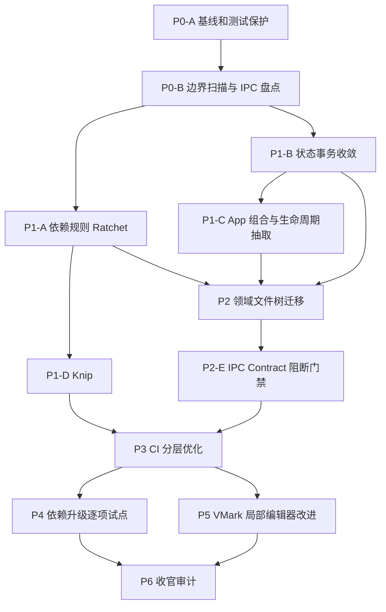

# mdpro 架构重构、工程治理与 CI 优化实施计划

> **版本**：v1.0 · 2026-11-07  
> **目标仓库**：[anzchy/mdpro](https://github.com/anzchy/mdpro) · `master`  
> **参考仓库**：[xiaolai/vmark](https://github.com/xiaolai/vmark) · `main`  
> **文档属性**：建议实施方案（Proposal），**不是已实施记录或验收报告**。实际执行前对基准 SHA、依赖版本和 CI 配置进行复核。  
> **实施原则**：不更换 Milkdown；不引入不必要的 VMark 产品复杂度；先证明架构边界，再移动文件；先稳定 CI，再优化吞吐；每个 PR 可回滚、可复核。

## 0. 执行摘要

### 推荐排序

1. **P0 — 基线、质量护栏与架构边界**：建立可复现指标；引入 Dependency Cruiser 的报告模式、IPC Contract Gate 的检测模式；定义状态所有权及模块依赖方向。
2. **P1 — 低风险架构治理**：逐步收敛跨 Store 状态事务；拆出 `App.tsx` 的生命周期/协调服务；选一个完整业务垂直切片验证 Feature-Oriented 目录布局；引入 Knip 基线。
3. **P2 — File Tree Reorganization**：按已验证的领域边界分批搬迁、修复 import/aliases/测试发现规则，持续收紧架构门禁。
4. **P3 — CI 拆层、提速、增强验证**：在路径布局稳定后，建立 `static / frontend-shards / merge / build / native / contract / webkit / security / gate` 的 DAG，保留现有测试身份完整性核验。
5. **P4 — 技术栈逐项升级**：先独立试点 Zustand 5、Vitest 4，再评估 TypeScript 6、Vite 8；升级以兼容性证据决定是否合并，不预先承诺必升。
6. **P5 — VMark 局部实践移植及回归固化**：选择确有用户价值的 Markdown 保真、表格和交互能力，以行为规格与差异测试为先，继续使用 Milkdown。
7. **P6 — 收官审计**：验证各项收益、清理临时例外、恢复常态开发节奏、提交最终架构文档与运行手册。

> **关键判断**：这里的 P0–P6 是实施阶段，不等同 GitHub Issue 的优先级。CI 的基本可靠性属于 P0 的前置条件，全面 CI 架构优化位于 P3。技术栈升级不要与目录迁移同 PR。

### 8 项优化任务全覆盖

| ID | 优化项 | 核心阶段 | 交付结果 |
|---|---|---|---|
| OPT-01 | Dependency Cruiser 架构依赖规则 | P0–P2 | 可执行依赖约束、例外预算、结构指标 |
| OPT-02 | App.tsx 职责分解 | P1–P2 | 声明式 Composition Root、生命周期服务与测试 |
| OPT-03 | TypeScript ↔ Rust IPC Contract Gate | P0、P2–P3 | 命令注册一致性、Payload 契约检查 |
| OPT-04 | Knip 死代码/未用依赖治理 | P1–P2 | 精确扫描配置、已知例外、清理报告 |
| OPT-05 | 跨 Store 状态协调收敛 | P1–P2 | 单一业务事务入口、状态不变量测试 |
| OPT-06 | CI 分层和性能优化 | P0、P3 | 更细分类、并行 DAG、指标看板、完整性门禁 |
| OPT-07 | Zustand/Vitest/TypeScript/Vite 升级 | P4 | 四个独立兼容性 PR 或带理由暂缓 |
| OPT-08 | 局部借鉴 VMark 编辑器插件 | P5 | 差异用例、最小实现、保真测试 |

## 1. 当前事实、证据与不确定性

### 1.1 已核实的基线（2026-11-07 阅读仓库）

- mdpro 技术栈：Tauri 2、Rust、React 19、TypeScript 5.8、Vite 7、Vitest 3、Zustand 4、Milkdown 7、CodeMirror 6；MCP Sidecar 为 Rust `mdpro_mcp`。
- mdpro 源码组织：`src/components`、`src/hooks`、`src/services`、`src/stores`、`src/plugins`、`src/utils`，原生侧 `src-tauri/src/commands`、`services`、`models` 等。
- `src/App.tsx` 约 986 行；当前 Document Store 存在跨 Store Flush 协议（需要实测路径梳理，**不能直接断言有 Bug**）。
- CI 已有四个 Vitest 分片、Coverage 合并、分片开始执行身份一致性检查及 `ci-gate`。PR 常规 Rust 测试侧重 Ubuntu；tag 才扩展部分平台；Rust Audit 独立于合并总门禁。
- 近期 CI 已有约 11 分钟成功样本，但一周范围存在排队长尾与多轮测试失败；所有速度目标必须基于 **新架构下的测量**，不能把历史中位数当未来效果。
- VMark 借鉴点：`dependency-cruiser`、三层依赖限制、`runtimeWiring.ts`、Knip、IPC Contract 检查、按变更选择 Job、Static/Shard/Coverage/Build/Native 分层及 `frontend`/`rust` 汇总门禁。

**源文件链接**：

- [mdpro package.json](https://github.com/anzchy/mdpro/blob/master/package.json)
- [mdpro Cargo.toml](https://github.com/anzchy/mdpro/blob/master/src-tauri/Cargo.toml)
- [mdpro CI](https://github.com/anzchy/mdpro/blob/master/.github/workflows/ci.yml)
- [mdpro App.tsx](https://github.com/anzchy/mdpro/blob/master/src/App.tsx)
- [mdpro documentStore.ts](https://github.com/anzchy/mdpro/blob/master/src/stores/documentStore.ts)
- [VMark 依赖规则](https://github.com/xiaolai/vmark/blob/main/.dependency-cruiser.cjs)
- [VMark Runtime Wiring](https://github.com/xiaolai/vmark/blob/main/src/services/runtimeWiring.ts)
- [VMark CI](https://github.com/xiaolai/vmark/blob/main/.github/workflows/ci.yml)

### 1.2 执行前必须重新确认

在真正开始 P0 前，先记录 `git rev-parse HEAD`、Node/Rust/pnpm 版本、测试总数、`ci.yml` 最新规则、主干是否有其他 Agent 正在修改架构及相关 Issue。不得假设本文记录的版本和目录在实施时不变。对正在进行的 PR，先做冲突/所有权排查，避免并行改同一个目录。

### 1.3 成功定义（Outcome > 活动数量）

- **正确性**：全部既有用户关键路径不回退，尤其是文件原子保存、脏状态保护、外部修改冲突、MCP 写入确认、应用退出与窗口切换。
- **架构**：新增跨层违例为零；旧违例有登记、Owner、删除计划；业务模块边界有依赖图和契约测试。
- **测试**：测试清单/开始执行身份、合并 Coverage、平台过滤规则一致；任何失败/跳过不能假绿。
- **CI**：以 GitHub Actions 实际运行建立基线与目标，分别记录 wall clock、queue time、job runtime、runner-minutes、失败重跑率、P50/P90。
- **协作**：每一项重构至少有实施者、审计者、测试证据；不因形式化文档而延迟功能实现或制造过度拆分。

## 2. 目标架构及文件树（先定义，再迁移）

### 2.1 边界规则

1. `shared/domain` 或现有纯函数层：不得依赖 React、Zustand、Tauri、UI 组件；只包含纯数据、类型、规则及确定性逻辑。
2. `services` / `application`：组织“打开→读取→应用状态”“保存→冲突校验→提交”等用例；系统 API 通过 Adapter/Port 访问；不向上导入 Component/Hook。
3. `hooks`：React 的生命周期和 UI 绑定适配器；不得作为跨模块业务事务的唯一执行入口。
4. `components`：负责渲染与局部交互；业务调用经公开的服务/命令，不随意跨 Feature 深层访问文件。
5. `stores`：有明确唯一状态 Owner；跨 Store 写入封装在用例服务/协调器中；禁止组件/插件任意直接写多个 Store。
6. `plugins`（Milkdown、CodeMirror）：尽可能独立于 App Store、文件系统和 Tauri。需要应用状态的场景通过受控接口、Callback 或 Port 注入。
7. `src-tauri`: Commands 负责入口校验与序列化；Service 负责业务逻辑；Model/Domain 负责纯规则。Rust IPC 公共接口有稳定命名与错误编码。
8. 不因目录美观制造过深嵌套；跨功能稳定共享的代码进入 `shared`，不把所有剩余代码塞进 `utils`。

### 2.2 建议最终文件树（**目标示意，不是要求一次搬完**）

```text
src/
  app/
    App.tsx                 # 路由、ErrorBoundary、Composition Root
    AppShell.tsx            # 纯布局
    bootstrap/              # 启动与运行期 wiring
  features/
    document/
      application/          # 打开、保存、关闭、恢复、切换用例
      state/                # 文档权威状态及选择器
      ui/                   # 文档关联 UI
      contracts/            # 前端请求/结果定义
    editor/
      adapters/milkdown/    # Milkdown 集成
      adapters/codemirror/  # CodeMirror 集成
      application/          # 模式切换、flush/selection 事务
      ui/
    files/
      application/          # 文件监听、外部修改决策
      adapters/             # Tauri invoke 实现
    mcp/
      application/          # 同步/确认/编辑操作
      ui/
    window/
      application/          # 窗口关闭、退出事务
      ui/
  shared/
    domain/                 # 纯类型、不变量、标识
    services/               # 明确跨域的通用服务
    ui/                     # 可共享通用组件
    utils/                  # 纯函数
  main.tsx
src-tauri/src/
  commands/                # IPC 边界
  domains/
    document/
    files/
    mcp/
    window/
  infrastructure/          # OS 适配、持久化、监听
  models/
  lib.rs
  bin/mdpro_mcp.rs
scripts/architecture/
scripts/ci/
tests/
  architecture/
  contracts/
  integration/
  journeys/
```

**不要一开始就同时修改 TS 与 Rust 两端的目录树。** 先从 TS 的一个最有收益的领域切片开始，Rust 保持现状，只有读到具体跨层代码问题时再做小范围迁移。保持 `git blame` 可追溯性并避免无意义重命名风暴。

### 2.3 避免误解

- VMark 的 `utils -> services -> hooks` 是 **约束与职责关系的简化表达**，不是所有依赖必须组成单线条；合法 Adapter/Store 依赖需要单独建模。
- Clean Architecture 不要求机械复制目录名称；架构是否有效由 **依赖方向、状态所有权和测试可替换性** 决定。
- 不建议 Milkdown→Tiptap，也不建议 Rust MCP→Node MCP；两者都有高迁移成本且缺少明确用户收益。

## 3. Phase 0：盘点、基线及“先不恶化”护栏

**目标**：在改动行为之前建立客观证据，避免“重构之后只剩绿 CI、丢了测试”或错误优化判断。  
**建议 PR**：P0-A `chore(arch): capture baseline`；P0-B `test(architecture): dependency and ipc inventory`（两个 PR，分别审阅）。

### P0-A 现状盘点

- 固定 SHA、当前相关 Issue/PR、运行工具版本；采集 TypeScript/Rust 架构依赖图。
- 统计 `App.tsx` import、effect、订阅、跨 Store 写入、Tauri invoke、事件 listen 的清单与调用图。
- 盘点编辑器重要状态：文档内容、保存基线、Milkdown 未提交内容、当前 Tab、外部变更、撤销栈、编辑模式、MCP pending。
- 统计关键测试数量及命令，定位各个 Test Suite 的真实入口、Coverage 最小值及慢测清单。
- 提取过去 14–30 天 CI：PR 最终 Head SHA、执行与排队、job 耗时、重试原因、被取消的运行；单独计算 docs-only / frontend / Rust / combined。
- 构建数据安全回归集（至少）：手动修改→保存；外部文件修改；快速切换标签；关闭脏文档；多窗口同路径；MCP 非焦点写入；崩溃恢复；Windows 路径大小写与文件身份。

**验收**：基线文件写明数据来源、时间范围、运行环境和 SHA；提供可复制的采集脚本，而非手写统计；没有改变产品行为。

### P0-B 初始门禁仅 Audit Mode

- 试点 `dependency-cruiser`：循环依赖、`stores → components`、`services → hooks/components`、`plugins → App stores/services` 等规则先生成报告，不立即硬阻断所有历史违规。
- 试点 IPC 扫描：枚举 `invoke("literal")` 与 Rust 已注册 `#[tauri::command]`，识别未知调用、重复或已删除命令；处理动态命令的显式清单。
- 快速验证代码中没有意外引入额外的测试排除路径；记录 CI 的现有强制门禁和非阻断项。

**退出条件**：每个将变成 Blocking 的规则均有“已知违规清单、如何测试规则本身、误报处理、Owner 与预期收敛方式”。

## 4. Phase 1：架构边界与状态一致性（优先于批量移动文件）

**目标**：让职责与状态事务更清晰，确认行为没有回退；先做一个可用的垂直切片。  
**建议 PR**：P1-A、P1-B、P1-C、P1-D，各自独立。

### P1-A — OPT-01 Dependency Cruiser 正式入场

1. 建立 `.dependency-cruiser.cjs` 或等价 TypeScript 配置；约束与 `tsconfig` 别名、动态 import、测试文件的路径规则保持一致。
2. 定义分层矩阵：从哪些目录允许导入哪些目录，哪些仅允许 `import type`，哪些例外必须列明来源。
3. 既有违规采用 Ratchet：禁止新增，减少存量违规；**不允许 PR 通过同时篡改基线自行放宽门禁**。校验应读取 merge-base 版本或走受控例外审查。
4. 生成架构依赖报告与关键循环列表，CI 中只有“新增违规”阻断；现有违规附整改 Issue。

**验收**：人为加入一个循环或 `Store→UI` 导入，检测必须失败；删除已知例外后检查仍通过；不产生大量因类型定义导入造成的虚假失败。

### P1-B — OPT-05 状态所有权与事务收敛（先于 App 拆分）

1. 画出 `documentStore`、`editorStore`、`milkdownEditorStore`、tab/window 状态的 Owner Matrix。
2. 将文档切换、编辑器 Flush、关闭确认、保存确认、外部修改决策标记为跨边界事务。
3. 对每个事务定义输入、前置条件、原子结果、失败/取消语义与 Event 顺序。
4. 优先围绕现有代码建立独立可测的协调器，例如 `documentTransitionService`；**先转移调用入口，后转移状态**。不引入与原 Store 并存的第二套权威真相。
5. 用 Contract Tests 验证：切换失败不会改变 active doc；Flush 失败不丢脏内容；关闭/重开后监听与草稿不泄漏；旧代次异步结果不能覆盖新文档。

**验收**：关键操作的跨 Store 顺序有集中测试；业务调用方不再必须自行重复成套写入两个或三个 Store；原有数据安全测试和用户旅程全部通过。

### P1-C — OPT-02 App.tsx 分解设计与最小抽取

- 先做 Effects 和生命周期映射，不凭“文件超 300 行”机械抽取。
- 将纯布局移入 `AppShell`；可独立测试的窗口级订阅/初始化/清理逻辑移入 `runtimeWiring` 风格的组合器；将业务事务放入 Service，由 Hook 只承担 React Adapter 职责。
- 所有 start 函数返回 disposer；装配失败按相反顺序清理；React StrictMode 重复挂载与卸载安全。
- 不一次迁出所有 Hooks；选一条明确的业务流（如打开文件或切换编辑模式），确认抽象对复杂度有实际帮助后才继续。

**验收**：没有新增事件监听泄漏、重复订阅、双重初始化；App.tsx 下降是结果不是验收目标；副作用入口与清理入口可被单测覆盖。

### P1-D — OPT-04 Knip 试点

- 安装并配置 Knip，正确声明 Vite、Tauri、Tests、脚本、动态载入、Milkdown 插件等入口。
- 先出机器可读的 unused exports/files/dependencies 报告；逐一核对动态路径，防止删除 Tauri 命令、MCP Tool、Vite 资源、声明式插件注册。
- 删除明显的无用依赖/文件，低风险单独 PR；其余按 baseline 承认并建立 Owner。
- 规则仅禁止新增死代码或新未使用依赖，直到对所有动态入口取得充分信心。

**验收**：人为新增未引用的 export 能被发现；已有动态注册模块不被错误要求删除；从 lockfile 与 Bundle Diff 验证清理效果。

## 5. Phase 2：按领域重组文件树及 IPC 契约正式治理

**目标**：在行为受测试保护后小批次迁移，令目录、状态所有权和依赖规则一致。  
**建议 PR**：每个 Domain 一个独立 PR（例如 P2-A document、P2-B editor、P2-C window、P2-D mcp）；IPC Gate 单独 PR P2-E。

### 5.1 目录迁移顺序

1. `shared/utils` 的纯工具（最小风险、建立约束样板）。
2. `document` 领域的 Application、Store 与文件 Adapter（已有最强数据安全测试）。
3. `editor` 与 Milkdown/CodeMirror Adapter（必须保留 Schema、插件注册与光标行为）。
4. `window` 生命周期与 Quit Guard（重视 macOS、Windows 差异）。
5. `mcp` 业务协调和 Confirm（安全敏感，最后迁移）。
6. Rust 领域拆分仅在明确收益和契约测试足够时做，不能为了对齐前端目录而强制迁移。

**每个迁移 PR 的硬要求**：
- 先补关键行为 Characterization Tests；
- 纯移动或 Import 修复与行为改动分离提交；
- 更新 Vite Alias、TS Config、Vitest、Coverage、Conditional Test Filters、CI path filter、Feature Ledger 与相关 ADR 的路径引用；
- 搜索旧路径字符串（含脚本、文档、测试夹具和 Agent 规则），不允许留下静默失效的旧路径引用；
- 相同功能的 Release/Debug 行为一致；
- PR 不跨两个高冲突领域；独立审计必须看完整 diff，而不只是 Typecheck 结果。

### 5.2 OPT-03 TypeScript ↔ Rust IPC Contract Gate

**第一层（必须）**：枚举前端 literal `invoke`、Rust 注册命令并做集合对比，动态命令经显式登记，新增命令不允许匿名无注册。  
**第二层（推荐）**：选择 `ts-rs`、`specta` 等生成关键 IPC DTO，或建立等价的 Schema/JSON Fixture 双向校验；先从 `open_file`、`save_file`、`close_document` 等高风险接口开始。  
**第三层（长期）**：为错误码、拒绝原因和 optional/null 语义建立 Rust→TS 契约测试；检查不同平台的编译 cfg 不导致命令集合漂移。

**验收**：改错命令名、删除 Rust 注册、改变关键 Payload 字段、破坏错误码映射时 CI 能失败。生成类型是辅助，而非替代运行时输入验证。

## 6. Phase 3：OPT-06 CI 结构和性能优化

**目标**：先保证测试正确性与覆盖完整性，再压缩关键路径，最后降低长尾和调度成本。  
**前提**：Phase 2 文件树和测试路径基本稳定；否则每个目录迁移 PR 都在改 CI 分类，产生额外调试成本。

### 6.1 目标 DAG

```text
PR ──┬── change-scope ──────┬─ static/architecture ────────────┐
     │                      ├─ frontend-test shard 1..4 ─┐     │
     │                      │                            ├─ coverage-merge + test-identity
     │                      ├─ frontend-build ────────────┤     │
     │                      ├─ rust-linux ────────────────┤     │
     │                      ├─ rust-macos/windows [条件] ─┤     │
     │                      ├─ ipc-contract + mcp-tests ──┤     │
     │                      ├─ webkit-regression [条件] ──┤     │
     │                      └─ security-audit ────────────┤     │
     └── prose-checks [始终] ───────────────────────────────┴─────┤
                                                                  ↓
                                                 ci-gate (必需; fail-closed)
```

### 6.2 变更分类建议

- `docs`: 仅许可名单内文档；文档/规则自检仍始终运行。
- `frontend`: React、TypeScript、CSS、编辑器插件和其测试输入。
- `rust`: `src-tauri/**`、Cargo 锁定文件，以及被 Rust `include_*` 或测试读取的跨目录输入。
- `contracts`: IPC 命令注册、Rust/TS Payload、MCP Schema、相关注册表或生成脚本。
- `integration`: File/Store/MCP/window/IME 等关键端到端路径，允许单独触发 Browser 或平台验证。
- **Fail-closed**：过滤脚本失败、值为空/未知时不得将跳过当作通过；新增目录默认运行完整检查，之后才能申请缩窄。

### 6.3 Job 分层建议

**A. `static`**：Typecheck、ESLint（如引入）、dependency-cruiser、Knip Ratchet、IPC 映射、Ledger、测试清单核验。常规应在数分钟内尽早失败。  
**B. `frontend-test`**：保留四分片 Vitest、Blob+JSON Report、对开始执行身份的核对，失败 Artifact 始终保留。  
**C. `coverage-merge`**：只在完整收到四分片报告后执行；校验 SHA、attempt、shard 唯一性、被选中的测试文件、Test Identity Union，并在合并报告上执行 Coverage Floors。  
**D. `frontend-build`**：并行 `tsc` + Vite Production Build，检查生成资产、Bundle Size、关键动态导入。  
**E. `rust`**：Linux Rust Test + cargo check；macOS/Windows 针对 Rust 或跨平台敏感修改执行相应 cfg 编译/测试，分阶段引入以控制成本。  
**F. `ipc/mcp`**：高风险安全入口单独验证；包括 DTO、命令注册、MCP Tool、文件权限及用户确认。  
**G. `webkit`**：针对 IME、selection、paste、复杂输入等建立少量真实 WebKit 测试；不能代替 Tauri Mac 真实 WKWebView 验证。  
**H. `security`**：npm/Cargo 审计与受控例外；是否阻断根据安全政策决定，至少禁止已证实的高风险、可达漏洞进入 Release。  
**I. `ci-gate`**：沿用稳定的 GitHub Branch Protection Check 名称，依变更分类校验所有相关 Job 的结果。

### 6.4 关键防绕过条款

1. 取消、失败、缺失分片、重复分片、旧 SHA Artifact、无 Coverage 都不能作为成功。
2. 只有分类器明确证明不相关，`skipped` 才合法。
3. 覆盖率只在全量合并后判定；每分片临时设置 0 阈值不能等于全局阈值关闭。
4. 不把 CI 速度提升建立在删除测试、取消数据安全用例、放宽超时或降低覆盖率之上。
5. CI 优化本身需有 Workflow Shape Tests、受控故障注入（缺 Shard / 错 Base / Artifact 缺失等）。
6. 先把新增 Job 配为非阻断观察期，证据稳定后纳入 `ci-gate`；但涉及覆盖完整性的既有硬门禁不可降级。

### 6.5 可测量目标（**内部目标，不是行业公认标准**）

| 维度 | 目标 | 验证方式 |
|---|---|---|
| Static / Architecture 快速反馈 P50 | ≤ 3 分钟 | GitHub Job 完成时间 |
| 常规 PR 所有 Required Checks P50 | ≤ 15 分钟 | 首次就绪到 Gate 完成，单独报告排队 |
| 常规 PR 所有 Required Checks P90 | ≤ 25 分钟 | 近 30 天滚动样本，按类型分组 |
| 错误 Skip / 缺失分片放行 | 0 | CI 故障注入/Shape Tests |
| 测试总数异常下跌 | 0 次未解释 | 清单与身份完整性对账 |
| Flaky Test | 建立真实基线并持续下降 | 同 SHA 无代码变化重跑统计 |
| Runner Minutes | 不超过收益预算 | 各 Job 时长求和，避免只看墙钟 |

**计时口径**：GitHub Workflow wall clock 与 Job runtime、queue/runner waiting 必须分别报；遇到 9 小时长尾，不能全算作测试执行慢。

### 6.6 CI PR 拆分建议

- P3-A `ci(scope): narrow change classification with fail-closed tests`
- P3-B `ci(static): isolate architecture and contract gates`
- P3-C `ci(build): parallel production build`
- P3-D `ci(browser): add minimal WebKit smoke`
- P3-E `ci(native): conditional macos and windows compilation`
- P3-F `ci(metrics): publish critical path and queue dashboard`
- P3-G `ci(gate): aggregate results with explicit skip policy`

**注意**：先保留目前的四分片和 Test Identity Union，不应回到只核对数字总数的实现。基于 P0 采集数据再决定是否变更四分片数量。

## 7. Phase 4：OPT-07 分别升级依赖，不与重构混合

**升级顺序仅为建议，是否升级由兼容性决定。**

1. **Zustand 4 → 5**：P1/P2 已建立 Store 合约后再尝试；检查 selector 相等语义、订阅、持久化、同步触发、React StrictMode、多窗口状态。
2. **Vitest 3 → 4**：在 Phase 3 DAG 稳定后升级；重点复核四分片 Blob、Coverage Merge、Test Identity/Status、jsdom、Reporter、测试超时与并发。
3. **TypeScript 5.8 → 6**：处理类型变更和不兼容；先用 `tsc --noEmit` 的只读试点记录错误种类，确认 Tauri/Vite/插件工具支持。
4. **Vite 7 → 8**：最后升级；验证 plugin-react、Tauri Dev HMR、产物路径、Chunk Split、Source Map、Bundle Size 及 Windows/macOS 包装。

每项升级的 PR 均包含：变更前/后锁定版本、破坏性变更清单、最小复现或兼容性测试、全量 CI 结果、Roll-forward 与 Rollback 操作；若带来的收益不明显或上游生态不稳定，记录 ADR 暂缓，不强推。

### 独立审批条件

- 不允许一次 PR 同时升级两个主要构建链工具，除非它们必须同步升级且有可验证的上游约束。
- 核心编辑器 Milkdown、CodeMirror、ProseMirror 的升级要另建专项；本项目 **不把切换 Tiptap 列为目标**。
- 更新 pnpm-lock、Cargo.lock、发行打包规则和安全审计基线时，应单独复核依赖供应链影响。

## 8. Phase 5：OPT-08 VMark 编辑器实现的局部借鉴

**基本原则**：比对用户行为和算法，不复制整个 Tiptap 体系；只有实际用户问题、回归或可测收益才引入。

### 候选研究序列

1. **Markdown 保真**：复杂 GFM 表格、空段落、硬换行、引用链接、HTML 片段、Unicode/CJK；比较 Markdown→WYSIWYG→Markdown 的语义差异与字节差异（明确哪些差异允许）。
2. **Selection/IME**：中文输入法、组合输入、撤销重做、跨 Mode 光标恢复、快速切换 Tab。
3. **性能和安全**：恶意/极端 Markdown 输入、超长表格、插件 Decoration 更新复杂度；按真实 Profiler 指标改善。
4. **UI 交互**：仅选择提升效率的表格菜单、插图处理、搜索/定位及快捷键行为。

每项子任务流程：`现象/用户价值 → VMark 代码定位 → 与 Milkdown API 的差异 → Characterization/Golden Tests → 最小实现 → 性能及回归测试 → 发布说明`。

**验收**：对用户可见的明确改善与测试证据；Milkdown/CodeMirror 双模式仍正常；不存在整包复制 VMark 插件、许可证遗漏或跨架构依赖破坏。

## 9. Phase 6：验收与技术债收口

- 重新采集架构图和违例清单：比较 P0 基线与 P6；说明每项指标改善及其取舍。
- 复验数据安全、IME、跨平台、MCP 和 Release 管线；关键用例真实 Mac/Windows 验证记录不可由 jsdom 代替。
- 清理已经被替代的导出、兼容 Shim、重复入口与超期架构例外；保留确实必要的兼容层。
- 维护最终 `ARCHITECTURE.md`、ADR、目录导航、Feature Ledger、CI Runbook、Agent 规则，并让 CI 验证路径引用未过时。
- 一份 Executive Report：哪些收益达成、哪些未达成、剩余风险、后续 30 天监控指标。

## 10. PR 依赖关系与执行计划



### 并行开发策略（适合多 Agent + Worktree）

- **单一集成主干**：所有实现经 PR + 合并门禁进 `master`；不同时改 `App.tsx`、`documentStore.ts`、`ci.yml` 等高冲突文件。
- **可以并行**：P1-A 依赖规则与 P1-B 状态映射；P1-D Knip 报告与 P1-C App 设计；P3 Dashboard 与 WebKit 探索（基于已冻结 CI Shape）。
- **不应并行落地**：P1-B 状态迁移与 P2 文档模块搬迁；同一编辑器目录的 VMark 借鉴与 TypeScript/Vite 升级；CI 大规模更改与 CI 检查器本身的变更。
- **PR 范围**：一个 PR 一个明确可验收成果，避免把“目录迁移 + 新功能 + 测试重写 + 依赖升级”塞进一个提交。
- **审计证据**：每 PR 附 base/head SHA、变更影响列表、测试命令结果、必要的真实 App 验收与风险承认；审查“行为是否仍受测试保护”，而不是只检查有多少 ADR。

### 粗略工作量与风险（用于排序，非交付时间承诺）

| 任务 | 相对工作量 | 主要风险 |
|---|---|---|
| P0 基线和规则摸底 | S–M | 指标口径错误、遗漏测试输入 |
| P1 架构边界 / Knip | M | 误报、多 Agent 规则冲突 |
| P1 状态与 App 拆解 | L | 数据丢失、重复事件订阅 |
| P2 领域迁移 / IPC | L | 路径/测试/动态加载失效 |
| P3 CI 分层 | M–L | 假绿、漏测、资源成本上涨 |
| P4 四项升级 | M–L | 构建链 API/插件兼容 |
| P5 插件借鉴 | 可变 | 编辑语义不保真、IME 回归 |
| P6 收官 | M | 文档与代码不一致 |

## 11. 阶段验收清单

### 每个 PR 通用 Definition of Done

- [ ] 对应 Issue 写明目标、非目标、风险、受影响的代码边界。
- [ ] 实施前存在能捕捉行为回退的测试或明示缺口及补测计划。
- [ ] `pnpm build`、关联 Vitest、Rust Test、架构/契约门禁和对应 CI 必需检查通过。
- [ ] 路径、命令、类型及用户行为改动同步更新 Feature Ledger / ADR / Agent 文档的相关位置。
- [ ] 审计者独立复核，尤其是文件安全、状态一致性、MCP 权限、异常处理。
- [ ] 有回滚方案且不依赖不可逆用户数据迁移；必要时包含真实设备验证记录。
- [ ] 不以降低覆盖率、删测试、盲目拉高 timeout、放宽例外基线来换取绿灯。

### Phase Gate（进入下一阶段前）

- **P0 → P1**：基线数据可重现，所有关键安全旅程有守护用例。
- **P1 → P2**：状态事务 Owner 明确，App 抽取方案经过小切片验证，依赖规则开始阻止新增违规。
- **P2 → P3**：目录迁移无未处理旧路径，架构图与测试清单准确，关键 IPC Gate 已能挡住显式违例。
- **P3 → P4**：CI 可靠性不低于基线，所有 Required Gate 仍 fail-closed，P50/P90/Runner Minutes 有可解释数据。
- **P4 → P5**：升级后的版本兼容性明确；未升级项有理由，不阻塞功能改善。
- **P5 → P6**：每个 VMark 借鉴均以行为和证据验收，没有不必要的框架迁移。

## 12. 风险登记与回滚

| 风险 | 预警信号 | 缓解 / 回滚 |
|---|---|---|
| 文档写入内容丢失 | Dirty Flag 不一致、切换后文本变化 | 立刻停合并；保留原 Store 接口，在独立 PR 回退事务抽取；用回归文件复测 |
| 跨 Store 同步失效 | activeDocument / Editor Store 不一致 | Contract Test 阻断；封闭状态迁移入口；回滚协调器接线 |
| Milkdown 插件失效 | Selection、输入法、撤销栈异常 | 插件局部回滚；保留 Golden Corpus 与变更前录屏/日志 |
| CI 假绿 | 分片缺失、Coverage 缺失、Skipped 被当成功 | 保留旧 `ci-gate` 作过渡；故障注入必须失败；不能删测试身份校验 |
| CI 过慢/成本过高 | P90 或 Runner Minutes 恶化 | 回退最近 Job 拆分或缩窄触发条件（通过正确性校验后） |
| 架构工具误报 | 有效动态入口被当死代码 | Audit Mode 先行；临时豁免有 Owner、证据和到期条件 |
| 依赖升级不兼容 | HMR、构建产物、测试 API 变化 | 升级独立 PR、锁定版本、回退 lockfile 和 package 变更 |
| 多 Agent 冲突 | 同时改共享根组件/CI 规则 | 关键文件单一 Owner；短 PR；先合并后基于新主干重放 |

## 13. 不在本次范围

- 整体用 VMark 替换 mdpro。
- Milkdown→Tiptap 或 Rust MCP→Node MCP 的重写。
- 将全部源文件移到 `features/`，仅为追求新的目录形状。
- 在没有真实数据的情况下规定内存、启动或输入延迟改善幅度。
- 将 VMark 当前全部产品能力、静态检查与数万测试一次性复制到 mdpro。
- 放弃现有 Test Identity Union、数据安全用例、跨窗口一致性约束。

## 14. 推荐的第一批可执行 Issues（先开单，不直接改仓库）

1. **ARCH-001｜冻结 mdpro 架构/CI 基线与核心用户旅程**：输出唯一 SHA、架构图、CI 耗时分类、关键行为矩阵。关联 OPT-01/05/06。
2. **ARCH-002｜引入 dependency-cruiser Audit Mode 与非法依赖 Fixture Tests**：不直接强制修完所有历史违例。OPT-01。
3. **ARCH-003｜跨 Store Document Transition 所有权审计与 Characterization Tests**：覆盖 Flush、Switch、Close、Save、Watcher、MCP。OPT-05。
4. **ARCH-004｜App.tsx Lifecycle Wiring Spike**：只迁一组启动/清理服务，证明显式 disposer 方案。OPT-02。
5. **ARCH-005｜Knip 动态入口覆盖与只读死代码报告**：避免误删编辑插件/MCP 入口。OPT-04。
6. **ARCH-006｜TS/Rust IPC Command Inventory 与失败用例**：命令注册/调用对账，不先扩成全量代码生成。OPT-03。
7. **CI-001｜为现有 GitHub Actions 出 P50/P90/Queue/Runner-Minutes 报告**：先测再优化。OPT-06。

**实施建议**：先完成 ARCH-001 + CI-001 的可验证基线，然后并行推进 ARCH-002、ARCH-003、ARCH-006；ARCH-004 必须等待 ARCH-003 的关键状态事务边界明确。后续 Issue 从 Phase Gate 的实际数据衍生，不预先人为塞满几十张任务卡。

---

**最终优先级**：

> 先修正与固化架构的约束能力，随后重构高风险状态协调，再小批次调整文件树；在路径和测试发现稳定后优化 CI；最后独立升级工具链和局部吸收 VMark 编辑器实践。整个过程以可验证的功能行为和实际运行数据为准，不以文件数量、文档数量或 CI Job 数量衡量成功。
