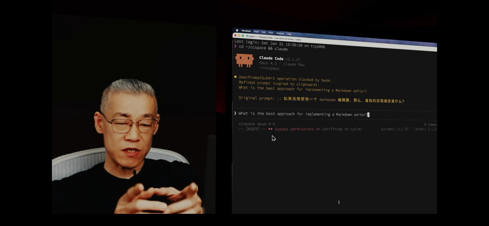

# Edge Cases Test Document

This document tests all markdown features added in Feature 006: TOC, Tables, and Images.

---

## Part 1: Table of Contents (TOC) Edge Cases

### 1.1 All Heading Levels

# Heading Level 1
## Heading Level 2
### Heading Level 3
#### Heading Level 4
##### Heading Level 5
###### Heading Level 6

### 1.2 Duplicate Headings

The TOC should handle duplicate headings with numeric suffixes.

## Introduction
Some content here.

## Introduction
This is a duplicate heading - should become `introduction-1`.

## Introduction
Third duplicate - should become `introduction-2`.

### 1.3 Special Characters in Headings

## Heading with "Quotes" and 'Apostrophes'
## Heading with (Parentheses) and [Brackets]
## Heading with <Angle> & Ampersand
## Heading with émojis 🎉 and ünïcödé
## Heading with `code` inside
## Heading with **bold** and *italic*
## Heading with numbers 123 and symbols !@#$%
## 日本語の見出し (Japanese Heading)
## 中文标题 (Chinese Heading)

### 1.4 Long Headings

## This is an extremely long heading that should be truncated in the TOC sidebar when it exceeds the available width and test ellipsis behavior

### 1.5 Empty and Whitespace Headings

##    Heading with leading spaces
## Heading with trailing spaces
##     Heading with both

### 1.6 Headings with Links

## Heading with [a link](https://example.com) inside
## Heading with  reference

### 1.7 Nested Structure for Hierarchy Test

# Document Title

## Chapter 1: Getting Started

### Section 1.1: Installation

#### Subsection 1.1.1: Prerequisites

##### Sub-subsection 1.1.1.1: System Requirements

###### Deepest Level 1.1.1.1.1: Notes

#### Subsection 1.1.2: Download

### Section 1.2: Configuration

## Chapter 2: Advanced Topics

### Section 2.1: Performance

### Section 2.2: Security

---

## Part 2: Table Edge Cases

### 2.1 Basic Table

| Name | Age | City |
|------|-----|------|
| Alice | 30 | NYC |
| Bob | 25 | LA |

### 2.2 Table Alignment

| Left Aligned | Center Aligned | Right Aligned |
|:-------------|:--------------:|--------------:|
| Left | Center | Right |
| Data | Data | Data |
| More | More | More |

### 2.3 Single Row Table

| Header 1 | Header 2 | Header 3 |
|----------|----------|----------|
| Only row | of data | here |

### 2.4 Single Column Table

| Single Column |
|---------------|
| Row 1 |
| Row 2 |
| Row 3 |

### 2.5 Empty Cells

| Col A | Col B | Col C |
|-------|-------|-------|
| Data | | Empty middle |
| | Empty first | Data |
| Data | Data | |
| | | All empty |

### 2.6 Wide Table (Many Columns)

| Col1 | Col2 | Col3 | Col4 | Col5 | Col6 | Col7 | Col8 | Col9 | Col10 |
|------|------|------|------|------|------|------|------|------|-------|
| A1 | A2 | A3 | A4 | A5 | A6 | A7 | A8 | A9 | A10 |
| B1 | B2 | B3 | B4 | B5 | B6 | B7 | B8 | B9 | B10 |

### 2.7 Tall Table (Many Rows - 50 rows for performance test)

| ID | Name | Value |
|----|------|-------|
| 1 | Item 1 | 100 |
| 2 | Item 2 | 200 |
| 3 | Item 3 | 300 |
| 4 | Item 4 | 400 |
| 5 | Item 5 | 500 |
| 6 | Item 6 | 600 |
| 7 | Item 7 | 700 |
| 8 | Item 8 | 800 |
| 9 | Item 9 | 900 |
| 10 | Item 10 | 1000 |
| 11 | Item 11 | 1100 |
| 12 | Item 12 | 1200 |
| 13 | Item 13 | 1300 |
| 14 | Item 14 | 1400 |
| 15 | Item 15 | 1500 |
| 16 | Item 16 | 1600 |
| 17 | Item 17 | 1700 |
| 18 | Item 18 | 1800 |
| 19 | Item 19 | 1900 |
| 20 | Item 20 | 2000 |
| 21 | Item 21 | 2100 |
| 22 | Item 22 | 2200 |
| 23 | Item 23 | 2300 |
| 24 | Item 24 | 2400 |
| 25 | Item 25 | 2500 |
| 26 | Item 26 | 2600 |
| 27 | Item 27 | 2700 |
| 28 | Item 28 | 2800 |
| 29 | Item 29 | 2900 |
| 30 | Item 30 | 3000 |
| 31 | Item 31 | 3100 |
| 32 | Item 32 | 3200 |
| 33 | Item 33 | 3300 |
| 34 | Item 34 | 3400 |
| 35 | Item 35 | 3500 |
| 36 | Item 36 | 3600 |
| 37 | Item 37 | 3700 |
| 38 | Item 38 | 3800 |
| 39 | Item 39 | 3900 |
| 40 | Item 40 | 4000 |
| 41 | Item 41 | 4100 |
| 42 | Item 42 | 4200 |
| 43 | Item 43 | 4300 |
| 44 | Item 44 | 4400 |
| 45 | Item 45 | 4500 |
| 46 | Item 46 | 4600 |
| 47 | Item 47 | 4700 |
| 48 | Item 48 | 4800 |
| 49 | Item 49 | 4900 |
| 50 | Item 50 | 5000 |

### 2.8 Table with Formatted Content

| Feature | Syntax | Example |
|---------|--------|---------|
| Bold | `**text**` | **bold text** |
| Italic | `*text*` | *italic text* |
| Code | `` `code` `` | `inline code` |
| Link | `[text](url)` | [Google](https://google.com) |
| Strikethrough | `~~text~~` | ~~deleted~~ |

### 2.9 Table with Long Cell Content

| Short | Very Long Content Cell |
|-------|------------------------|
| A | This is an extremely long cell content that should wrap or be handled appropriately by the table renderer without breaking the layout |
| B | Another long cell with `code snippets` and **formatted text** mixed together |

### 2.10 Table with Special Characters

| Symbol | Description | Unicode |
|--------|-------------|---------|
| © | Copyright | U+00A9 |
| ™ | Trademark | U+2122 |
| € | Euro | U+20AC |
| ¥ | Yen | U+00A5 |
| → | Arrow | U+2192 |
| ★ | Star | U+2605 |
| ✓ | Checkmark | U+2713 |
| ✗ | X Mark | U+2717 |

### 2.11 Table with Pipes in Content

| Expression | Result |
|------------|--------|
| `a \| b` | a or b |
| `cmd1 \| cmd2` | pipe |

### 2.12 Minimal Table

|A|
|-|
|1|

---

## Part 3: Image Edge Cases

### 3.1 Local Images (Relative Paths)

### 3.2 Local Images (Absolute Paths)

### 3.3 Remote Images (URLs)

### 3.4 Missing/Invalid Images

### 3.5 Image with Alt Text Variations

### 3.6 Image with Title

### 3.7 Various Image Formats

### 3.8 Images with Dimensions (HTML style)

### 3.9 Image as Link

### 3.10 Multiple Images in Sequence

  

### 3.11 Image in Table

| Preview | Name | Size |
|---------|------|------|
|  | Image 1 | 1.2MB |
|  | Image 2 | 800KB |

### 3.12 Data URL Image

### 3.13 Image with Query Parameters

### 3.14 Image with Fragment

### 3.15 Unicode in Image Path

---

## Part 4: Combined Edge Cases

### 4.1 Table with Images

| Icon | Name | Description |
|------|------|-------------|
|  | Feature A | First feature |
|  | Feature B | Second feature |
|  | Feature C | Missing icon |

### 4.2 Heading with Table Below

## Data Summary

| Metric | Value |
|--------|-------|
| Total | 100 |
| Average | 50 |

### 4.3 Deeply Nested Content

#### Section with Everything

Here's a paragraph with an image: 

| Column A | Column B |
|----------|----------|
|  | Text |

Another paragraph after the table.

---

## Part 5: Stress Tests

### 5.1 Rapid Heading Sequence (TOC Update Test)

# H1
## H2
### H3
#### H4
##### H5
###### H6
# H1 Again
## H2 Again

### 5.2 Very Long Document Section

Lorem ipsum dolor sit amet, consectetur adipiscing elit. Sed do eiusmod tempor incididunt ut labore et dolore magna aliqua. Ut enim ad minim veniam, quis nostrud exercitation ullamco laboris nisi ut aliquip ex ea commodo consequat.

Duis aute irure dolor in reprehenderit in voluptate velit esse cillum dolore eu fugiat nulla pariatur. Excepteur sint occaecat cupidatat non proident, sunt in culpa qui officia deserunt mollit anim id est laborum.

Lorem ipsum dolor sit amet, consectetur adipiscing elit. Sed do eiusmod tempor incididunt ut labore et dolore magna aliqua. Ut enim ad minim veniam, quis nostrud exercitation ullamco laboris nisi ut aliquip ex ea commodo consequat.

### 5.3 End of Document

This is the final section to test TOC scroll-to-end functionality.

| Final | Table |
|-------|-------|
| Last | Row |

**End of edge cases test document.**
